# Redefining Software Engineering in the Age of Autonomous AI Agents

## From AI-Assisted Craftsmanship to Verifiable Software Factories

November 2026 · @hamatz (v2.0, English translation of the Japanese canonical edition)

> **Build the Factory, Not Just the Software.**

> This paper updates the design theory of the previous edition in light of lessons learned during the development of Auto Developer. The Japanese edition ([`paper.md`](paper.md)) is canonical. The reference implementation is [hamatz/auto_developer](https://github.com/hamatz/auto_developer). Knowledge sharing and federated governance across organizations and external vendors are subjects for a separate paper. The Factory discussed here is not tied to a particular product or model.

## Executive Abstract

The widespread availability of high-performance foundation models and coding agents has expanded the implementation capabilities of individual developers. Increasing code-generation capacity, however, is not the same as increasing an organization's capacity for software quality assurance. If verification capacity fails to keep pace with generation capacity, human review workloads and unverified changes may accumulate, reinforcing organizational distrust of AI-assisted development.

This paper does not dismiss caution about AI-assisted development as a mere failure to understand technology. Rather, those advocating its adoption bear the responsibility of presenting engineering grounds on which an organization can decide that generated artifacts are acceptable.

To this end, we distinguish a craftsmanship-acceleration model, which makes individual work more efficient, from a Software Factory, which continuously generates, verifies, reviews, commits, recovers, and learns on the basis of approved contracts. Building on the three-layer architecture of Harness, Loop, and Graph introduced in the previous edition, we propose seven design principles: canonical path engineering, intent-to-contract compilation, evidence-bound execution, verification of verification, recoverable autonomy, composable autonomy, and bounded self-improvement. We further define Engineering Metabolism as a cross-cutting mechanism that converts experience into verifiable and durable production capabilities and updates all three layers over time.

Development of the reference implementation, Auto Developer, exposed problems not adequately addressed by the original theory, including post-verification changes to artifacts, misinterpretation of review results, discrepancies in verification environments, and prolonged independent audits. Through these cases, we argue that not only generated artifacts but also the mechanisms by which they are accepted must themselves be verifiable.

The goal is not to remove humans from development. It is to redistribute human responsibility from the sequential inspection of individual implementations to decisions about objectives, specifications, verification conditions, risk tolerance, and exceptions. Freedom to develop with AI is gained not through unconditional trust in models, but through verifiable production systems.

### Contributions and Research Positioning

This is a design-and-practice paper based on the construction of a reference implementation and retrospective analysis, rather than a performance evaluation based on controlled comparative experiments. We do not claim to have invented CI/CD, separation of duties, specification-driven development, provenance verification, or failure recovery. Our contributions are threefold:

1. We present a reference framework integrating seven design principles and responsibility boundaries for production systems that accommodate stochastic implementation agents.
2. We specify an evidence protocol connecting verification, review, and commitment; preservation and recovery after failure; and a bounded improvement loop through Engineering Metabolism. We map these to the reference implementation and its implementation status (Section 2.3).
3. From failure records of a Factory used to develop itself, we identify the need to evaluate the validity of the production process as well as individual artifacts, and propose methods for future comparative evaluation.

These are design contributions and hypotheses derived from observations. They do not demonstrate superiority over other approaches or establish a world-first implementation.

## Prologue — How Much Software Could We Build?

Imagine handing over a design document before going to bed and waking the next morning to software that has been implemented, tested, and independently reviewed.

Imagine that, even if something fails along the way, the existing system remains intact, the reason for failure is recorded, and the experience informs the next development cycle.

Imagine running not just one development team, but five or ten at once, under clearly defined responsibility boundaries.

How much more ambitious could the things we build become?

Much of what software developers have been able to achieve has been constrained by time, headcount, budget, and the complexity humans can manage. AI agents have the potential to remove some of these constraints.

But simply acquiring intelligent models and capable coding agents will not bring us to that future. Even if our ability to write code improves dramatically, we will encounter another constraint unless our ability to verify, accept, and maintain that code changes as well.

What we need is not unconditional trust in AI. It is the engineering of software production systems that draw on AI's capabilities while detecting errors and controlling which changes are accepted.

This paper is about that engineering discipline.

## Chapter 1: Why Your Workplace Still Won't Give AI the Green Light

### 1.1 We Have Capable Models. Why Is Approval Still Withheld?

Coding agents such as Claude Code and Codex CLI enable developers to implement features, run tests, and refactor interactively. Advances in models will further expand these capabilities.

However, merely distributing capable agents does not automatically improve organizational quality assurance. In organizations where CI and review already work well, AI assistance alone may improve quality and productivity. The problem addressed here is adoption without a corresponding investment in verification and governance capacity.

Responding to concerns about the reliability of AI outputs by citing the performance of the latest models is insufficient. What organizations ask is not whether a model is intelligent on average, but whether erroneous changes can be detected and handled safely when mistakes occur.

### 1.2 Four Pathologies of Development Without a Harness

1. **Review Tsunami & Rubber-Stamping:** When generation capacity exceeds review bandwidth, queues grow. Attempting to resolve this by shortening approval procedures may render review superficial.
2. **In-Session Self-Bias:** When implementers can also change evaluation criteria, weakened tests or convenient interpretations of specifications may go undetected. Self-review is not a substitute for independent acceptance decisions.
3. **Wish-Driven Drift:** Adding prohibitions to CLAUDE.md or AGENTS.md does not by itself block deviations. The existence of a rule must be distinguished from its enforcement.
4. **Ephemeral Craftsmanship:** Even if skilled developers solve problems through prompting or manual intervention, the next developer must solve them again unless the solution survives in tools, checks, or structure.

These are not inevitable consequences of AI. They are engineering risks that can emerge when generation capacity improves while the production system remains unchanged.

An increase in generation speed is itself not a universal empirical finding. METR's 2025 randomized controlled study reported that, across 246 tasks performed by 16 experienced open-source developers, the AI tools of that time increased completion time by 19%. Its February 2026 follow-up discussed possible acceleration with newer tools and the difficulties of estimation arising from participant and task selection. [R1, R2] We therefore assume neither that AI is always faster nor that it is always slower. Our concern is how to expand acceptance capacity when generation capacity increases.

### 1.3 What Should Humans Be Responsible For? — Redesigning Accountability

In high-assurance domains such as financial institutions, concern about deploying implementations without understanding them is legitimate. The question posed here is not whether accountability is necessary, but how to achieve it.

Modern software relies on numerous components whose code humans have not read in its entirety, such as operating systems, databases, and cryptographic libraries. Trust is formed by combining evidence including adoption history, verification, vulnerability monitoring, and software bills of materials (SBOMs). Generated code likewise requires direct verification evidence that accounts for its lack of an established adoption history.

| Subject | Example allocation of responsibility between humans and machines |
|---|---|
| Objectives, SPEC, invariants, acceptable risk | Humans decide and approve |
| Acceptance and immunity tests | Machine checks supplemented by human confirmation that the tests adequately represent the specification |
| High-risk changes such as authentication, authorization, payments, accounts, and data deletion | Require independent verification and prescribed human review |
| Low-risk changes approved for delegation in advance | Process through verification gates, independent review, and evidence; humans examine exceptions and samples |
| Production releases | Retain authorization to release in accordance with organizational approval rules and risk |

This allocation does not automatically guarantee compliance with audits or regulations. It is a design example clarifying what humans must decide and what evidence supports those decisions. Approval to use AI also involves conditions beyond code quality, including confidential information handling, transmission to external services, contracts, intellectual property, and operational responsibilities. The Factory does not replace such approvals.

## Chapter 2: From Craftsmanship Acceleration to the Software Factory

Saving an hour on one's own work is different from leaving behind a system in which another developer can work tomorrow under the same quality conditions. The former accelerates today's work; the latter changes tomorrow's production capacity.

The transition to a Factory does not discard existing CI/CD or type systems. It reorganizes them into a production process that stochastic generative agents can use repeatedly and that handles success and failure mechanically. Claude Code and Codex can continue to serve as implementers within that process.

A Software Factory is neither a mechanism for launching large numbers of AI agents nor merely CI equipped with automated tests. We define it as a production system that takes approved development contracts as input and performs generation, verification, review, commitment, recovery, and learning under clear responsibility boundaries and with verifiable evidence. Unattended operation is one capability indicative of maturity; it does not imply deploying every change to production without human involvement.

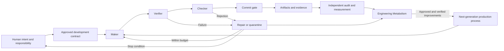

| | Craftsmanship acceleration | Software Factory |
|---|---|---|
| Object of improvement | Individual work | Production system |
| Basis for trust | Developer capability and inspection | Contracts, verification, separation of duties, evidence |
| Failure | Individual repair | Detection, quarantine, recovery, learning |
| Model | Major determinant of work capability | One replaceable component |
| Success | Code has been written | An artifact meeting acceptance conditions has been committed |

### 2.1 Separation of Duties as a Design Principle

If the Maker can create an artifact, make its final acceptance decision, and commit it, adding more role names does not establish separation of duties. Just as execution and approval are separated in financial transactions, the Factory distinguishes the authority to create, judge, and commit.

| Role | Responsibility | What the role is not permitted to do unilaterally |
|---|---|---|
| Human / designer | Approve objectives, contracts, and acceptable risk | Treat unauthorized rule changes as legitimate artifacts |
| Maker | Implement within the approved scope | Make the final decision on its own work or alter protected contracts |
| Verifier | Execute and record defined checks | Relax passing criteria at its own discretion |
| Checker | Independently review specifications and diffs | Give final approval to artifacts it has modified itself |
| Commit gate | Check required evidence and identity of the subject | Commit artifacts lacking mandatory conditions |
| Auditor | Independently inspect the production process and artifacts | Continue repairs without limit on the basis of findings |

This is a design example of logical separation of responsibilities. Its effectiveness depends on permission settings and execution environments; launching separate LLMs alone does not establish it.

### 2.2 Measuring Three Kinds of Quality Separately

Whether the product works correctly, whether the agent performs good work, and whether the production process operates according to its rules are related but distinct subjects of evaluation.

| Subject of evaluation | Example claim | Example verification | What this alone cannot demonstrate |
|---|---|---|---|
| Product Quality | Unauthorized operations are rejected | Acceptance tests, formal verification | Correctness of unstated requirements |
| Agent Quality | The requested defect can be reproduced and repaired | Independent task sets, blind evals | Correct execution every time |
| Factory Quality | Rejected changes are not committed | State transitions, evidence reconciliation, fault injection | Sufficiency of the acceptance criteria themselves |

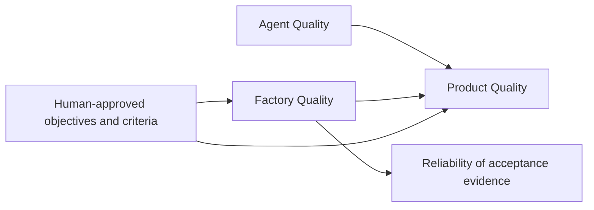

This classification is the analytical framework of this paper, not a standard intended to replace existing quality models. For example, even if the Checker scores highly on evals, a commit gate that ignores rejection is a Factory defect. Conversely, even when the process operates according to its rules, insufficient criteria allow product defects to escape. Keeping these three dimensions distinct helps guide investment in improvement. Adding a commit gate to a problem that should be addressed by improving Agent Quality might merely slow work. A Factory Quality defect, in contrast, may persist even after the model is upgraded.

### 2.3 Mapping the Seven Design Principles to Implementation

The following table maps the design principles to the reference implementation Auto Developer (reference snapshot `72938c9`). In this paper, v0.10.0 refers to the version designation recorded in that development snapshot; it does not imply confirmation that an official Git tag or GitHub Release has been published. The statuses are classifications based on public records examined for this paper, not results of exhaustive verification of each feature.

| # | Design principle | Main sections | Correspondence in Auto Developer | Status | Evidence |
|---|---|---|---|---|---|
| 1 | Canonical Path Engineering | 3.3, 3.4 | Skills for standard procedures (`/nightly-run`, `/nightly-compile`); generation of the CLI reference (DX-4); checks of commands in documentation (DX-1, DX-14); errors guiding the next action (e.g., GATE-13, GATE-15) | Partial (procedures and guidance; canonical paths embodied in code structure are outside scope) | SPEC 4.10, 4.2 |
| 2 | Intent-to-Contract Compilation | 4 | Spec Compiler (`--outline` / `--check` / `--impact` / `--emit`), protection of approved IR, DESIGN_DRIFT display | Implemented (does not guarantee semantic completeness) | v0.10.0 release notes |
| 3 | Evidence-Bound Execution | 5.2, 5.3 | Single-use Evidence bound to Tree SHA and SPEC hash (INV-2); mandatory review by a different model family (INV-6, GATE-4); reconciliation of review inputs and outputs with the commit subject (INV-10, GATE-5–7, BDL-4); rejection of duplicate determinate reviews on the same Evidence (GATE-12/13); Fail-Fast on low-level paths (GATE-15) | Partial (after one rejection, re-verification and review without changing code remain possible) | SPEC 3, 4.2; Phase 70 contract; GATE-13 tests |
| 4 | Verification of Verification | 5.4 | Correction of CI environments (Phase 71); removal of side effects through a temporary index (GATE-9); sandbox fixes under actual conditions (SBX-7/8); Red/Green proof for audit findings (AUDIT-5) | Partial (mechanical Red-First enforcement for all changes and blind Checker evals are in the v0.11 draft) | Phase 71 contract; SPEC 4.6, 4.7; v0.11 draft |
| 5 | Recoverable Autonomy | 6.1 | Quarantine and preservation (RCV-1, RCV-6, RCV-7, INV-3); atomic persistence of job state (RCV-2); resumption (RCV-3); idempotent crash recovery via `recover inspect / plan / apply` (RCV-4); integration job recovery (TEAM-6); Pilot 04 fault-injection E2E | Implemented (Pilot 04 fault data were not rerun for this paper) | SPEC 4.3; Pilot 04 E2E tests |
| 6 | Composable Autonomy | 6.2 | Worktree separation; ownership checks (INV-9, TEAM-3); preservation of bundles and integration gate; RC tag generation (TEAM-5, TEAM-6); human integration into the mainline | Experimental (independent teams only; `depends_on` and specialization by discipline not supported) | SPEC 4.8, 6; v0.11 draft |
| 7 | Bounded Self-Improvement | 7.3–7.5 | Audit by an Auditor from a different model family (AUDIT-1); routing by severity (AUDIT-2/3); repair budget (AUDIT-4, default five cycles, INV-7); Red/Green proof of resolution and recording lessons (AUDIT-5) | Partial (automatic aggregation of lessons and guard proposals are in the v0.11 draft; automated pruning remains future work) | SPEC 4.6; v0.11 draft |

For Principle 1, the implementation provides only procedures and guidance for users and agents. The design of code structures that themselves make correct implementation easier, as described in Section 3.3, and measures of canonical path discoverability remain future work.

## Chapter 3: An Environment Where Correct Work Is Easy and Incorrect Changes Are Hard to Commit

Rather than repeatedly reciting rules, build a codebase in which the correct path is easier to take. For agents and humans alike, this is not a design intended to restrict freedom. It reduces unnecessary exploration and rework, allowing attention to be devoted to the actual problem.

### 3.1 Harness, Loop, and Graph

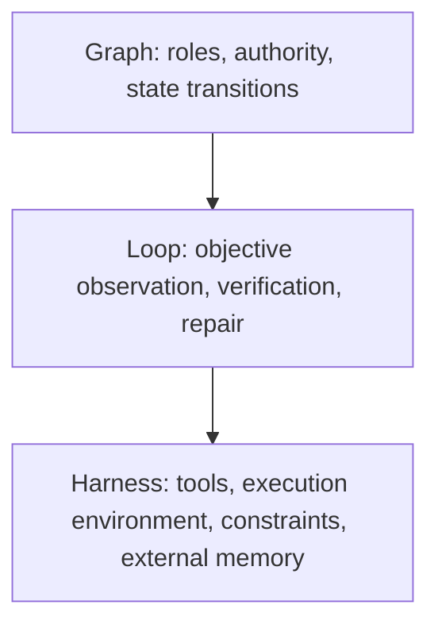

The Harness determines what can be done; the Loop determines what counts as passing; and the Graph determines who does what and which state may follow. The three layers need not be separate products; they distinguish responsibilities. The names and basic layering derive from the discussion by m4lka cited in the previous edition. [R13] Whereas these layers define the production process at a given time, Engineering Metabolism is a cross-cutting mechanism that updates them through experience (Chapter 7).

### 3.2 From Wish to Wall

Natural-language instructions, interactive confirmations, runtime blocking, and refusal at commit time differ in enforcement strength. Keeping secrets out of the work environment, denying access through OS permissions, and externally enforcing merge conditions on protected branches are stronger than prohibitions expressed only in prompts.

A Git worktree separates working states; it is not an OS-level security boundary. Local hooks and protected-file checks must likewise distinguish mechanisms that refuse to commit changes from mechanisms that prevent access itself. Configuration an agent can modify itself does not constitute an enforcement boundary on its own.

### 3.3 Canonical Path Engineering

A Factory does not mature merely by adding walls. The legitimate implementation path must be the easiest to discover and execute. Clear module boundaries, reference implementations, types, appropriate abstractions, a small set of tools, feature maps, and concrete error messages are assets for this purpose.

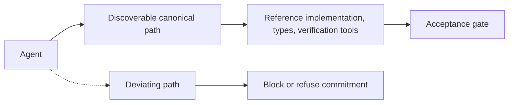

Lauren Tan's public pstack skills and the secondary account of her talk [R5, R6] suggest the importance of an environment in which agents can operate and observe actual applications, and of code structures conducive to success. Individual prohibitions depend on context; there is no need to import, for example, bans on specific React APIs or comments as general principles. What matters is the design of canonical paths and the mechanization of rules.

### 3.4 From Supplying Screenshots to Agents Making Their Own Measurements

If agents can obtain screen views, execution traces, profiles, logs, and test results, humans need not relay as many observations. Observability and the ability to make passing decisions are distinct. Screenshots are valuable diagnostic material, but if invariants concerning position or dimensions can be evaluated numerically, implement those conditions as tests.

## Chapter 4: The Spec Compiler — Connecting Divergence and Convergence

During design discussions, yesterday's hypothesis may be overturned today. During implementation, however, authorization conditions or rules for calculating monetary amounts must not be changed arbitrarily. Even when the same intelligence is used, creative exploration and disciplined execution are worth treating as distinct processes.

The Elephant-Goldfish Model (EGM), described in Google's public repository [R4], separates the contexts of the designer and reviewer of a design document. We extend this to implementation and diff review, separating the Elephant, which shares a long-running context with the human designer, from the Maker, which executes a bounded task, and the Checker, which does not inherit the implementation conversation. Independence is strengthened by separating inputs and authority and, where appropriate, using different model families. (Auto Developer does not treat decisions as approvals if the Maker and Checker or Auditor belong to the same or an unknown model family; INV-6.) Context or model separation alone, however, does not mathematically guarantee independence of errors.

At the design stage, ambiguity is tolerated and alternatives explored. At the execution stage, that ambiguity must not become arbitrary implementation decisions. We call the transformation layer connecting these two stages the Spec Compiler.

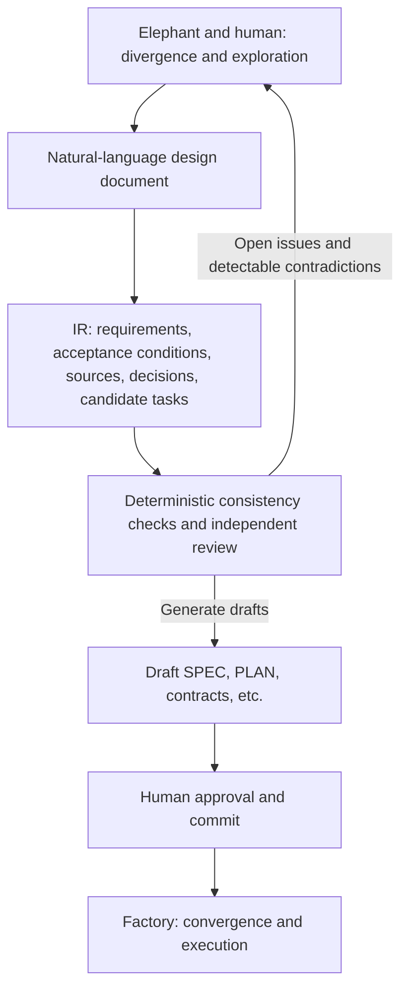

The intermediate representation makes the sources in the design document traceable. The implementation checks the JSON IR, hashes of source ranges, requirement IDs and references to acceptance conditions, ownership, and open issues. SPEC and PLAN are not the IR itself but draft contract documents generated from it.

The v0.10.0 Spec Compiler provides `--outline`, `--check`, `--impact`, and `--emit`. Impact analysis enumerates candidates rather than deciding whether existing tests must change. Approved IR is protected, and status displays indicate design drift (DESIGN_DRIFT). See the [release notes](https://github.com/hamatz/auto_developer/blob/72938c923efb4d4b141fffaa4aff6fc863186bfc/docs/releases/v0.10.0.md).

This transformation is not a compiler that guarantees semantic completeness of natural language or detection of every contradiction. It checks mechanically decidable consistency and returns semantic judgments that cannot be decided mechanically to humans and independent reviewers. The compiler itself has no authority to modify formal contracts.

## Chapter 5: Evidence-Based Execution Governance — Verifying That Verification Took Place

### 5.1 Types of Evidence and Their Limits

| Type | Judgment supported | Limitations |
|---|---|---|
| Formal verification | Proof of properties with respect to a formalized specification | The validity of the specification and model must be established separately |
| Deterministic checks | Test, type-check, and build results under specified conditions | Do not guarantee unchecked properties |
| Independent review | Deviations from specifications, design problems, gaps in tests | Stochastic judgment subject to error |
| Observational artifacts | Reproduction, diagnosis, and additional judgment | May not demonstrate satisfaction of acceptance conditions on their own |
| Self-report | Description of the situation | Not used alone as grounds for commitment |

Deterministic checks and independent review are not substitutes for one another. The commit protocol proposed here requires both sets of applicable conditions to be met.

### 5.2 Is the Code That Passed the Tests Really the Code Being Committed? — Evidence-Bound Execution

Changing a diff after successful verification, reusing approval granted to a different artifact, or retrying reviews on the same candidate until a favorable result appears are problems that can occur even after independent verification has been introduced.

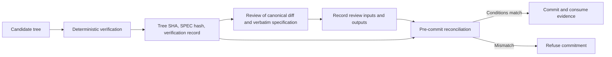

As a design principle, the final review decision for a given verification record is treated as unique; rejection must not be concealed in order to select a different acceptance decision. Failed review records are preserved, and necessary repairs and re-verification follow. If an independent reassessment is deliberately undertaken, its conditions must be specified in a separate approved policy.

Auto Developer v0.9.0 incorporated reconciliation of the verified tree and SPEC, canonical diff, verbatim specification used in review, and Checker output into the commit gate. In v0.10.0, GATE-12/13 reject a second determinate decision on the same Evidence in the low-level `record-review` path and retain indeterminate outputs in the history. Review can be repeated following re-verification that issues new Evidence. This discourages review shopping on the same Evidence, but does not categorically prohibit re-verification without a code change. Indeed, the [corresponding test](https://github.com/hamatz/auto_developer/blob/72938c923efb4d4b141fffaa4aff6fc863186bfc/tests/test_gate13_single_review_per_verify.py) permits review after re-verifying unchanged code. Meanwhile, GATE-15 in v0.10.0 counts verification failures and rejections together for the same task, even on the low-level path, and refuses verification and commitment when the count reaches two (INV-4; the `run` path has the CORE-4 retry limit). Consequently, even within a single attempt interval with ordinary records available, one rejection may still be followed by re-verification of unchanged code, issuance of new Evidence, and another review. To control paths that commit without resolving previous rejections, including those involving unrelated changes that produce a different tree, we propose `NoUnresolvedReject` in Section 5.3. It has not been implemented.

Hashes are useful for checking identity and integrity, but do not by themselves establish the legitimacy of the record producer or guarantee complete tamper resistance. Depending on the threat model, establish trust anchors through signatures, external append-only records, protected CI, or other appropriate measures.

### 5.3 Making Commitment Conditions Explicit — Invariants of the Acceptance Protocol

We use the following notation. These are example logical acceptance conditions proposed in this paper, not a formal proof covering every implementation path.

| Symbol | Meaning |
|---|---|
| T | Canonicalized candidate tree |
| S | Approved contract (SPEC, acceptance conditions, etc.) |
| B | Base commit for the diff |
| E | Description of verification environment and check configuration (runtime environment, subjects of checks, dependencies) |
| V, R | Verification and review records, each with an identifier `id` |
| C | Candidate for commitment |
| P | Applicable policy (authority, independence, budget, conditions for reassessment) |
| task | Identifier of the task in question |
| H | History of verification, review, and adjudication for the task |
| digest(x) | Digest of canonicalized x, distinct from a record identifier |

```text
GateEligible(C) :=
  -- Contract and authority
  ValidContract(S, P) AND Authorized(C, P)
  -- Trustworthiness of records
  AND TrustedRecords(V, R, P)
  -- Deterministic verification: what, against what, under which conditions
  AND Pass(V)
  AND V.subject  == digest(T)
  AND V.contract == digest(S)
  AND V.base     == B
  AND V.env      == digest(E) AND AcceptableEnv(E, P)
  -- Independent review: did it reference the verification and see the same inputs?
  AND Approve(R)
  AND R.evidence_id == V.id
  AND R.inputs == (digest(T), digest(S), B)
  AND IndependentReviewer(R, P)
  -- Control of iteration
  AND NoUnresolvedReject(task, T, H, P)
  AND WithinBudget(H, P)
  -- Identity of the commitment subject and single use of evidence
  AND digest(C.tree) == digest(T)
  AND FreshAndUnconsumed(V)

Commit(C) :=
  atomically { require GateEligible(C); write(C); consume(V); append(H) }
```

`NoUnresolvedReject(task, T, H, P)` means that the resolution or adjudication required by policy P has taken place for rejected or indeterminate review results in the history H of the task, with respect to candidate tree T. A change in the tree digest alone does not count as resolving previous findings. Examples of resolution include a repair addressing the finding followed by re-verification and independent review, a new review under an approved independent reassessment policy, or human adjudication. Indeterminate outputs are distinguished from rejections and may be resolved through reruns or adjudication defined by P. This condition brings selection of alternative acceptance decisions through re-verification of the same tree or through unrelated changes within the scope of control. GATE-12/13 in v0.10.0 reject duplicate decisions on the same Evidence; GATE-15 limits failures at the task level. The control that binds resolution of findings to task history, corresponding to `NoUnresolvedReject`, has not been implemented (Section 5.2).

`GateEligible` defines the commit-gate predicate proposed in this paper. It supports the claim that acceptance conditions under the applicable policy have been met, not the claim that no defects exist. The subject of the digest is the canonicalized artifact. The diff base, identity of the verification environment and check configuration, and necessary dependencies must also be recorded as appropriate to the scope. Races between reconciliation and commitment must be prevented. `Commit(C)` above treats acceptance confirmation, commitment, evidence consumption, and history append as one indivisible transition. Where indivisibility cannot be achieved, recovery to the same outcome after failure must be possible (`Recovering` in Section 6.1). Satisfying this predicate does not imply complete product correctness or authorization for production release.

The trust boundary must be explicit. In an environment where the Maker has the same authority to modify the verifier, evidence store, commit gate, and signing keys, local reconciliation alone provides no guarantee against a malicious actor. Separate execution privileges, protected CI, and external trust anchors are additional design measures. These can be connected to the notions of provenance and process integrity in SLSA and in-toto [R7, R8], but we do not claim that Auto Developer has been certified as conforming to them.

### 5.4 What a Green CI Did Not Guarantee — Verification of Verification

Auto Developer's development records include a case in which a CI Python version matrix did not use the intended executables. Correcting the execution environment exposed numerous failures on macOS (Chapter 8). This is a concrete example of the need to establish what was checked and under which conditions before trusting check results.

Even when CI is green, the intended environment or tests may not actually have been used. Check the number of executed tests, execution environment, target commit, failure classification, and correspondence to the artifact. Deliberately failing tests, mutation testing, and property-based testing can also improve the validity of the measurement instrument.

For new regression tests, confirm that the target defect causes the test to be red before the fix and that the same test turns green after the fix. Existing positive-path and regression tests that were already green before the fix are, of course, not meaningless. Distinguish the two cases.

Candidate tests are themselves untrusted code. A time limit alone does not provide isolation. Execute untrusted tests within an appropriate OS boundary, and stop if the sandbox cannot start under actual execution conditions. For agent skills, use independent evals, blind evaluation where appropriate, and held-out evaluation sets to monitor overfitting to the evaluation. Auto Developer specifies Red/Green verification for candidate audit tests, but mechanical enforcement of Red-First for every test added during ordinary tasks and blind evaluation of the Checker itself are matters for consideration in the v0.11 draft.

## Chapter 6: Recoverable and Composable Autonomy

### 6.1 When the Factory Stops in the Middle of the Night — Recoverable Autonomy

The maturity of unattended operation cannot be measured solely through successful execution paths. Design for crashes, timeouts, successive rejections, and failures during destructive operations, identifying the states from which work can safely resume.

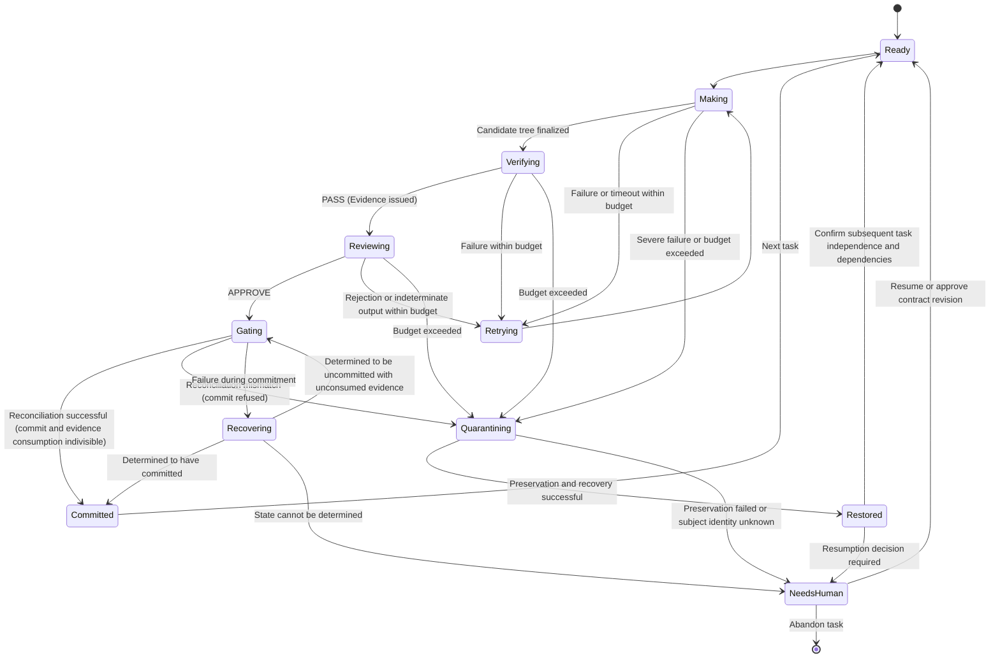

`Gating` represents pre-commit reconciliation in Sections 5.2 and 5.3; `Recovering` represents recovery from a failure occurring during commitment and evidence consumption. In Auto Developer, the latter corresponds to job-state persistence and the idempotent recovery commands `recover inspect / plan / apply` (RCV-2–4), and is also the state targeted by Pilot 04's fault injection immediately after a commit (Section 8.2). The budget in the diagram is a generalized design constraint that may include implementer failure, indeterminate results, time, and cost. Auto Developer's INV-4 (`run`: CORE-4; low-level paths: GATE-15) stops a task when the combined count of verification failures and rejections reaches two. On low-level paths, indeterminate reviews are not included in that count, and the count is reset, for example, when resuming after quarantine. Because a reconciliation mismatch may indicate a process abnormality rather than an implementer's failure, it leads to quarantine instead of another retry. `NeedsHuman` is not a terminal state: human adjudication leads to resumption, contract revision, or abandonment.

Quarantine failed changes, and restore the working state only after confirming exclusion of secrets and successful preservation. If the recovery actor or the identity of the recovery subject is uncertain, stop on the safe side. Subsequent work may continue only when independence and dependencies have been established. Successful quarantine does not imply unconditional permission to proceed to the next task.

### 6.2 From One Factory to Multiple Production Lines — Orthogonality of Boundaries and Skills

Parallelization is not simply a matter of increasing the number of agents. Design ownership boundaries separately from the tools, skills, and verification conditions specific to each domain.

| Lane | Example ownership | Example verification |
|---|---|---|
| UI | UI components | Layout, interaction, accessibility |
| API | Domain logic and APIs | Types, boundary values, idempotence |
| Infra | Infrastructure as code and environment configuration | Static checks, permissions, configuration validity |

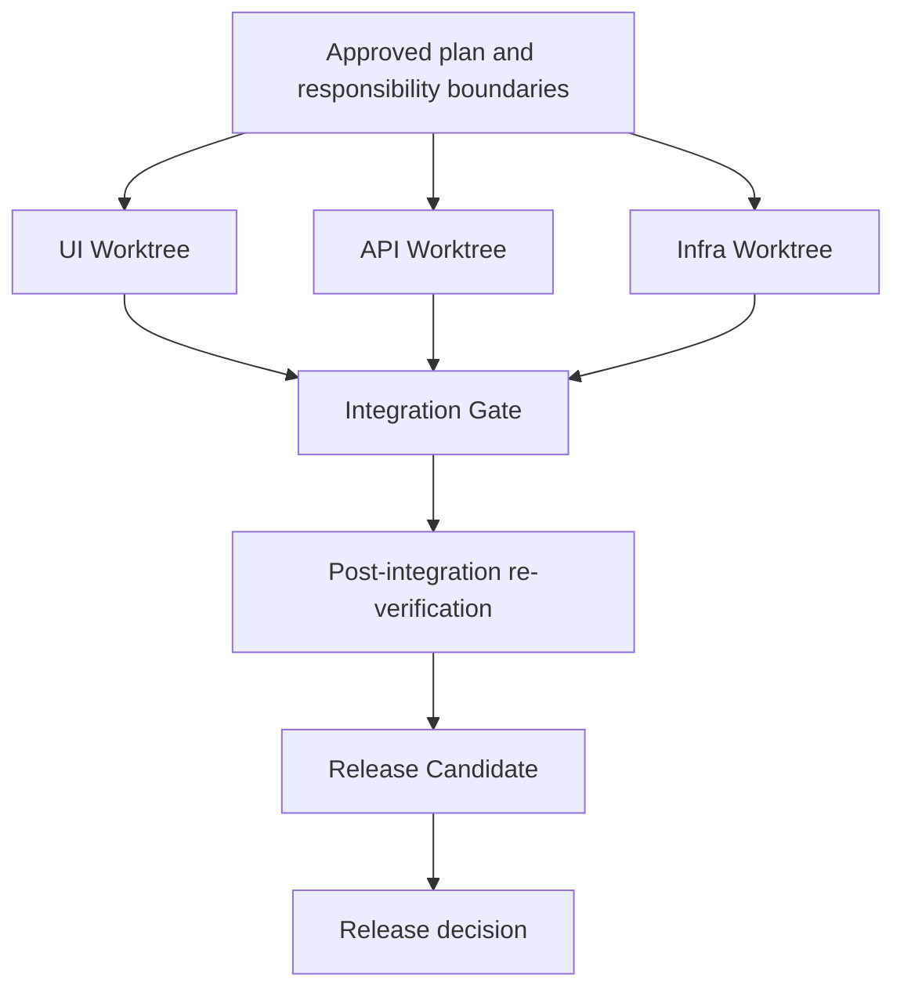

Correctness of each team's output does not establish correctness after integration. The integration gate reconciles the evidence from each team and re-verifies the integrated state. Auto Developer's multi-team path creates a dedicated integration branch and RC tag, leaving integration into the mainline to humans. Multi-team support in v0.10.0 is experimental: all teams use the same Maker, Checker, and verification. The discipline-specific allocation of skills, models, and verification shown in the table is a design proposal, not an implemented feature. The [v0.11 design draft](https://github.com/hamatz/auto_developer/blob/72938c923efb4d4b141fffaa4aff6fc863186bfc/docs/contracts/v0.11-draft.md) identifies specialization as future work.

## Chapter 7: Engineering Metabolism — A Mechanism That Builds Development Capability Through Development

> Build software. Build the ability to build.

### 7.1 Turning Experience into Capability — Defining Engineering Metabolism

We define **Engineering Metabolism** as a mechanism that converts experience gained during software production into verifiable and durable production capabilities. Taking Level 7 in m4lka's maturity model, cited in the previous edition [R13], as a starting point, we treat not only the accumulation of lessons but also their promotion into enforcement mechanisms, validation of improvements, pruning, budgets, and stopping conditions as parts of a single mechanism. This is neither a standardized maturity certification nor a claim of priority for the term.

Its purpose is not to provide agents with more knowledge. It is to transform past experience into mechanisms that remain effective even when future agents do not remember that experience. Whereas Harness, Loop, and Graph define the structure of the production process, Engineering Metabolism defines how that structure is updated over time. It is not a fourth stacked layer, but a cross-cutting improvement mechanism acting on all three layers.

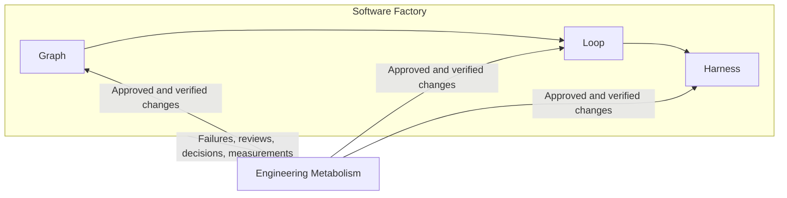

| Term | Positioning in this paper |
|---|---|
| Engineering Metabolism | Mechanism for converting experience into production capability |
| Engineering Immunity | Ability to detect and block recurrence of specific defects or deviations |
| Engineering Compounding | Expected long-term effect of accumulating effective improvements; does not guarantee monotonic improvement or compound growth |

One metabolic cycle consists of Capture (observation and recording), Distill (extracting lessons), Promote (promotion into tools, types, tests, and gates), Validate (checking effectiveness and side effects), and Prune (removing unnecessary rules and checks). Not every experience needs to become an enforcement mechanism. Judgments that cannot be mechanized remain documented, and candidates whose benefits do not justify their costs are deferred.

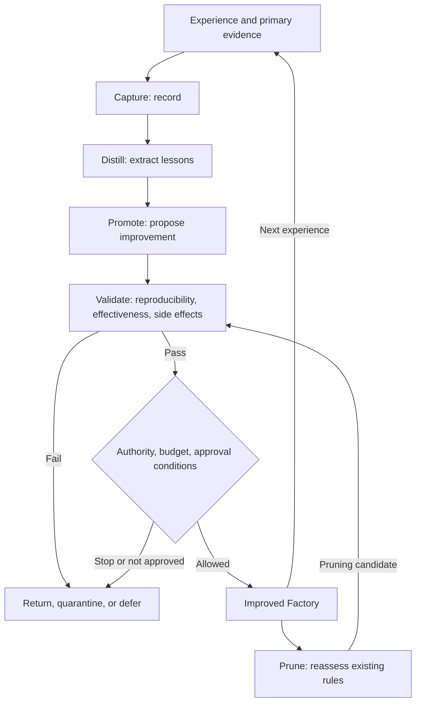

The diagram depicts the complete conceptual process, not a fully automated current implementation. Committing improvements requires independent verification and approval appropriate to the subject; the improvement actor must not be able to relax protected verification conditions or authority boundaries on its own.

### 7.2 Avoiding the Need to Repeat the Same Warning — Promoting Lessons

Disposable sessions are less likely to carry previous biases forward, but experience also disappears. Accumulate experience as external memory, retrieve it only when needed, and transfer it into mechanisms with enforcement power wherever possible. Lesson records contain Context, Trap, Rule, Rung, Immunity Test, and Proof.

| Where the lesson resides | Characteristics |
|---|---|
| Conversation or prompt | Temporary reminder |
| AGENTS.md or LESSONS.md | Reusable, but compliance is not necessarily enforced |
| Tools and reference implementations | Make the correct path easier to follow |
| Tests and linters | Mechanically detect decidable deviations |
| Commit gates and permissions | Block unauthorized commitment or access |
| Structure itself | Change the design to make failure less likely |

The half-life of fixes attributed to Arcos in the previous edition [R14] is a conceptual metaphor; specific durations should not be generalized without empirical measurement. What matters is moving lessons from reliance on attention to durable mechanisms.

### 7.3 Independent Audit and Immunity

Distinguish the task-level Checker from the Auditor, which examines a broader scope. Evaluate audit findings by severity and reproducibility, executing candidate tests in isolation. Record findings as lessons when Red/Green results against the relevant commits have been confirmed.

A candidate test passing is not sufficient grounds for unconditional promotion to a formal acceptance test or protected immunity test. Changing the measurement instrument changes production rules; separate authority to approve that change from the implementer.

### 7.4 When an Overzealous Auditor Brings Development to a Halt — Bounded Self-Improvement

Independent auditing may continue finding additional issues if its search scope and stopping conditions are ambiguous. The number of findings does not directly indicate audit quality. If zero defects is the stopping criterion, operating within a finite budget becomes difficult.

Auto Developer separates the repair path for serious P0/P1 findings from the P2/INFO backlog, and limits repair cycles for the same module. Reaching that limit is not a pass; it requires human judgment. The default repair budget is five cycles of automatic P0/P1 registration for the same module (AUDIT-4). In a generalized Factory, design improvement budgets that account not only for cycle counts but also time, tokens, computational cost, and risk.

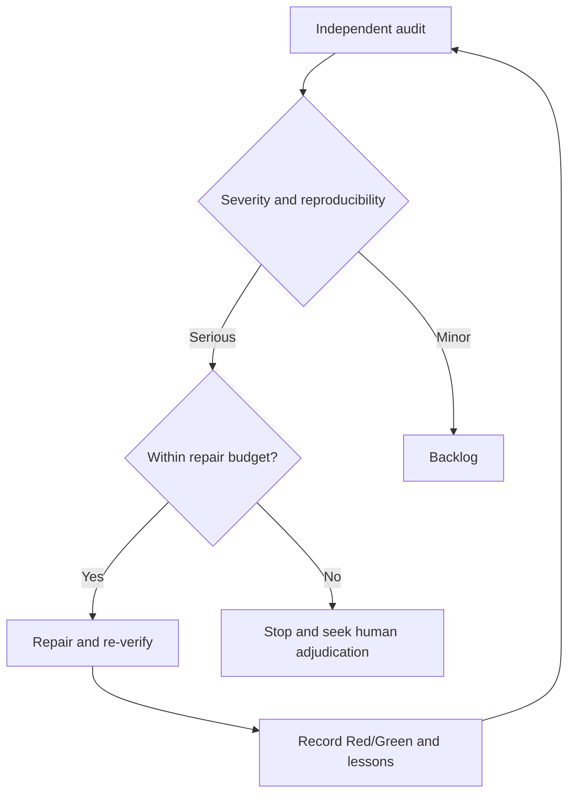

### 7.5 Pruning and Cost-Effectiveness

Turning every past failure into a permanent rule is not necessarily optimal. Guards incur costs such as waiting time, computation, maintenance, and false positives. Reassess low-risk constraints through repeated evaluations and regression tests after model changes, and prune them with evidence and approval. Mandatory conditions concerning authority, secrets, production connectivity, and evidence must not be automatically removed.

v0.10.0 implements reproduction tests for audit findings, Red/Green results before and after repair, lesson recording, and improvement budgets. Mechanical enforcement of Red-First for all changes by ordinary Makers, automatic aggregation of recurring lessons and proposal of guard candidates, and blind Checker evaluation remain future work described in the [v0.11 draft](https://github.com/hamatz/auto_developer/blob/72938c923efb4d4b141fffaa4aff6fc863186bfc/docs/contracts/v0.11-draft.md). Thus, neither full automation of Engineering Metabolism nor its overall effectiveness has been demonstrated.

### 7.6 Building the First Production Line

A Factory need not start in its complete form. Begin by turning one property that humans repeatedly check into a test. Next, make that test a commitment condition that implementers cannot weaken without authorization. Then incorporate failure feedback, independent review, evidence binding, quarantine, and recovery in turn. Unattended operation and parallel execution are extensions to introduce after confirming their respective boundaries and stopping conditions.

For example, start with a single property: unauthorized API calls must be rejected. Prepare an independent acceptance test and run it in CI that the implementer cannot modify. On failure, record the input, observation, and expected value, and require repair and re-verification. Even this constitutes a minimal unit of the Factory.

This sequence is an implementation proposal, not an empirically validated maturity scale. Teams with sufficiently mature CI and tests can begin further along the sequence. Starting small and adding necessary constraints in response to actual failures is one way to avoid overengineering the Factory itself.

## Chapter 8: A Factory That Builds the Factory — Updating and Evaluating Theory Through Practice

Auto Developer is a reference implementation developed to make the approach of the previous edition accessible to anyone. Using it in its own development exposed defects not only in the Factory's products but also in the Factory itself.

### 8.1 A Record of an Overnight Execution — Phase 74

We present an analysis of Phase 74 (refinements to v0.10.0, eight tasks) by cross-checking three types of records: Auto Developer's event log (62 Phase 74 entries in `events.jsonl`), Git commit history, and quarantine branches. The counts, ordering, and timestamps of the three records agreed. Execution began at 00:25 JST on November 25, 2026, and the last task was committed at 11:07 JST. All times below are also in JST.

| Observation | Value |
|---|---|
| Models | Maker: gemini-4-hydrogen-medium; Checker: claude-sonnet-5-5 (different model families; INV-6) |
| Tasks committed | 8 / 8 |
| Verification | 17 attempts (15 passes, 2 failures) |
| Review | 15 reviews (8 APPROVE, 7 REJECT). Four of eight tasks were approved on their first review |
| Quarantine | 3 times (tasks 5, 7, and 8, each after two successive rejections) |
| Human intervention | 4 times (one modification to a protected immunity test and three resumptions after quarantine; see below) |
| Diff | 25 files, +3,543 / −108 lines (`9eb4589..228ea07`) |
| Elapsed time | Approximately 10.7 hours (including approximately 3 hours 24 minutes waiting for human intervention) |

**Human intervention.** There were four interventions of two kinds. First, in task 4, a protected immunity test assumed the very behavior that the task was intended to close off: recording APPROVE on the same verification after REJECT. Verification therefore failed at 03:17 and execution stopped. Only a human may modify immunity tests. The author, who had been asleep, modified the test at 06:28 (`8a99ca2`, the only out-of-pipeline commit in the range), restarted from verification with the new HEAD as the base, and obtained a pass at 06:41. This is an example of the design preventing the implementer from modifying a protected measurement instrument (Sections 3.2 and 7.3), as intended. At the same time, it illustrates a failure to detect a contradiction between the new specification and existing immunity tests before implementation ("Contradiction between a design decision and acceptance conditions" in Section 8.2). Second, all three quarantines followed the rule requiring a stop after two successive failures of the same task (INV-4). The orchestrator (Antigravity) stopped and left a request for guidance. The author examined that request in Claude Code, made necessary repairs, and instructed Antigravity to resume. Thus, commitment of tasks 4, 5, 7, and 8 involved human judgment and modification; this execution did not finish unattended. Decisions to resume after quarantine and the details of the repairs were not recorded in the event log and are based on the author's account. This sequence corresponds to `Quarantining → Restored → NeedsHuman → Ready` in the state diagram of Section 6.1. It is also an example of the stopping condition working and transferring judgment to a human.

Separately from elapsed time, distinguishing time spent waiting for human intervention from actual working time, taking into account the execution host's operating state, is a measurement challenge for Section 8.3.

**What review stopped.** The reasons for REJECT include concrete defects: for example, a bug in which `lstrip('./')` damaged paths beginning with a dot; failure to refer to the configured verification script during integration; and a change that would write Evidence tokens in plaintext to the event log. These records show independent review identifying concrete defects before acceptance. Without a controlled comparison, however, we cannot conclude that human reviewers would have missed them or that quality was higher than under conventional methods. Lines of code are only supplementary information about the scale of the output.

This execution took place with verification-review reconciliation already in place (GATE-5–7, Phase 70), while implementing review hardening (GATE-13) itself. Fail-Fast on low-level paths (GATE-15) did not yet exist, and stopping decisions depended on the orchestrator's procedures.

The event records and quarantine branches used for reconciliation are not included in the public repository. An archive, [`phase74-evidence.tar.gz`](phase74-evidence.tar.gz) (SHA-256: `680b38d71acd727ca624d72d5003dcd0f97831018252c17230b736d1475f5124`), is supplied as an appendix to this paper. It contains the Phase 74 event records, full review history (15 entries), Evidence, quarantine branches, and a replay snapshot of the dashboard. Absolute paths and consumed Evidence tokens have been replaced, but review inputs and outputs remain unmodified. The included `verify.py` allows the consistency of the records with one another and with the repository to be checked. The warnings at the top of the dashboard reflect its generation-time state, not the state during execution.

### 8.2 Cases Where Failure Changed the Theory

**The Checker said REJECT. The code was committed anyway.**

`LESSONS.md` reports discrepancies between saved Checker outputs and approval records for four commits in Phases 67–69. According to the development records, the cause lay in how completion notifications from a background Checker were handled. The lesson is that having a separate model is not the same as ensuring that the review performed by that model is correctly reflected in the commitment process. Subsequently, a design was introduced to preserve review inputs and outputs and reconcile them immediately before commitment.

The [Phase 70 contract](https://github.com/hamatz/auto_developer/blob/72938c923efb4d4b141fffaa4aff6fc863186bfc/docs/contracts/phase70.md) records the four cases identified during reconciliation on November 22, 2026 (`b7af7f2`, `86eeea9`, `e5fa287`, `84a0043`), plus two commits that were made before the Checker output arrived. The latter ultimately received APPROVE, but the ordering was not guaranteed in either case. The causal analysis identifies duplicate background completion notifications, commitment on the first notification, and an API that accepted a self-reported string as the decision. Countermeasures were defined as INV-10, GATE-5–7, and BDL-4. The original output files were not independently reconciled again for this paper.

**What a green CI did not guarantee.**

The problem of a CI version matrix selecting an executable other than the intended Python became apparent when the verification script's environment selection was corrected. Recorded failure counts are not a general measure of verification coverage or product quality, but they concretely demonstrate the need to establish the identity of the verification environment.

According to the [Phase 71 contract](https://github.com/hamatz/auto_developer/blob/72938c923efb4d4b141fffaa4aff6fc863186bfc/docs/contracts/phase71.md), a CI matrix of macOS / Ubuntu × Python 3.10 / 3.12 actually used Python 3.9 on macOS and 3.12 on Ubuntu. Correcting the selection produced reports of 72 failures and 9 errors on macOS and one failure on Ubuntu. The former primarily involved a sandbox unable to read the symbolic-link path to Python; the latter reflected an erroneous test assumption rather than a product defect (SBX-7/8). Failure counts should not simply be equated with numbers of product defects.

**Verification itself changed the working state.** The same contract reports that the verification process calculating the Tree SHA staged files in the real Git index, potentially causing accidental commits of confidential files. GATE-9 revised the design to use a temporary index. Side effects of verification are themselves subjects of verification.

These are retrospective analyses recorded in the repository, not experiments independently reproduced for this paper. Other observed cases and their design implications are summarized below.

| Observed event (according to repository records) | Design principle derived |
|---|---|
| Four commits with discrepancies between REJECT outputs and APPROVE records | Bind review inputs and outputs to the commitment subject |
| CI did not execute the intended Python; 72 failures and 9 errors on macOS after correction | Verify the verification environment and subject |
| Difference between sandbox startup checks and actual execution conditions | Verify assumptions under production-equivalent conditions |
| Prolonged development due to repeated audit findings | Design severity routing, repair budgets, and stopping conditions |
| Implemented functionality was unreachable through the user-facing path | Verify E2E behavior using published procedures and distributions |
| Contradiction between a design decision and acceptance conditions | Check detectable specification inconsistencies before implementation |

Sources: [LESSONS.md](https://github.com/hamatz/auto_developer/blob/72938c923efb4d4b141fffaa4aff6fc863186bfc/LESSONS.md), [SPEC.md](https://github.com/hamatz/auto_developer/blob/72938c923efb4d4b141fffaa4aff6fc863186bfc/SPEC.md), and [CHANGELOG.md](https://github.com/hamatz/auto_developer/blob/72938c923efb4d4b141fffaa4aff6fc863186bfc/CHANGELOG.md). The reference snapshot is `72938c923efb4d4b141fffaa4aff6fc863186bfc`, dated November 27, 2026. The following additional cases are based on the same snapshot.

**Testing a Factory stoppage.** The [Pilot 04 E2E tests](https://github.com/hamatz/auto_developer/blob/72938c923efb4d4b141fffaa4aff6fc863186bfc/tests/test_pilot04_recovery_e2e.py) are designed to check recovery and idempotence upon reapplication against four fault-injection datasets: failure during Maker execution, immediately after verification, immediately after commitment, and during quarantine. Because the tests are skipped when the external ZIP is unavailable, we do not claim four successful recoveries solely from the existence of the test code. The fault datasets were not rerun for this paper.

**Zero findings does not mean zero defects.** The v0.10.0 release notes report zero independent audit findings but explicitly characterize this as weak assurance because reasoning was brief relative to an input diff of approximately 600,000 tokens. This illustrates the need to evaluate the audit itself.

### 8.3 How Can We Tell Whether a Factory Has Become More Capable?

Factory output cannot be measured solely by PR counts or generated lines of code. Combine measures such as accepted tasks, human intervention time, first-pass verification rate, rework rate, escaped defects, recurrence rate, safe-stop rate, recovery success rate, and cost per accepted task. In particular, evaluate the cost of turning previously detected failures into future checks against the rework subsequently avoided.

We do not claim that all these indicators have already been measured. This is a proposed evaluation design using the reference implementation's measurement infrastructure and development history. Future work is to compare model-only changes, Factory improvements, and their combination under equivalent task and risk conditions.

[METRICS.md](https://github.com/hamatz/auto_developer/blob/72938c923efb4d4b141fffaa4aff6fc863186bfc/METRICS.md) distinguishes event-derived metrics from Git-history-derived metrics. For example, Phases 50–53 each record four `pipeline_commits`, but event-derived metrics such as first-pass rate are missing. Out-of-path commits include automated audit and external commits, so they must not be equated with the number of human interventions. A first-pass rate whose denominator includes only successful tasks is subject to survivorship bias; results for all started tasks should also be reported.

For Engineering Metabolism, we additionally propose the following metrics. All are new evaluation designs; they are not claimed to have been measured in the current METRICS.md.

| Metric | Proposed operational definition |
|---|---|
| Lesson-to-Guard Latency | For promoted lessons, elapsed time from initial observation to introduction of an approved guard; also report the number of unpromoted lessons |
| Guard Promotion Rate | Share of lessons judged mechanizable during an evaluation period that are committed as effective guards; fix the judgment criteria and target population |
| Defect Recurrence Rate | Recurrences of known defect classes divided by corresponding recurrence opportunities; specify the definition of an opportunity and the observation period |
| Guard Effectiveness | Proportion of independently prepared cases containing targeted defects detected or blocked by a guard; also measure false rejection of valid cases |
| Guard Maintenance Cost | Human time and computational cost of executing and maintaining checks and responding to false rejections during the observation period |
| Improvement Yield | Report changes in rework, escaped defects, and cost observed under comparable conditions alongside the investment in improvement; do not aggregate different units without justification |

Metabolic activity is distinct from metabolic health. Increases in rules, tests, or audits alone cannot establish improvement. An observation that a defect did not recur after improvement does not demonstrate guard effectiveness if there were no opportunities for recurrence.

### 8.4 The Next Experiment: Separating Model Progress from Factory Progress

The central hypothesis is that improving the Factory while holding the model fixed can increase the volume or cost-effectiveness of output that can be safely accepted. The controlled comparison uses the following 2 × 2 design:

| | Baseline development process | Enhanced Factory |
|---|---|---|
| Baseline model | A | B |
| Newer model | C | D |

Use the same initial commit, equivalent tasks, acceptance criteria, and limits on computational resources and time; stratify by task difficulty and randomize the order of trials. Run each condition multiple times in isolated working environments, and evaluate using hidden acceptance tests and independent evaluators. Fix or record model versions, tools, execution environments, prompts, and Factory configurations. Manage state between trials so learned lessons do not contaminate the control conditions.

Primary outcomes are the independent acceptance rate across all started tasks and the incidence of serious undetected defects. Secondary outcomes are human work time, computational cost, and elapsed time per accepted task, safe-stop rate, and recovery success rate. Do not exclude failures, timeouts, or unfinished work: sum the costs of all trials and divide by the number accepted. If the number accepted is zero, report unit cost as undefined and provide total cost and failure counts. Whether safety and productivity improvements coexist is an empirical question. Report sample sizes and uncertainty without presuming superiority. Evaluate the interaction between model and Factory, and retain existing CI and human review in the comparator process rather than constructing a deliberately weak control.

For evaluating the Factory itself, use negative cases such as deliberate rejection, evidence mismatch, post-verification modification, and fault injection. Measure the share of cases that should be rejected and are rejected, together with the false rejection rate for normal cases. These are experimental plans and have not been carried out for this paper.

### 8.5 Comparison with Related Practices

We organize the relationship to existing research and practice by the problems addressed rather than the names of technologies. The following compares emphases in public materials; it is not a comprehensive comparative trial of each system's capabilities.

| Line of work | Connection to this paper |
|---|---|
| OpenAI Harness Engineering [R3] | Observability for agents, structural constraints, and development-environment design |
| EGM [R4] | Separation of design context from independent document review; extension to implementation and diff review is the design proposed here |
| pstack [R5, R6] | Agent work practices, observation, and evaluation; the public eval procedure in particular avoids exposing terms that reveal evaluation to candidates |
| Warp Factory Engineering [R9, R10] | Measurement, improvement, and configuration management of production infrastructure; self-improving Factories are not unique to this paper |
| SLSA and in-toto [R7, R8] | Artifact and process provenance, verification against trust anchors; prior art for acceptance-evidence design |
| SSDF and Assurance Cases [R11, R12] | Integrating practices into a secure SDLC; structuring claims, arguments, and evidence |

Our focus is on connecting these insights to an acceptance protocol for autonomous development, recovery after failure, and bounded improvement, explaining their necessity through the implementation's failure records. From an Assurance Case perspective, for example, an Evidence Bundle is one component of the material supporting a claim; it does not itself complete the argument for safety.

For Lauren Tan's talk, we refer to the secondary account [R6] and verified blind eval, among its technical points, against the public playbook [R5]. Because we have not directly examined the original recording of the talk in detail, we do not treat PR counts, individual Dune constraints, or company-wide effects as independently demonstrated results.

### 8.6 Limitations and Threats to Validity

Passing tests and review does not prove specification correctness or the absence of defects. Different model families can share blind spots, and hash reconciliation requires trust anchors. Software safety also involves production operations, dependencies, the supply chain, data, laws and regulations, and organizational approval rules. The Factory does not replace them.

The cases in this paper derive primarily from the self-development of a single Python-based open-source tool. They are retrospective analyses by the author, subject to case-selection and observer bias, confounding from concurrent changes to models, specifications, and processes, and missing original logs. External validity across languages, enterprise sizes, and high-risk business domains remains unverified.

Introducing a large-scale Factory for small changes or prototypes is not always economical. Design constraints and verification in proportion to the risk delegated and the scale of execution.

## Chapter 9: Conclusion — What Will We Be Able to Build Tomorrow?

To persuade organizations cautious about AI-assisted development, demonstrating how intelligent the latest models are is insufficient. The questions are how erroneous artifacts are detected, under which conditions they are committed, what is preserved when failure occurs, and how the next failure can be prevented.

Human work need not be limited to sequential monitoring of implementations. Designing paths that make correct work easier, establishing verifiable contracts, binding evidence to artifacts, preparing for failures, and controlling self-improvement within sustainable bounds are also important responsibilities of software developers.

Good guardrails do not exist to suppress creativity. They expand the scope of work that organizations can delegate with confidence.

AI capabilities will continue to change. Today's Factory implementation may eventually be replaced. Yet the tasks of defining objectives and acceptance conditions, separating authority, checking evidence, recovering from failure, and returning experience to future production capability remain important across generations of models.

Build a system that does not require unconditional trust in AI. Then make that system itself verifiable, and develop its production capability through the experience gained in development. This is the Software Factory Engineering proposed in this paper, with Engineering Metabolism supporting its sustained evolution.

Its value extends beyond finishing today's work more quickly. It expands the opportunity to attempt complex systems that small teams could not maintain, products abandoned for lack of specialists, and development that could not begin because of demanding quality conditions. How much can be safely delegated in high-assurance domains such as financial systems, for example, is an important question for future research.

Software engineering in the age of AI is not the end of writing code. It is the beginning of an era in which the object of engineering expands from individual software artifacts to the very capability to produce them.

Building excellent software will remain valuable work. But building a system that continually produces excellent software offers a different, lasting kind of value.

We design not only what we deliver today, but the very possibilities of what we can build tomorrow.

**Build the Factory, Not Just the Software.**

## References and Public Practice Materials

Reference date: November 27, 2026. Research papers, standards, public practice articles, and secondary accounts are distinguished. R13 and R14 retain attributions from the previous edition; their original texts could not be retrieved again for this revision.

- [R1] Joel Becker, Nate Rush, Elizabeth Barnes, David Rein, *Measuring the Impact of Early-2025 AI on Experienced Open-Source Developer Productivity*, 2025, [arXiv:2507.09089](https://arxiv.org/abs/2507.09089) (comparative study, preprint).
- [R2] METR, *We are Changing our Developer Productivity Experiment Design*, 2026-02-24, [research report](https://metr.org/blog/2026-02-24-uplift-update/) (follow-up report).
- [R3] OpenAI, *Harness engineering: leveraging Codex in an agent-first world*, 2026, [public article](https://openai.com/index/harness-engineering/) (practice report).
- [R4] Google, *Elephant-Goldfish Model*, [public repository](https://github.com/google/elephant-goldfish-model) (OSS, not an officially supported product). [Official introduction](https://opensource.googleblog.com/2026/10/introducing-elephant-goldfish-model-plugin.html).
- [R5] Cursor, pstack, [Eval playbook](https://github.com/cursor/plugins/blob/2f87c854fe3e2fcda44ca86b46ede35aad3c46b7/pstack/skills/poteto-mode/playbooks/eval.md) (public skill).
- [R6] Tenten Skills Atlas, [Lauren Tan's multi-agent trust engineering](https://tenten-skills-knowledge-base.vercel.app/en/docs/skills-atlas-lauren-tan-agent-trust) (secondary account of a talk; original recording not examined in detail).
- [R7] SLSA, [Verifying artifacts](https://github.com/slsa-framework/slsa/blob/ba7d291a1521a8f3fc68db80990f2ba1562ccb12/spec/verifying-artifacts.md) (specification material).
- [R8] Santiago Torres-Arias et al., *in-toto: Providing farm-to-table guarantees for bits and bytes*, USENIX Security 2019, [paper and presentation page](https://www.usenix.org/conference/usenixsecurity19/presentation/torres-arias) (peer-reviewed research).
- [R9] Warp, *Becoming a factory engineer*, 2026, [public article](https://www.warp.dev/blog/factory-engineering-software-factories) (practice and conceptual discussion).
- [R10] Warp, *Closing the loop with self-improving cloud software factories*, 2026, [public article](https://www.warp.dev/blog/agent-self-improving-software-factories) (practice report).
- [R11] NIST, *Secure Software Development Framework (SSDF) Version 1.1*, SP 800-218, 2022, [recommendations for standard practices](https://csrc.nist.gov/pubs/sp/800/218/final).
- [R12] Carnegie Mellon Software Engineering Institute, [Assurance Cases Overview](https://www.sei.cmu.edu/library/assurance-cases-overview/) (overview).

- [R13] m4lka (@m4lkxx), *Harness, Loops, Graphs: What Each Layer Fixes and What It Breaks*, [X post](https://x.com/m4lkxx/status/2114338456750997922) (attribution from the previous edition).
- [R14] Arcos (@0xarcos), *Harness Engineering: How to Build AI Agents That Never Make the Same Mistake Twice*, [X post](https://x.com/0xarcos/status/2115810770747339140) (attribution from the previous edition).

## Reference Implementation and Notes on Reproducibility

- [Previous edition of paper.md](https://github.com/hamatz/agent-harness-kit/blob/f335368d285e83f41bf1bb1738724b2e34827008/docs/paper.md)
- [Auto Developer](https://github.com/hamatz/auto_developer)
- [Auto Developer SPEC](https://github.com/hamatz/auto_developer/blob/72938c923efb4d4b141fffaa4aff6fc863186bfc/SPEC.md)
- [Auto Developer LESSONS](https://github.com/hamatz/auto_developer/blob/72938c923efb4d4b141fffaa4aff6fc863186bfc/LESSONS.md)
- [Auto Developer CHANGELOG](https://github.com/hamatz/auto_developer/blob/72938c923efb4d4b141fffaa4aff6fc863186bfc/CHANGELOG.md)

The cases in this paper are grounded in public records at the pinned commit above. For Phase 74 in Section 8.1, the author reconciled local event records, Git history, and quarantine branches. Third parties can use the appendix data to check consistency among the records. The appendix's internal consistency has been checked with the included script, but independent external reanalysis and verification involving full reconstruction of all Git bundle objects have not been performed for this paper. The external Pilot 04 fault datasets and original talk recording were not reverified in this revision. Independent reruns of implementation tests, external peer review, and comparative experiments have also not been undertaken. Engineering Metabolism is the operational definition used in this paper, not a claim of priority for the term.
