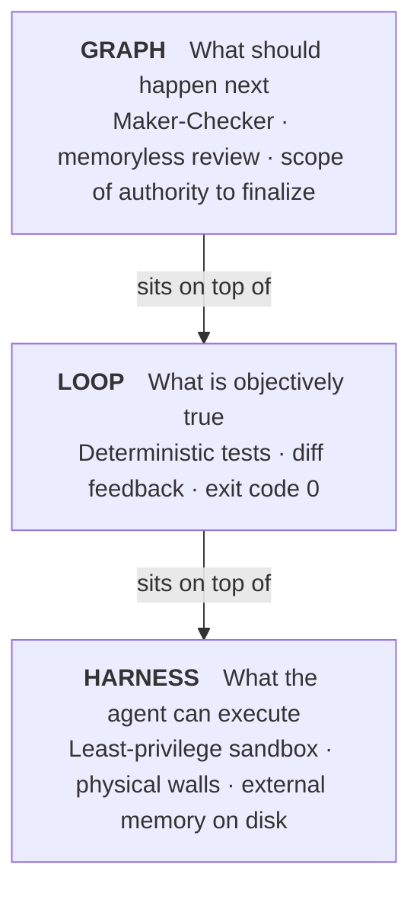
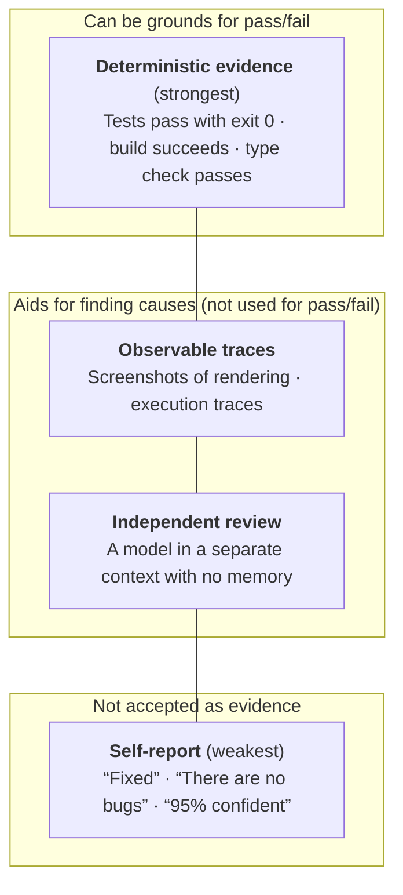
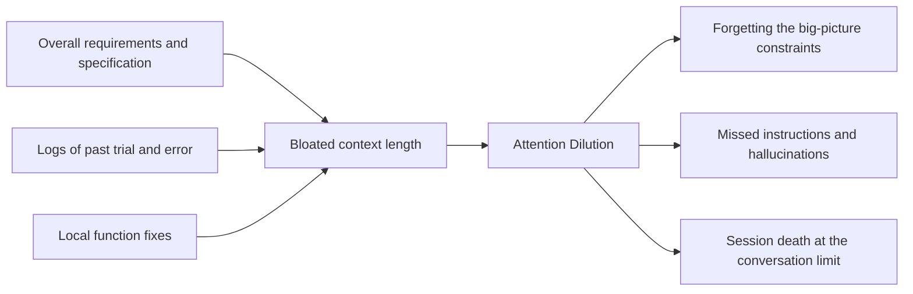
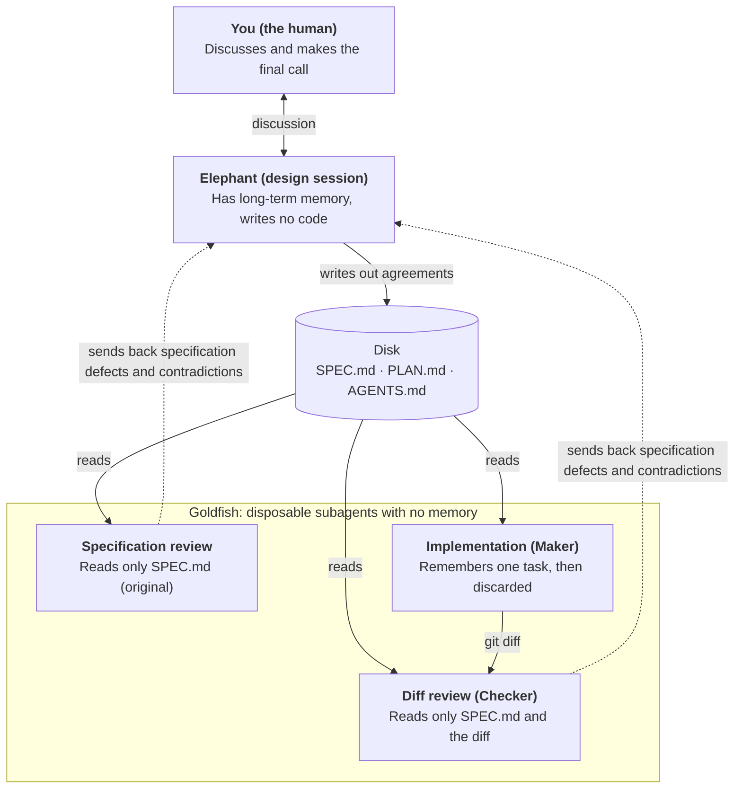
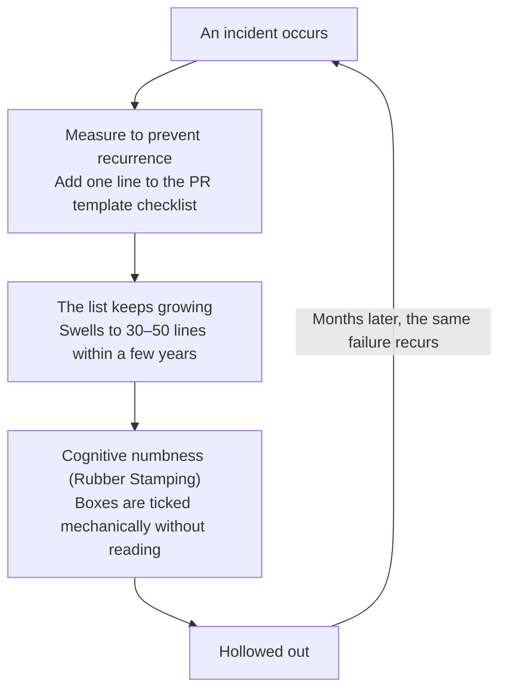
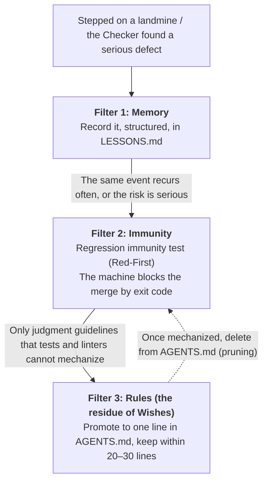
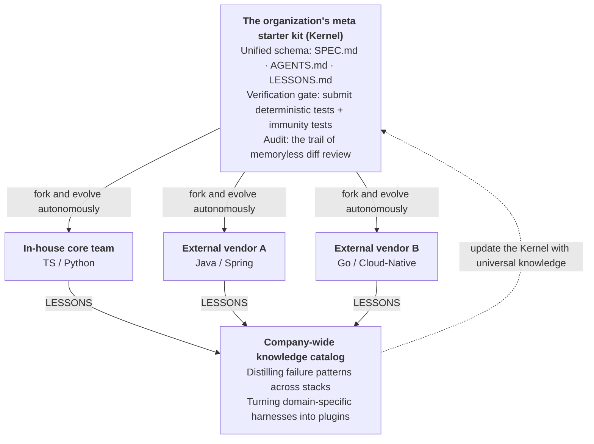

# Redefining Software Engineering for the Age of Autonomous AI Agents

November 2026 · @hamatz

> **English translation.** The Japanese version, [`paper.md`](paper.md), is the canonical text. If the two differ, the Japanese version takes precedence. This translation corresponds to the revision of the Japanese version committed alongside it.
>
> The starter kit described in this paper is in [`kit/`](../kit/). The typesetting tool that appears in the case study, together with its tests, is in [`examples/compositor/`](../examples/compositor/). Code, diagrams aside, is reproduced unchanged from the Japanese version, so comments and messages inside code blocks remain in Japanese.

## Executive Abstract

**From "writer of code" to "harness architect", and an architecture for self-evolving organizations**

With the rise of large language models (LLMs) and agent technology, the bottleneck in software development has moved from the speed of code generation to the cognitive limits of humans who check and glue the work together. The conventional Human-in-the-Loop style (chat UIs) and the norm that "developers must understand every single line of code" were meant to guarantee safety. Faced with astronomically growing software complexity and the automation of cyber threats, they have instead become structural barriers that destroy productivity and the speed of defense.

This paper sets aside that spiritual, willpower-based myth of safety and presents a three-layer architecture, "Harness, Loop and Graph", built around objective evidence that machines can judge (deterministic verification). Drawing on the Elephant-Goldfish Model (EGM) published by Google — a division of labor between a long-context design session that writes no code (the Elephant) and memoryless subagents that review independently (the Goldfish) — it gives a theoretical basis for a cognitive division of labor that extends the Goldfish role from reviewing specifications to implementation and diff review. On that basis, it lays out a design for Level 7 (a self-learning loop), in which past incidents are promoted not into natural-language checklists but into reproduction tests (Immunity Tests).

Finally, for enterprise environments where in-house teams and external vendors work side by side, it proposes a "Federated starter kit" model of organization: instead of forcing a unified technology stack, only the verification protocol is shared, so that knowledge can cross-pollinate and evolve. In doing so, it redefines the source of competitive advantage for next-generation engineering organizations.

## Chapter 1: The State of Autonomous Agent Development and the Human Bottleneck

### 1.1 The inconvenient truth of Human-in-the-Loop, and the human-router problem

With the rapid progress of large language models (LLMs), having AI write code has become an everyday sight in software development. Yet the widely adopted "Human-in-the-Loop" style of development contains a serious structural deception.

It looks as though the human holds the reins and drives the task. In reality, the human has been reduced to the slowest and most expensive glue filling the gaps between development tools and AI models. The typical development loop through a chat UI (a single session) suffers from four pathologies that are, from an engineering standpoint, extremely inefficient.

1. **Cognitive overload from invisible diffs (Diff Blindness)**: When the whole repository or thousands of lines of code are pasted into a chat and a fix comes back as another huge code block, the boundary of the change disappears entirely. The human has to scan and reconcile "what changed and how" with their own eyes. Code the AI produced in seconds is paid for with tens of minutes of human diff checking — the tail wagging the dog.
2. **Degraded intelligence from bloated context (Context Bloat)**: Pouring loosely related files and long error logs into the conversation history quickly saturates the model's finite context. Attention is diluted, and the result is a structural decline in intelligence: design principles agreed at the start are forgotten, instructions are missed, and hallucinations multiply.
3. **Verification as a black box (False Confidence)**: Models often self-report, "I've fixed it. It should work correctly now." But no objective evidence is offered of what tests were run behind that statement. The human trusts the report, builds locally, hits a trivial runtime error, and the cycle of rework repeats.
4. **Inter-process communication through a human (Human as an IPC Cable)**: In the cycle of "copy the error log, paste it into the chat, paste the AI's suggestion into the editor, run the tests again", none of the human's higher intelligence is used. The human wears down their cognitive resources as nothing more than a clipboard and an IPC cable.

A design that puts the human at the center of the loop does not secure safety. It works as the biggest bottleneck, tying the development throughput of the whole system to the raw processing speed of a human being.

### 1.2 From "knowing every line = accountability" to "being able to show the grounds = accountability"

The norm that preserves this human bottleneck and blocks the move to autonomy is the idea that "**developers must understand every line of code**".

In mission-critical fields such as financial institutions, core infrastructure and government, there is a strong objection: "Putting code you don't understand into production is an abdication of accountability to auditors and regulators." This objection is right in that it takes accountability seriously. What this paper questions is not whether accountability is needed, but what it consists of. Having humans read every line is neither the only way nor the most reliable way to fulfill it.

First, **the premise that "humans understand the code line by line" no longer holds in modern software stacks**. Even robust financial systems are built on the Linux kernel, PostgreSQL, cryptographic libraries and thousands of dependency packages. Of course, these are not trusted blindly. There are mechanisms of trust other than reading every line: track records of adoption, selection criteria, monitoring of vulnerability information, SBOMs (software bills of materials) and license checks. In other words, accountability has always been fulfilled not by "having read every line" but by "being able to show the grounds for why something can be trusted".

Generated code, unlike a dependency library, has no track record of adoption. That is exactly why the grounds must be prepared in a more direct form: deterministic tests against the specification, regression immunity tests, memoryless review, and the audit trail of all of these.

Second, there is the speed of defense. Reading the location of a vulnerability from a published fix and writing an exploit is a long-known task, and one that AI agents may well automate further. If defenders insist on reading every line of a patch in weeks of committee meetings, they keep running with a known vulnerability in the meantime. Thicker manual review procedures do not necessarily mean more safety.

What is needed, then, is not to stop human review but **to change what humans read**. Human attention is finite, so it should be concentrated on what machines cannot judge and on what causes the greatest damage when it is wrong.

| Target | Who checks it, and how |
| --- | --- |
| `SPEC.md` (invariants and scope) | A human reads and approves it. If it is wrong, every later check uses the wrong yardstick |
| Diffs of acceptance tests and immunity tests | A human reads them. Machines cannot yet judge whether a test correctly reflects the specification (Section 2.2, item 4) |
| Implementation diffs in high-risk areas (authentication and authorization, payments and accounting, cryptography, data deletion and migrations, public external APIs) | After passing the deterministic gates, a human reads every line |
| All other implementation diffs | Left to the deterministic gates and memoryless review; humans sample them to watch for trends |

With this allocation, an organization can explain to auditors and regulators: "Humans check the specification, the yardsticks and the high-risk areas; everything else is shown through the trail of mechanical verification." Compared with a claim of having read every line, this is, if anything, stronger accountability, because it comes with verifiable grounds.

### 1.3 A paradigm shift from grit and willpower to objective yardsticks

The horizon software engineering should aim for is not to keep up a subjective faith in which "humans read every line of code through sheer grit and convince themselves there are no bugs". It is to move the grounds for correctness from the uncertain cognition of human reading to objective yardsticks that machines can judge.

Yardsticks, however, differ in strength. Formal verification with proof-assistant languages (such as Lean 4) **proves** that a specification is met. Passing tests, on the other hand, is only **evidence** that nothing breaks in the specified cases; it does not show the absence of defects that no test was written for. This paper relies mainly on the latter. Formal verification is the strongest yardstick where the target allows it, but most code in practice will be measured with tests. That is exactly why a mechanism is needed to cover the weaknesses of the yardstick itself (Section 2.2, item 4).

- **Old paradigm (control by willpower)**: "AI output cannot be trusted. Therefore humans must visually check everything and fix things by hand." → Humans burn out, things are missed, and it does not scale.
- **New paradigm (control by engineered harness)**: "AI reasons probabilistically, so it will naturally make mistakes and hallucinate. Therefore, **humans design 'verification rails' (Harness & Loop) that physically block the commit the moment the AI departs from the invariants or the specification, and drive it to correct itself**." → The object of trust shifts from "the model's intelligence" to "the rigor of the verification pipeline".

Engineers must shed the role of "writer of code" and become "harness architects", who objectively define specifications and constraints and tune the environment in which agents run autonomously.

### 1.4 Observations from practice

This section records a case observed in the author's own project. The tool in question is included in this repository at [`examples/compositor/`](../examples/compositor/).

#### Case: fixing layout breakage in a vertical-writing typesetting tool

The author developed a long-form writing tool supporting vertical writing and a paper mode (paged view) together with an agent through a chat UI. Figures split across page boundaries, chapters not starting at the top of a page, particular sections shifted by a few pixels — fixing breakage like this took **more than 20 exchanges, with a screenshot shared every time**.

It is not that the agent had no "eyes". An observable trace, a screenshot of the rendered result, was handed over every time. There were three reasons it still did not converge.

1. **The human was the one taking and handing over the screenshots** — On every round trip, the human built the tool, captured the screen and pasted it into the chat. This is exactly pathology 4 from Section 1.1, "inter-process communication through a human".
2. **A screenshot shows that something is broken, but not where or by how many pixels** — In the hierarchy of evidence it sits below deterministic evidence. Because the pass/fail yardstick was the human eye, the human also had to judge every time whether it was fixed.
3. **There were no tests protecting fixes already made** — A fix would bring back a different breakage that had been fixed earlier. As a result, symptomatic patches piled up in the code. Their traces remain: a three-stage approach (carry the figure forward, switch to padding if it doesn't fit, check once more at the end and push it out) and a process that alternates the placement steps four times until they settle.

**That a check took only 5 minutes was, in fact, the problem** — Each round trip took the human no more than 5 minutes to check, including a simple regression check. Even so, 16 of the more than 20 exchanges were redos because something that should have been fixed was not. These were not recurrences of the same defect, but rework of the form "it looked fixed, but something else broke" or "it was fixed only on some paper sizes". This tool's layout changes across 8 combinations: 4 page sizes × 2 writing directions. A 5-minute visual check cannot cover them all, and if the one or two combinations looked at were correct, the human judged it "fixed".

**Which layer could have prevented it** — Most of the breakage could have been prevented in the Loop layer. "No figure crosses a page boundary" and "every chapter starts at the top of a page" can be judged by an exit code by computing positions, and running them across all 8 combinations adds no human effort. Had this check been put in place as a regression immunity test when the first breakage was fixed, both "something else broke" and "only some sizes were fixed" would have been caught on the spot, and the loop would have become one in which the agent measures and fixes things on its own.

**What could not be mechanized** — On the other hand, judgments such as "it feels cramped when the body text starts right below the caption" or "the space to the left and right of a text wrap looks tight" could not be turned into tests, and the human eye was needed to the end. This is the area where the human remains as the Evaluator described in Section 4.3.

#### Recorded observations

| Item observed | Measured (before introducing the position tests) | Notes |
| --- | --- | --- |
| Round trips to fix layout breakage | More than 20 | Screenshot shared every time |
| Human checking time per round trip | 5 minutes or less | Includes a simple regression check |
| Rework (should have been fixed, but wasn't) | 16 | Includes "looked fixed but something else broke" and "fixed only on some paper sizes" |
| Recurrence of the same defect | 0 | All rework was breakage in a different place or on a different page size |
| Changes sent back by a Checker (reviewer) | Not measured | No Checker was in place at the time |

No comparison figures were taken after introducing the tests. The claims in this paper rest on the observations above, from before the tests, and on the check shown in Appendices 5 and 6: the tool's own output passes, and deliberately broken versions fail. How much the number of round trips actually falls after introduction is outside the scope of this paper's verification.

**If this is measured in the future** — As a metric for whether a self-learning loop is working, Arcos proposes the "repeat-failure rate": the share of the week's failures that are already recorded in `LESSONS.md`. If it approaches zero, learning is taking place. The case in this section, however, is not fully captured by this metric alone. There were zero recurrences of the same defect; all 16 reworks happened "in a different place" or "on a different page size". Beyond protecting fixed breakage, the machine must be made to look at the combinations no one has looked at yet (Appendix 6). Recording, alongside the repeat-failure rate, "the number of defects found only by human visual inspection" shows how coarse the mesh of the checks is.

The next chapter describes in detail the execution infrastructure that puts this idea into practice in real environments: a three-layer architecture of Harness (environment and walls), Loop (objective evidence) and Graph (separation of authority).

## Chapter 2: A Three-Layer Architecture for Agent Execution

In operating autonomous agents, trust should rest not on the model's own probabilistic output (its self-reports) but on the external structure surrounding the model. This external structure must be defined as three layers with clear boundaries of responsibility: Harness (environment and walls), Loop (objective evidence) and Graph (separation of authority).



### 2.1 Harness (environment and walls): from Wish to Wall

Erase the AI model itself from the architecture diagram, and everything that remains of the execution infrastructure — file system, CLI, sandbox, process permissions — is the Harness. The principle of a mature harness is to give the agent only the minimum power it needs and to make deviation physically impossible.

#### 1. The Least-Tool Principle

Adding "convenient tools" to an agent without limit does not raise its intelligence; it makes its judgment wander. In an environment with too many tools, the agent spends its compute on the meta-reasoning of "which tool should I use", and ends up choosing wrongly or causing conflicts. A good harness is narrowed down to a small number of primitive tools with strictly defined inputs and outputs (reading and writing files, minimal shell execution, a test runner). (Any specific upper limit is the author's rule of thumb and varies by model and task.)

#### 2. The decisive gap between Wish and Wall

- **Wish**: Writing "Please do not read `.env` or authentication keys" or "Do not run migrations on your own" in the prompt or a rules file.
- **Interactive prompt**: Asking the human each time, "Open `.env`? \[Y/n\]".
- **Physical wall (Wall)**: Making the target nonexistent from the agent's process, or inaccessible by permission.

A prohibition in a prompt cannot, in principle, rule out the risk that the model breaks it at the end of a long chain of reasoning. Confirmation dialogs induce approval fatigue and decay into "just press Y".

What deserves attention here is that **many settings commonly mistaken for walls are not actually walls**. For example, `.gitignore` only "excludes things from commits"; it does not stop an agent from reading files in its working area. In this paper, a wall means only something that satisfies one of the following.

| Kind of wall | Concrete examples | What it prevents | What it does not prevent |
| --- | --- | --- | --- |
| Make it nonexistent | Keep real secrets only in a secret store and in CI/production; the agent's working area contains only `.env.example` (dummy values). Do not mount secret directories into the container | Reading, leaking into logs, any exfiltration | Nothing (what does not exist cannot be read) |
| Block by permission | OS permissions, file-system restrictions in the sandbox, read-deny settings in the agent tool | Unintended reads | With only tool-side deny settings, workarounds via the shell (a sandbox is assumed alongside) |
| Block at the merge point | Make "passing the required CI checks" a merge condition through branch protection. Run tests, type checks and secret scanning in CI | Unverified code merging into the production line | Temporary deviation within the working area (handled by the Loop) |

A local pre-commit hook is also useful, but because it can be bypassed with `--no-verify`, on its own it counts not as a wall but as an "early warning". The final wall belongs on the server side, where the agent cannot change the settings (rulesets or branch protection, and CI). This works as a wall, however, only if no one is allowed to bypass it (administrators included) and the agent's credentials have no permission to change repository settings, rulesets or workflows. For anyone who can change the settings, the settings are not a wall.

#### 3. Separating RAM (context) from Disk (file system)

An LLM's context window is volatile "RAM". In long-running work, any attempt to keep progress or design specifications in RAM will certainly evaporate with context compression or session switches. A harness must provide a mechanism to move all state that needs to persist onto "Disk".

- `SPEC.md`: the anchor for the unchanging design and invariants
- `PLAN.md`: current task progress and the next move
- `git commit`: checkpoints of state that can be rolled back

Build a structure in which, even if the agent crashes, work can resume immediately just by rereading the files on Disk and the Git history. This is the core function of the harness.

### 2.2 Loop (convergence based on objective evidence): the hierarchy of evidence

When an agent outputs "I've fixed it. It works fine now", a system that takes this at face value and allows the commit does not deserve to be called automation. That is because the strength of the loop equals the strength of the weakest thing the system accepts as evidence of completion.

#### 1. The Hierarchy of Evidence



An agent's self-report is the weakest kind of noise and must not be accepted as evidence that closes the loop. The criterion for accepting code is left to a deterministic fact: whether the test runner returned `exit 0`. Independent review matters, but it cannot replace deterministic evidence; it sits in a position that complements it.

#### 2. The Red-First principle (confirming in advance that a test can fail)

Accepting a test that was already Green before the fix as evidence of passing is meaningless. It is merely evidence that the test checks nothing. Bug-fix and feature loops must require observing the transition: "First write a test that is certain to be Red (Exit 1) against the code before the change, confirm that failure, and then make it go Green (Exit 0) by changing the code."

#### 3. Feedback through primary evidence (artifacts), not natural language

A loop that merely says "the test failed" does not converge. Feedback that brings convergence presents objective artifacts like the following.

- The concrete difference between **EXPECTED** and **SAW** (what was observed)
- The relevant lines of the failing stack trace
- A fence that limits the search area ("restrict the fix to `src/auth/`")

If a failure with the same SAW happens twice in a row, stop the loop immediately (escalate). Repeating the same failure is not a lack of effort; it is evidence that there is an area the model cannot observe, or that the problem setting itself has broken down.

#### 4. Covering the weaknesses of the yardstick itself

When an agent writes both the implementation and the tests, the tests tend to weaken to fit the implementation. Tests that merely trace the implementation, shallow assertions that check nothing, rewriting the expected value of a failing test — all of these return Exit 0. Red-First shows that "this test checks something", but not that "it checks what is needed, thoroughly enough". So the following four mechanisms are applied to the yardstick side as well.

1. **Don't let the Maker write the acceptance tests** — Acceptance tests derived from `SPEC.md` are written on the Elephant's (and the human's) side. Make them readable but not writable from the Maker's context, and require approval from a code owner (a human) for any change to or deletion of existing tests and immunity tests. Close the path of rewriting the tests to make them pass — not with a wish, but with a wall.
2. **Measure the holes in the checks with mutation testing** — Deliberately break the implementation a little at a time (inverting conditions, shifting boundary values and so on) and count whether the tests fail. A mutation that passes despite the breakage marks a place the tests are not looking at. Tools include Stryker (JS/TS), PIT (Java) and mutmut (Python).
3. **Write properties, not examples** — Property-based tests state "this property holds for any input", and the tool searches for counterexamples (fast-check, Hypothesis and others). The checks are less bound to the range of examples the agent happens to think of.
4. **What humans read is not the code but the yardstick** — Move the center of gravity of human review from implementation diffs to diffs of `SPEC.md` and the tests. Whether a test correctly reflects the specification is an area machines cannot yet judge, and it is the work of the human as Evaluator in Section 4.3.

The check of `tests/verify_layout.mjs` in the appendix is a very small manual version of item 2. Running it against deliberately broken versions, one for each combination of page size and writing direction, revealed that the first version did not detect any horizontal-writing breakage at all. The check was fixed and adopted only after confirming that the broken versions failed in every combination (Appendix 5).

### 2.3 Graph (Maker-Checker and separation of authority): memoryless review

Even when deterministic tests pass, they cannot fully prevent architectural decay: "the code has turned into spaghetti", "an unnecessary external library was added carelessly", "over-abstraction that violates YAGNI". Preventing this is the job of the third layer, the Graph, at the core of which is Maker-Checker (separating creation from review).

#### 1. The Self-Blindness Problem of a single agent

Ask the agent that wrote the implementation, "Is there any problem with this code?", and it will, with high probability, pass over its own blind spots. It is caught in the context (bias) it generated itself. Having a different model review while sharing the same conversation history carries those blind spots over too.

#### 2. The Checker must be a memoryless reviewer

The Checker's value lies less in how capable its model is than in **having seen none of the Maker's trial and error**. In the EGM terms described in Chapter 3, the Checker is launched as a Goldfish (a memoryless subagent). An example of the division of roles:

- **Maker (implementation)**: Minimizes scope, writes code against the given task specification and drives the tests to Green. Needs speed, local focus and the ability to run tools (e.g. a Gemini-family model).
- **Checker (review)**: Checks against `SPEC.md`, trims over-engineering and points out latent edge cases. Needs abstract thinking and judgment of overall consistency (e.g. Claude Opus).

The model names are examples as of 2026; the definitions of the roles do not depend on any model. Combining models from different families may also reduce overlapping blind spots, but the more essential factor is the separation of contexts.

#### 3. The diff as the only boundary interface

At the handoff from Maker to Checker, the Maker's work log (its natural-language excuses) must not be passed along. It biases the Checker and lowers the accuracy of the review. The artifacts handed over are limited to **just two: `SPEC.md` (the specification baseline) and `git diff` (the facts of the change)**.

#### 4. The Checker's authority to finalize, and its limits

Give the Checker not just the job of commenting but **the authority to delete unnecessary code and refactor names** (the Pruner). However, the moment the Checker touches the code, it becomes the Maker of that change. So two rules apply.

1. **Duty to re-verify**: Even after the Checker's changes, rerun the verification gate from Section 2.2 and confirm Exit 0 before finalizing.
2. **Scope of authority**: What the Checker may do directly is limited to "deletion" and "renaming and tidying that do not change behavior". If it judges that logic needs to be added or behavior changed, it sends the point back to the Maker.

This closes the loophole of "nobody reviews the reviewer's changes".

Only once this three-layer structure is established does the agent graduate from "a chat tool that runs wild unless a human babysits it" to "a production subsystem that runs autonomously on rails of specifications and tests". The next chapter dissects this structure theoretically from the perspective of the Elephant-Goldfish Model published by Google.

## Chapter 3: A Theoretical Basis in Cognitive Models — Extending the Elephant-Goldfish Model

Underlying the three-layer structure of Chapter 2 is a strategy for allocating compute so as to overcome the cognitive limits of LLMs. This chapter starts from the Elephant-Goldfish Model (EGM), which Google released as open source in October 2026, and extends its division of labor to implementation and diff review. It discusses why a single session breaks down when made to carry both the big picture and the local implementation, and where the boundaries of cognitive responsibility should be drawn.

### 3.1 The limits of depending on a single context, and cognitive breakdown

The most intuitive approach, and the one that leads to the most devastating failures, is **monolithic context operation**: accumulating everything from requirements and design to detailed implementation and test logs inside a single chat session.



#### 1. Attention dilution and the degradation of intelligence

The context window corresponds to human working memory. **"Being able to take something as input" is not the same as "being able to give all of it equally sharp attention"**. When the context fills with redundant trial and error, piles of stack traces and unrelated modules, attention is diluted, and the most important constraints defined at the start — "the invariants of the authentication logic", "naming conventions" — sink into background noise.

#### 2. The "blind iteration loop": eyes but no yardstick

Iteration loops are especially likely in tasks where checking the rendered result is essential, such as e-book typesetting or complex HTML/CSS layouts. When the agent can see only the text representation it generated itself, it cannot observe "how it was actually rendered" (SAW), and keeps changing padding and margin values by guesswork.

But handing it screenshots does not solve the problem. An image can show that something "is broken", but not "where and by how many pixels it is off" or "what counts as fixed". As long as the pass/fail yardstick remains the human eye, the round trips of a human capturing, pasting and judging never end. In the case in Section 1.4, more than 20 exchanges were needed even with a screenshot attached every time.

To close the loop, a yardstick to measure with is needed in addition to eyes to observe with. Write the breakage down as a condition on positions, such as "no figure crosses a page boundary", in a form the agent can run itself and judge by exit code. Use the eyes (observable traces) to look for causes, and decide pass/fail with the yardstick (deterministic evidence).

### 3.2 The original EGM: the elephant designs, the goldfish inspects

EGM is a framework that divides the roles in AI development among three parties: the Elephant, the Goldfish and You (the human).

- **Elephant**: A long-running session that holds a long conversation history and context. It has the big picture of the architecture and the memory of the project, and **writes no code at all**. It concentrates on discussing with the human, recording design intent and fine-grained decisions, and drafting design documents.
- **Goldfish**: A zero-context subagent with no past conversation history. It inspects the specification the Elephant drafted objectively, without the biases of the drafting process, and points out defects.
- **You (the human)**: Answers the Elephant's questions, discusses design choices and makes the final decisions.

The heart of this division of labor is the "asymmetry of memory". Design needs a long context, but inspection is better without one, because an inspector who shares the author's context also shares the author's blind spots.

### 3.3 This paper's extension: using goldfish for implementation and diff review too

This paper extends EGM's principle of the asymmetry of memory beyond the design phase. The original Goldfish inspects the specification; this paper launches Goldfish for three purposes. This extension is this paper's own proposal, not a claim of the original.

| Role | Memory | Input it receives | Output | Relationship to the original |
| --- | --- | --- | --- | --- |
| Elephant (design session) | Long-term: conversation history + external Disk | Discussion with the human, review results | `SPEC.md`, `PLAN.md`, `AGENTS.md` | As in the original, plus writing decisions out to Disk |
| Specification-review Goldfish | None | `SPEC.md` only | Defects and contradictions in the specification | As in the original |
| Implementation Goldfish (Maker) | Only for the duration of one task | One step of `PLAN.md`, an excerpt of the relevant specification, a failing test | A code diff and a record of the tests passing | This paper's extension |
| Diff-review Goldfish (Checker) | None | `SPEC.md` and `git diff` only | A commit that prunes or renames, or a send-back | This paper's extension |



The Goldfish do not read the Elephant's conversation; they read only the Disk. Whichever Goldfish finds a problem with the specification, it goes back to the Elephant.

#### 1. The Elephant's responsibility: the anchor that writes decisions from RAM to Disk

The Elephant writes no code. It agrees with the human on the north star the system should head toward (the Goal) and the boundaries that must not be crossed (the Invariants). The original Elephant uses the long conversation history itself as its memory; this paper additionally requires that **agreed decisions always be written out to external Disk, in `SPEC.md` and `AGENTS.md`**. Even if the Elephant's session is cut off, the invariants on Disk do not waver. Every downstream Goldfish reads only this Disk, not the Elephant's conversation.

#### 2. The implementation Goldfish's responsibility: hyper-focused execution that deliberately lacks unneeded context

The implementation Goldfish is cut off from noise such as the architecture of the whole system and the history of past failures, and **focuses its attention solely on "making this one test in step 3 of `PLAN.md` pass"**. Concern for "future extensibility" or "consistency with other modules" causes over-engineering in a local implementation phase. Give the implementation Goldfish only "a narrow scope, a clear input/output specification and a failing test".

#### 3. The review Goldfish's responsibility: seeing because it knows nothing

The diff-review Goldfish (the Checker of Chapter 2) has seen none of the Maker's trial and error. Because its only inputs are `SPEC.md` and `git diff`, it is not swayed by excuses about "why it was written this way" and looks only at departures from the specification and unnecessary complexity. It performs on code diffs the inspection the original performs on specifications.

### 3.4 Managing the context lifecycle: forced garbage collection

The final key to making this division of labor work is to make the Goldfish's context disposable.

#### 1. Short-lived implementation Goldfish (Ephemeral Subagents)

The moment an implementation Goldfish completes one task, it is discarded together with its context. Continuity of work is secured not by conversation logs but by three finalized artifacts.

1. **`git commit`**: the finalized code diff and message
2. **`PLAN.md`**: the checkbox updated to complete
3. **The objective test log**: the trace of every test passing (Exit Code 0)

#### 2. Review at checkpoints, and feeding back to the Elephant

At the milestone where an implementation Goldfish finishes, a new review Goldfish is launched and reviews by reading only `SPEC.md` and `git diff`. If the review Goldfish judges that "the specification itself is ambiguous or contradictory", that is a design problem, not a code problem. The point is returned to the Elephant (and the human) and settled as a revision of `SPEC.md`.

### 3.5 Relationship to EGM: design to EGM, implementation and verification to this paper's harness

Google publishes the original EGM as a plugin that can be installed in Antigravity, Claude Code, Codex and others. Does installing it make this paper's mechanisms unnecessary? No. The two cover different stages and complement each other.

EGM is a tool for "settling the design before starting implementation". It covers brainstorming the concept, drafting design documents, staged review by reviewers with fresh contexts, resolving the points raised, and reporting drift between design documents and code; approved design documents go into `docs/designs/`. On the other hand, what the Goldfish review is the design document and the source code it refers to, not code diffs. EGM also has no enforcement through CI, hooks or permissions, and EGM itself states that review is no substitute for tests or human judgment.

| Stage | Who covers it | What it involves |
| --- | --- | --- |
| Concept and design | EGM | Brainstorming, drafting design documents, staged memoryless review, human approval, reporting drift between design documents and code |
| From design to specification | Where the two meet | Derive `SPEC.md` (invariants, acceptance tests, definition of done) from the approved design document |
| Implementation | This paper (Harness, Graph) | A working area with no secrets, implementation Goldfish discarded after one task, `PLAN.md` |
| Verification | This paper (Loop, Graph) | Judgment by exit code, Red-First, memoryless diff review with limited authority, CODEOWNERS and branch protection |
| Learning and organization | This paper (Chapters 4 and 5) | Promotion to regression immunity tests, pruning `AGENTS.md`, federated rollout |

The case in Section 1.4 shows this boundary well. The more than 20 round trips arose not from a design error but from the lack of a yardstick to measure whether things were fixed. However much the design is polished, this loop does not stop. What stops it is the Loop of Section 2.2 and the checks in Appendices 5 and 6.

In practice, it works well to leave the design stage to EGM and use the approved design document as the starting point for `SPEC.md`. Into `SPEC.md` go the invariants and the definition of done from the design document that can be turned into acceptance tests. The "specification-review Goldfish" in the table in Section 3.3 is positioned as a minimal substitute when EGM is not used. EGM's "report of drift between design documents and code" can also be used alongside, like the pruning in Chapter 4, as a mechanism for regularly finding gaps between what is written and what actually exists.

From the above, it becomes clear that the phenomenon of "an agent gradually becoming confused over long work" was a confusion between roles that should have memory and roles that should not. Making the Goldfish disposable, however, also erases the trial and error and the know-how for avoiding landmines gained in that session. The next chapter discusses a self-learning loop that overcomes the cost of this forgetting.

## Chapter 4: Reaching Level 7 — A Self-Learning Loop That Keeps Memory from Evaporating

**An autonomous metabolic system that gets past the trap of hollowed-out PR checklists**

Running Goldfish as disposable evaporates what was gained along the way: trial and error, undocumented library behavior, lessons about landmines never to be stepped on again. A state in which the agent repeats the same mistakes every time it crosses a session, and the human keeps raising the same warnings in the prompt, is still short of autonomous operation.

The "Levels" in this chapter follow the maturity stages presented in m4lka (@m4lkxx)'s article "Harness, Loops, Graphs: What Each Layer Fixes and What It Breaks". The article organizes the path from babysitting an agent to running multiple agents into the following eight stages (the table's wording and summaries are this paper's).

| Level | Layer | Name | What becomes possible |
| --- | --- | --- | --- |
| 0 | — | Chat | The human does everything |
| 1 | Harness | Hands | The agent can execute things itself |
| 2 | Harness | Memory | Work can resume midway |
| 3 | Loop | Checks | Mistakes come to the surface |
| 4 | Loop | Feedback | The agent can recover from mistakes on its own |
| 5 | Graph | Shape | Work is split into the right shape |
| 6 | Graph | Gates | Mistakes stop while they are still small |
| 7 | Learning | — | The same mistake never happens twice |

What this chapter aims for is Level 7: a state in which the experience of running tasks and failing is distilled onto disk and automatically fed back into the behavioral norms of the next agent. The article depicts Level 7 as the stage at which learning happens in every layer. This paper makes it concrete as a mechanism that promotes lessons into an executable form, the regression immunity test.

### 4.1 The pathology of human organizations: the tragedy of bloated PR rules

The thing to be most wary of in designing a self-learning loop is **applying to agents, unchanged, the "failure of quality control by checklist" that human development organizations have repeated**.



The essence of this failure is that past lessons were left as natural-language bullet points that depend on human attention. In agent operation too, if past failures keep being appended to rules files or prompts, attention dilution returns and the agent drowns in a sea of instructions. Level 7 self-learning does not mean adding to checklists. It is **a metabolic process that sublimates lessons from "text that demands attention" into "executable code that a machine rejects physically"**.

### 4.2 Three self-promotion mechanisms



#### 1. Filter 1: structured records in a post-incident learning memory (`LESSONS.md`)

When resolving an unexpected error took several retries, or when the diff-review Goldfish (Checker) pointed out a design defect, the agent records the lesson in `LESSONS.md` when the task is complete. To exclude vague impressions, the following schema is enforced.

- **Context**: the file where it happened, the technology used, the concrete situation
- **Trap**: what was misunderstood, and what defect it caused
- **Rule**: the implementation pattern that is recommended or strictly forbidden
- **Rung**: which rung of the table in item 4 of this section the fix was placed on. Aim one rung lower than intuition suggests
- **Immunity Test**: the relative path to the test code that verifies mechanically against recurrence
- **Proof**: a record of reproducing the original failure and confirming that the guard actually fired

`LESSONS.md` is not expanded line by line into the prompt at all times. It works as an "external dictionary" that is searched at the start of a task, consulting only the relevant areas.

#### 2. Filter 2: mandatory regression immunity tests

This is the great watershed that separates this approach from the PR checklist disease of human organizations. When fixing a bug, before writing the fix, the agent first puts in place **a reproduction test that is certain to fail (Exit 1) against the current code** (Red-First). After confirming that the test passes once fixed, the reproduction test is not thrown away as temporary scrap but **kept in the repository permanently as a regression immunity test**.

Running a single test in CI that pokes at an exception prevents recurrence far more reliably than having the agent chant "don't forget the exception handling for X" a hundred times in natural language. Whether or not the agent is conscious of past rules, an "automatic immunity" takes hold in which the required CI check blocks the merge.

#### 3. Filter 3: promotion to the rules file (`AGENTS.md`) and periodic pruning

Only when landmines of the same category appear repeatedly in `LESSONS.md` and cannot be mechanized with tests or linters is the lesson promoted to `AGENTS.md` as a one-line norm. In other words, `AGENTS.md` is the place for "the residue of Wishes that could not be mechanized", and it should be treated with that awareness.

- **The principle of replacing with tests and linters** — Norms that can now be blocked mechanically by type definitions, custom linter rules or unit tests are deleted from `AGENTS.md` immediately.
- **Keep the residue small** — Natural-language norms are always limited to "higher-level design philosophy and attitude that cannot be mechanized", and kept within 20–30 lines (the author's rule of thumb).

#### 4. Where to place a fix, and its "half-life"

Arcos observes that fixes meant to prevent the same failure differ greatly, depending on where they are placed, in "how long it takes for the same failure to come back". He calls this the half-life of a fix and arranges the placements as a ladder of rungs. The following table maps that arrangement onto this paper's terminology.

| Where the fix is placed | How long it stays effective (rough guide) | Position in this paper |
| --- | --- | --- |
| A warning in the conversation | That session only | Wish |
| Written in the prompt | Days | Wish |
| Written in `AGENTS.md` | Weeks | The residue of Wishes (item 3 of this section) |
| Made into a tool (script) | Months | Harness |
| Made into a check (tests, linters, CI) | Until removed | Loop (regression immunity tests) |
| Made into a gate (hooks, permissions, branch protection) | Until removed | Wall |
| Changing the construction itself | Permanently | Wall (making the target nonexistent) |

The three filters in this section (memory, immunity, rules) correspond to grouping this ladder roughly into three. The principle is to push a fix as far down the ladder as it can be kept. The top three rungs of the table all rely on the attention of humans or models, and get buried when the context grows long or the model is replaced. The lower the rung, the more it works without relying on attention.

#### 5. Pruning should be based on evidence

The pruning in item 3 of this section was "delete natural-language norms once they are mechanized". There is another kind of pruning: deleting the guard itself. Guards consume tokens, waiting time and the agent's attention, and can even get in the way of other solutions a smarter model would find on its own. Vercel reported that it cut the dedicated tools of its internal data-analysis agent from 17 to 2, and that on five representative queries success rate, speed and token usage all improved. The sample is small, but it shows that continually adding guards and tools is not always right.

The decision to delete must, however, also be based on evidence. Each time the model is updated, check with the following procedure.

1. Remove one low-risk guard
2. Reproduce the original failure that guard was created for (run the Immunity Test in `LESSONS.md`)
3. If it still fails, put the guard back. If it no longer fails, delete it and record the reason in `LESSONS.md`

Guards concerning permissions, secrets and connections to production are not removed automatically, even with this procedure. Agents may tighten guards, but only humans may loosen them — the same principle as item 4 of Section 2.2.

### 4.3 The changing role of humans: to Evaluator and Rule Pruner

Once the Level 7 self-learning loop is running, humans are no longer the "glue" that copies and pastes error messages from right to left, nor a "human linter" that reads diffs line by line. Human responsibility moves to two meta-domains.

1. **Designer of the evaluation function (Evaluator)**: Defining in `SPEC.md`, as conditions, what counts as "success", and refining it through discussion with the Elephant. Watching that the agent is not taking loopholes that deceive the tests (specification gaming).
2. **Tuner of the rules (Rule Pruner)**: Regularly surveying what has accumulated in `LESSONS.md`, cutting away natural-language norms that are no longer needed, and distilling only the essential knowledge into the harness.

By entrusting the generation and fixing of code to the agent's own objective loop, humans move to "the side that designs the system's self-evolution mechanism itself". The next chapter scales this self-learning loop up to the whole company and organization.

## Chapter 5: Into Organization Theory — Distributed Evolution of Starter Kits and Cross-Pollination of Knowledge

**A federated ecosystem for enterprises that mix in-house and outsourced development**

The mechanisms up to Chapter 4 deliver dramatic productivity and safety in a single repository or a small team. When one tries to roll them out across a whole company, however, one runs into "the walls of organizational structure". Different technology stacks exist for core systems, front ends, data platforms and mobile, and a "hybrid structure of in-house and outsourced development" with multiple external system integrators and vendors is the norm.

### 5.1 The illusion of a fully unified technology stack, and the collapse of centralized control

The first trap in a company-wide rollout is "forcing a single company-standard toolchain and a single language stack". This centralized control collapses in the face of the following realities.

1. **Damage to domain optimization and vendors' strengths**: There are clear reasons why Go or Java is chosen for low-latency processing and accounting systems, Next.js for web front ends, and Python for data pipelines. External partners, too, are most productive in the stacks they know best. Imposing a single stack destroys productivity in the field at its root.
2. **Hollowed-out rules and a bottleneck at the center**: Different technology stacks mean different characteristics of generated code and different quirks of dependency libraries. Abstract rules that do not fit the field are hollowed out immediately, and when the center cannot keep up with requests for exceptions, the promoting organization itself becomes the bottleneck.
3. **The fragility of a "winner takes all" model**: A selection model that makes the starter kit of the single most successful team the company standard falls into the trap of local optimization. A kit optimized for web development is fatally ill-suited to core batch systems or security-critical work.

What should be aimed for is a "Federated model" that preserves the autonomy of each team and technological diversity while raising, in an integrated way, only the immunity of the organization as a whole.

### 5.2 Standardize the verification protocol, not the stack

The only area that should be unified across the organization is "the meta-container for running agents, verifying their work and drawing up knowledge" — the Verification Protocol.



The "meta starter kit (Kernel)" distributed by the center (a Platform Engineering organization or a CoE) is not a particular code template. It defines only the following three interface conventions.

#### 1. A unified schema for input and output artifacts

- `SPEC.md`, which defines the system's invariants
- `AGENTS.md`, which holds the residue of norms that cannot be mechanized
- `LESSONS.md`, which turns the structure of failures into a dictionary

Fix the location and schema of these three files across the company. Whether the internal language is Java or Rust, standardize the "shape of the procedure" by which agents read the specification, follow the norms and record failures.

#### 2. Turning the Definition of Acceptance into a mechanical protocol

Rethink the business practice of "humans review every line of the delivered source code and stamp their acceptance", and make the submission of objective artifacts the condition for acceptance. However, following the hierarchy of evidence in Section 2.2, **distinguish deterministic evidence from supporting evidence**.

| Category | Deliverable | Treatment at acceptance |
| --- | --- | --- |
| Required (deterministic evidence) | Deterministic tests for every specification in `SPEC.md` passing completely (Exit Code 0). Execution logs from CI managed by the ordering party | Rejected if even one is missing |
| Required (deterministic evidence) | Commit history of regression immunity tests for defects found during development (including records that they were Red before the fix) | Rejected if even one is missing |
| Supporting evidence | Logs of memoryless diff review (Checker) and records of how the points raised were handled | Not used as grounds for pass/fail. Humans sample them to check trends in the points raised |

Tests are run not on the vendor's machines but **in CI managed by the ordering party**. By making reproducibility in the ordering party's environment the condition for acceptance, rather than trusting submitted logs, the logs themselves are kept from becoming self-reports. The ordering party is freed from the heavy labor of reading code in languages it does not use line by line, and can concentrate on auditing "whether the harness is functioning soundly and the deterministic evidence is complete".

#### 3. A common format for structured data about failures (meta-knowledge)

Have each team describe the landmines (Traps) and lessons (Rules) it encountered as structured data that can be synchronized to a company-wide registry.

### 5.3 Federated evolution: distributed exploration and cross-pollination of knowledge

#### 1. "Distributed exploration" in each team (Fork & Local Adaptation)

Each team starts its project by forking the central Kernel and lets it evolve in its own way according to its technology stack and business characteristics. A front-end team hones a harness that verifies layout breakage with a headless browser; a core-systems team evolves a stress-test harness that detects exhausted DB connection pools and deadlocks. By running agents simultaneously in diverse settings, the organization as a whole can mine patterns of failure and success in countless environments in parallel.

#### 2. Promoting universal knowledge to the core Kernel (Distillation)

Knowledge in each project's `LESSONS.md` that applies across technology stacks is returned to the central Kernel and becomes a company standard. Even across different stacks, the essence of serious landmines is shared.

- Missing retries with exponential backoff and timeout cutoffs in communication with external APIs
- Gaps in guaranteeing idempotency in distributed environments
- Risks of secrets being expanded into memory or written to logs

A landmine stepped on by vendor A's agent, working in Java, is abstracted and reflected by the next day in the agent environment of an in-house team working in Python.

#### 3. Cataloging domain-specific harnesses and sharing them as plugins

Deep, language-dependent knowledge and particular verification scripts (for example, `tests/verify_layout.mjs` in the appendix) are not forced into the company-wide core. Instead, they are registered in an internal registry as a "verification plugin catalog". A team starting up with a similar stack can import a proven harness from the catalog and immediately gain strong defenses.

### 5.4 The Compounding Organization

Know-how from the field that used to scatter when a project ended is, with this model, accumulated for the first time as **a machine-readable organizational asset**. Even if the code an external vendor writes is specific to the project, `LESSONS.md`, the regression immunity tests and the verification harnesses remain as permanent assets in the ordering party's central registry. (Their ownership and the scope of sharing among vendors need to be settled in advance by contract.)

With every project launched and every collaboration with an external partner, the company's starter kits grow smarter and more resilient. The organization's experience of failure keeps being converted into "living code and rules" that are not forgotten as people come and go. This is **the competitive advantage of a self-evolving engineering organization**, which competitors that have merely introduced AI tools cannot catch up with.

## Chapter 6: Conclusion — Redefining Software Engineering, and a New Competitive Advantage

Now that automatic code generation has reached practical use, what we face is "redesigning the very engineering mechanisms that guarantee software quality, safety and productivity".

### 6.1 From "writing code" to "tuning the meta-system"

Software engineering used to resemble a craftsman laying bricks by hand, one course at a time. Organizational governance was the work of humans inspecting the arrangement of those bricks by eye and stamping their approval (manual review of every line). But the growing complexity of software and the automation of cyber threats have broken the premise of this manual work.

- **Traditional software engineering**: Engineering in which code is derived directly from requirements and humans subjectively vouch for its correctness.
- **Next-generation software engineering**: **Meta-Engineering** — defining the invariants to be satisfied (SPEC) and the physical constraints (Harness), and building and tuning objective verification loops (Loop & Graph) in which agents converge on code autonomously.

The engineer's main battlefield has moved from "writing code" to "laying rails from which AI cannot depart from the specification". The source of trust lies not in the model's whimsical intelligence but in **the rigor of the deterministic verification gates** surrounding the model, and in **the correct separation of roles that have memory from roles that do not**.

### 6.2 Redefining organizational competitiveness: from model superiority to the "metabolic rate of the loop"

State-of-the-art foundation models are a commodity anyone can use through an API. The advantage gained merely by subscribing to the latest model disappears within months. What creates the real gap is the maturity of organizational knowledge: whether a company's design philosophy, security rules and lessons from past failures have been turned into "executable protocols" along which agents can run without getting lost.

This is not speculation. LangChain improved only its harness without changing the model (gpt-5.2-codex), raised its Terminal Bench 2.0 score from 52.8% to 66.5%, and pushed its ranking from outside the top 30 into the top 5 (as of the February 2026 announcement). The core of the improvement was a mechanism that has the agent verify against the specification just before finishing, and detection of loops that keep editing the same file. In the 2024 SWE-agent study, too, using the same GPT-4 Turbo, an interface designed for agents solved 64% more tasks, in relative terms, than a bare shell. A team at OpenAI reported that, without humans writing code directly, it had Codex produce a repository of about one million lines and about 1,500 pull requests in roughly five months. What was emphasized there, too, was ingenuity on the harness side: a short `AGENTS.md` of around 100 lines, and custom linters whose error messages include how to fix the problem.

1. **Difference in starting point**: An organization that runs agents from day one of a project with accumulated landmine-avoidance measures and automatic verification harnesses built in, versus an organization that types instructions into a chat from scratch every time.
2. **Difference in metabolic rate**: An organization in which one team's defect is immediately converted into a regression immunity test and shared with every agent across the company and all vendors by the next day, versus an organization in which the same failure recurs again and again in different places.

The real asset is the rotational speed of the loop that learns from failures and feeds them back into the behavioral norms of the agents (the Compounding Feedback Loop) itself.

### 6.3 Closing remarks

From an engineering standpoint, the debate over "whether AI will take human jobs" is already out of focus. What should be asked is whether humans can shed the task of "writing code" and leap with their intelligence to "designing systems of constraint, verification and evolution".

Stop reviewing every line by grit and willpower. Move what humans read to the specifications, the yardsticks and the high-risk areas, and entrust everything else to rails of mechanical verification based on objective evidence. Entrust the memory of design to the elephant, and implementation and review to goldfish without memory. And grow federated starter kits that sublimate the failures of individual teams into the immunity of the whole company. The development organizations that accept this discipline are the ones that will lead creativity in the next-generation digital society.

## Appendix: Starter Kit Samples

A set of templates that can be placed as-is when setting up a repository, to start operating right away. The same files are included in this repository's [`kit/`](../kit/) (the typesetting-specific checks in Appendix 6 are in [`examples/compositor/`](../examples/compositor/)). The structure **puts the mechanisms that enforce rules into the machine (the Wall), and writes into the rules file only the residue that cannot be mechanized**. The samples below are taken from the repository (some explanatory comments are omitted), so their contents and comments are in Japanese.

### Directory layout

```text
.
├── AGENTS.md             # エージェントへの指示（業界共通の置き場所）。機械化できない規範の残余と、機械側の強制箇所の索引
├── SPEC.md               # 仕様・不変条件・スコープ定義書（Elephantが起草）
├── PLAN.md               # 現在のタスク進捗と次の一手
├── LESSONS.md            # 自己治癒メモリ（やらかし・教訓・置き場所・免疫テスト・作動確認）
├── tests/
│   ├── verify_ui.mjs     # UI の汎用検証：ブラウザのエラーを Exit Code で判定
│   ├── verify_layout.mjs # 組版を扱う場合：紙面の不変条件（図版のページまたぎ・章の改ページ）を判定
│   └── verify_matrix.mjs # 組版を扱う場合：判型×組方向の全組み合わせを書き出して verify_layout に掛ける
├── .github/
│   ├── CODEOWNERS        # 壁：テスト・ゲートの変更に人間の承認を求める（ルールセットで必須化して初めて効く）
│   └── workflows/
│       └── verify.yml    # 壁：マージ条件となる必須チェック
├── .env.example          # ダミー値のみ。本物の .env は作業領域に存在させない
└── .gitignore            # 誤コミット防止（壁ではない）
```

### Where the walls are

| What to protect | Wall (enforced by machine) | Supporting measures (not walls) |
| --- | --- | --- |
| Keep secrets from the agent | Real secrets do not exist in the working area or container. Development uses dummy values in `.env.example`; the real ones live only in the secret stores of CI and production | Read-deny settings in the agent tool, `.gitignore` |
| Keep secrets from being committed | Make CI secret scanning a required check | Local pre-commit hooks |
| Keep unverified code from merging | Use branch protection to make passing the `verify` workflow a merge condition, with no exception for administrators | The explanation in AGENTS.md |
| Keep the agent from rewriting the gates and tests | Require approval from a code owner (a human) for changes to `.github/`, acceptance tests, immunity tests and protection settings. Allow no one to bypass this, and give the agent's credentials no permission to change settings or rulesets | None |

### 1. `SPEC.md` (the contract for specifications and invariants)

Drafted by the Elephant session in discussion with the human, and finalized after inspection by the specification-review Goldfish. When EGM is used for the design stage, extract from the approved design document (`docs/designs/`) the invariants and the definition of done that can be turned into acceptance tests (Section 3.5).

```markdown
# Product Specification & Invariant Contracts (SPEC.md)

## 1. 概要 (Overview)
- プロジェクト名称: [プロジェクト名]
- 目的 / 解決する課題: [1-2文で簡潔に記載]
- 想定ユーザー & 利用形態: [ローカル完結CLI / シングルページWeb / マイクロサービス等]

## 2. コア要件 (MVP Scope)
- [ ] 機能A: [入力条件] に対して [期待される出力・状態変化] を返す
- [ ] 機能B: 外部DB/認証サーバーに依存せず、ローカルで永続化する
- [ ] 機能C: [キーボード操作 / APIエンドポイント] のサポート

## 3. 非機能要件・絶対制約 (Constraints & Out of Scope)
- スコープ外: クラウド認証の独自実装 / 重厚なUIライブラリの無断導入 / 過剰な分散アーキテクチャ
- 技術スタック制約: [例: TypeScript (Node.js v20+ / ESM)]
- 依存ライブラリ方針: 新規パッケージ追加時は理由を PLAN.md に記録すること

## 4. 厳格な不変条件 (System Invariants)
1. データ整合性: オフラインでも読み書きが完結し、クラッシュ時にデータが破損しないこと
2. 境界値防御: 不正な入力に対してクラッシュせず、適切なエラーを返すこと
3. 機密遮断: ログ、UI、テストに機密情報・APIキー・個人情報が出力されないこと

## 5. 完了定義 (Definition of Done)
- CIの verify ワークフローがすべて成功していること（ローカルでの成功は完了の証拠にならない）
```

### 2. `AGENTS.md` (the residue of norms and an index of where enforcement lives)

Instructions to the agent go in `AGENTS.md` at the root of the repository. `AGENTS.md` is a common format for agent instruction files, managed by the Agentic AI Foundation under the Linux Foundation. It is read by Codex, Cursor, Gemini CLI, GitHub Copilot, Jules and others, and Antigravity has read it since v1.20.3 (March 2026). Writing instructions in a tool-specific location such as `.antigravity/rules.md` means they cannot be carried into teams that use a different tool under the federated model of Chapter 5. For tools that read their own file names (`GEMINI.md`, `CLAUDE.md` and so on), have that file refer to `AGENTS.md` rather than keeping two copies of the content.

```markdown
# Agent Execution Rules

本ファイルは2部構成である。
第1部は「機械が強制していること」の索引であり、守らせる仕組みは本ファイルの外にある。
第2部は、機械化できていない規範の残余（Wish）である。
第2部の項目が機械化できた時点で、その項目は第1部へ移すか削除する。

---

## 第1部：機械で強制済み（参照のみ）
- 検証ゲート: .github/workflows/verify.yml（型検査・リンター・テスト・シークレットスキャン）。
  通過しないコードはブランチ保護によりマージできない。
- 機密: 本物の .env は作業領域に存在しない。.env.example のダミー値を使うこと。
- ゲートとテストの変更: .github/、受入テスト、免疫テストの変更・削除は人間のコードオーナー承認が必須。
  テストを書き換えて通すことはできない。

---

## 第2部：機械化できない規範（Wish の残余。20〜30行以内に保つ）

### 実装（Maker）
1. タスクの解決に必要最小限のコードのみを変更する。SPEC.md にない抽象化・機能追加をしない。
2. 既存のテスト、公開インターフェース、型定義を独断で変更しない。必要なら PLAN.md に理由を書いて止まる。
3. 作業は PLAN.md の1ステップごとに [実装 → 検証 → コミット] を完結させる。
4. バグ修正では、修正前に失敗する再現テストを書き、失敗を確認してから修正する（Red-First）。
5. 同一の失敗が2回続いたら、修正を止めて状況を PLAN.md に記録する。

### 査読（Checker）
6. 入力は SPEC.md と git diff のみ。実装時の会話ログは読まない。
7. 直接行ってよいのは、不要コードの削除と挙動を変えない改名・整理のみ。
   ロジックの追加・挙動の変更が必要なら、指摘として差し戻す。
8. 直接修正した場合は、検証ゲートを再実行して成功を確認してから確定する。
9. 仕様そのものの曖昧さ・矛盾を見つけたら、コードではなく SPEC.md の問題として報告する。

### 学習（Level 7）
10. 着手前に LESSONS.md を検索し、関連する Trap を確認する。
11. 2回以上手こずった問題、Checkerに重大な指摘を受けた問題は、完了時に LESSONS.md に記録する。
```

### 3. `LESSONS.md` (self-healing memory)

The second entry records the case from Section 1.4 in this format.

```markdown
# Repository Lessons Learned (AI Operational Memory)

## 記録フォーマット
### [YYYY-MM-DD] 事象の簡潔な要約
- Context: 対象ファイル、利用ライブラリ、作業内容
- Trap: 何を誤認し、どのような不具合を引き起こしたか
- Rule: 今後とるべき実装パターン（推奨/禁止）
- Rung: 修正の置き場所（会話 / プロンプト / AGENTS.md / 道具 / 検査 / 関門 / 作り）。直感より一段下を目指す
- Immunity Test: 再発を機械的に防止するテストのパス
- Proof: 元の失敗を再現し、ガードが作動したことを確かめた記録

## 恒久教訓インデックス

### [記入例] 非同期処理とトランザクションのスコープ
- Context: IndexedDB 操作全般
- Trap: transaction のスコープ内で外部の fetch を await したため、トランザクションが自動コミットされ例外が発生した
- Rule: トランザクション内に非同期I/Oを混在させない。必要なデータを取得し終えてから書き込む
- Rung: 検査
- Immunity Test: tests/storage_transaction.test.ts
- Proof: 修正前のコードでこのテストが失敗することを確認済み

### [記入例] 縦組み紙面で図版がページをまたぐ
- Context: 紙面モード（ページ送り）の組版。図版・コード図版を本文に回り込ませる処理
- Trap: 図版の前に余白を足して次のページへ押したところ、本文がその余白まで避け、別の図版が境目をまたいだ。
  スクリーンショットで確認しながら直したため、直した崩れが別の修正で崩れ、一部の判型でだけ直っていることもあり、20回以上往復した
- Rule: 図版は余白で押さず、本文中のページの切れ目まで運ぶ。運べないときだけ詰め物を挿む。
  合否は目視ではなく位置の検査で決め、全判型・全組方向（8通り）に掛ける
- Rung: 検査（CI の必須チェック）
- Immunity Test: tests/verify_layout.mjs、tests/verify_matrix.mjs
- Proof: 8通りすべてで、壊した版が Exit 1 になることを確認済み（付録5・6）
```

### 4. `.github/workflows/verify.yml` (Wall: the required check)

This workflow becomes a wall only once it is designated as a required status check in a ruleset (or branch protection). Placing the file alone does not make it a wall.

```yaml
name: verify
on:
  pull_request:
  push:
    branches: [main]

jobs:
  verify:
    runs-on: ubuntu-latest
    steps:
      - uses: actions/checkout@v4
        with:
          fetch-depth: 0
      - uses: actions/setup-node@v4
        with:
          node-version: 20
      - run: npm ci
      # 以下3つはプロジェクトに合わせて置き換える（例は TypeScript）
      - run: npx tsc --noEmit
      - run: npm run lint
      - run: npm test
      - name: Secret scan
        uses: gitleaks/gitleaks-action@v2
        env:
          GITHUB_TOKEN: ${{ secrets.GITHUB_TOKEN }}
          # 組織アカウントのリポジトリでは無料のライセンスキーが必要（個人アカウントでは不要）
          # GITLEAKS_LICENSE: ${{ secrets.GITLEAKS_LICENSE }}

      # --- UI を持つリポジトリの場合 ---
      # - run: npx playwright install --with-deps chromium
      # - run: npm start &                                  # 検査対象を起動する
      # - run: node tests/verify_ui.mjs http://localhost:3000
      # 画面の正しさは、プロジェクトごとに測れる条件を足す。組版のように組み合わせで
      # 結果が変わるものは、全組み合わせを機械に掛ける（examples/compositor/tests/ を参照）
      # - if: failure()
      #   uses: actions/upload-artifact@v4
      #   with:
      #     name: test-results
      #     path: test-results/
```

### 5. `tests/verify_layout.mjs` (a verification script for typesetting: judge by yardstick, not by appearance)

The starter kit includes a generic `tests/verify_ui.mjs` that checks only for browser errors. For the "correctness" of the screen itself, each project adds conditions it can measure. As an example, this section shows a script that checks the page invariants of the typesetting tool.

Following "eyes for finding causes, a yardstick for pass/fail" from Section 3.1, this script checks the typesetting invariants by computing positions and judges by exit code. It takes a screenshot but does not use it for pass/fail. A check that looks only at console errors lets layout breakage like the case in Section 1.4 pass straight through.

- **Conditions checked** — Zero browser errors. In paper mode, no figure, code figure or table crosses a page boundary, every chapter of the main body starts at the top of a page, and no subheading is stranded at the bottom of a page.
- **How failures are reported** — For each violation, an EXPECTED and SAW pair is printed (the primary evidence of Section 2.2). From this output alone, the agent knows which figure overflowed by how many pixels on which page, and can fix it itself.
- **Implementation notes** — The `.mjs` extension removes the need to declare ESM. Instead of the deprecated `networkidle`, it waits for fonts to finish loading (because the typesetting is redone after fonts load). The path of an exported HTML file can also be passed directly.

**Confirmed with Red-First (4 page sizes × 2 writing directions)** — A test book (3 chapters, 12 code figures) was exported from the author's typesetting tool in 8 combinations: A4, B5, A5 and A6 × vertical and horizontal. Deliberately broken versions were prepared and run against each. The results are in the following table.

| Version run | Vertical (4 page sizes) | Horizontal (4 page sizes) |
| --- | --- | --- |
| The tool's own output | Exit 0 for all | Exit 0 for all |
| Version with page alignment and figure carrying disabled | Exit 1 for all (9–11 violations) | Not applicable (the process is not used in horizontal writing) |
| Version with chapter page breaks removed | — | Exit 1 for all (2 chapters) |
| Version with code figures taller than a page | — | Exit 1 for all (12 figures) |

**The hole in the yardstick was found by breaking the yardstick** — The first version of the script had been checked only on vertical A5. Run on horizontal writing, it returned Exit 0 even for the version with chapter page breaks removed. In horizontal writing, one page is one column of a multi-column layout, and every element starts at the column's left edge, so a check that looks only at horizontal position sees no difference. The check was fixed to judge horizontal writing by "distance from the top of the column" and "whether a box is split across several columns", giving the results above. The "weakness of the yardstick itself" from item 4 of Section 2.2 had happened in this very test. Had it not been confirmed that broken versions fail, a test that detected no horizontal-writing breakage at all would have kept returning Exit 0.

**Breakage the yardstick did not measure, found in a real manuscript** — Later, an internal booklet (5 tables, about 30 subheadings) was typeset with this tool. It passed all 8 checks, yet looking page by page revealed a table split across two pages and subheadings stranded at the bottom of a page in 4 places. The checks measured only figures and chapters, and the test book had no tables or subheadings, so neither had ever been tried. So first "no table crosses a page boundary" and "no subheading is stranded at the bottom of a page" were added to the checks, it was confirmed that the booklet failed in all 8 combinations with the unfixed tool, and only then was the tool fixed. A chapter with tables and subheadings was also added to the test book, and the self-test now confirms that versions which stop pushing them to the next page fail only the 4 vertical or 4 horizontal combinations respectively. A yardstick guarantees correctness only within what it measures. What prompted widening that range was a real manuscript outside the checks, and the human eye.

```javascript
/**
 * examples/compositor/tests/verify_layout.mjs
 * 組版（紙面モード）の検証ゲート。合否は「見た目」ではなく、測れる条件で決める。
 * 汎用のブラウザエラー検査（kit/tests/verify_ui.mjs）に、Compositor の紙面の不変条件を足したもの。
 *   1. ブラウザのエラーが 0 件（コンソール・未捕捉例外・読み込み失敗）
 *   2. 紙面モードのとき、組版の不変条件を満たす
 *      - どの図版・コード図版・表もページの境目をまたがない
 *      - 本編の章はページの頭から始まる
 *      - 小見出しがページの末尾に取り残されない（見出しと続く本文が同じページに載る）
 * スクリーンショットは人間が原因を探すための補助で、合否には使わない。
 *
 * 準備: npm install -D playwright && npx playwright install chromium
 * 実行: node examples/compositor/tests/verify_layout.mjs <書き出したHTMLのパス>
 */
import { chromium } from 'playwright';
import fs from 'node:fs';
import path from 'node:path';
import { pathToFileURL } from 'node:url';

const arg = process.argv[2] || 'http://localhost:3000';
const target = /^https?:\/\//.test(arg) ? arg : pathToFileURL(path.resolve(arg)).href;
const OUT_DIR = path.resolve('test-results');
// スクリーンショットは入力ごとに別の名前で残す（8通りを続けて検査しても上書きしない）
const name = (/^https?:\/\//.test(arg) ? arg.replace(/^https?:\/\//, '') : path.basename(arg, path.extname(arg)))
  .replace(/[^A-Za-z0-9._-]+/g, '_').slice(0, 80) || 'page';
const SHOT = path.join(OUT_DIR, name + '.png');
const TOL = 1; // px。丸め誤差の許容幅
// CI でネットワークに出られない場合、Web フォントの取得失敗はエラーに数えない
const IGNORE = [/fonts\.(googleapis|gstatic)\.com/];
const ignored = (url) => IGNORE.some((re) => re.test(url));

fs.mkdirSync(OUT_DIR, { recursive: true });
const browser = await chromium.launch();
// 紙が縮小表示されない大きさにしておく
const page = await browser.newPage({ viewport: { width: 1600, height: 1400 } });

const errors = [];
page.on('console', (m) => {
  // 読み込み失敗はコンソールにも出るが、URL は location() にしか入っていない
  if (m.type() === 'error' && !ignored(m.location().url || '')) errors.push('console: ' + m.text());
});
page.on('pageerror', (e) => errors.push('uncaught: ' + e.message));
page.on('requestfailed', (r) => { if (!ignored(r.url())) errors.push('request failed: ' + r.url()); });
page.on('response', (r) => { if (r.status() >= 400 && !ignored(r.url())) errors.push('HTTP ' + r.status() + ': ' + r.url()); });

let failures = [];
try {
  const res = await page.goto(target, { waitUntil: 'load', timeout: 15000 });
  if (res && res.status() >= 400) throw new Error('HTTP ' + res.status());
  // ページ送りの組版処理はフォント読み込み後にやり直されるので、それを待つ
  await page.evaluate(() => document.fonts.ready);
  await page.evaluate(() => new Promise((r) => requestAnimationFrame(() => requestAnimationFrame(r))));
  await page.screenshot({ path: SHOT, fullPage: true });

  failures = await page.evaluate((TOL) => {
    const out = [];
    const stage = document.querySelector('.stage');
    const flow = document.querySelector('.flow');
    const reel = document.querySelector('.reel');
    // 紙面モードでなければ組版の検査はしない
    if (!stage || !flow || !reel || !reel.firstElementChild) return out;
    const vert = document.documentElement.classList.contains('vertical');
    const m = (stage.style.transform || '').match(/scale\(([\d.]+)\)/);
    const z = m ? parseFloat(m[1]) : 1;
    const w = flow.getBoundingClientRect().width / z; // 1ページの幅
    const ref = reel.firstElementChild.getBoundingClientRect();
    // 本文の先頭から見た位置。縦組みは右から左へ進む
    const startOf = (el) => {
      const b = el.getBoundingClientRect();
      return (vert ? ref.right - b.right : b.left - ref.left) / z;
    };
    const pageOf = (x) => Math.floor((x + TOL) / w) + 1;
    // ページ内の位置。境目のわずか手前（丸め誤差の範囲）は、pageOf と同じく次のページの頭として扱う
    const inPage = (x) => { const r = ((x % w) + w) % w; return w - r < TOL ? 0 : r; };
    const label = (el) => {
      const t = el.querySelector('figcaption, .bar');
      return ((t && t.textContent) || el.className || el.tagName).trim().slice(0, 40);
    };

    const figures = [...reel.querySelectorAll('figure, .code')].filter((el) =>
      !el.closest('.footnotes, .outline') &&
      !(el.parentElement && el.parentElement.closest('figure, .code'))); // 入れ子は外側だけ
    const tables = [...reel.querySelectorAll('.prose table')];
    // 図版と表は「ページの境目をまたがない」で同じ測り方をする。規則の名前だけ分けて出す
    const boxes = [...figures.map((el) => [el, '図版がページの境目をまたがない', label(el)]),
                   ...tables.map((el) => [el, '表がページの境目をまたがない',
                     ((el.rows[0] && el.rows[0].textContent) || 'table').replace(/\s+/g, ' ').trim().slice(0, 40)])];
    // 小見出しと、その直後の要素。直後が無い（節の末尾の）見出しは対象外
    const headings = [...reel.querySelectorAll('.prose h3, .prose h4')]
      .filter((h) => h.nextElementSibling)
      .map((h) => [h, h.nextElementSibling, h.textContent.trim().slice(0, 40)]);
    const chapters = reel.querySelectorAll('section.movement:not(.frontmatter)');
    const chapterName = (el) => { const h = el.querySelector('h2'); return (h && h.textContent) || el.id; };

    if (vert) {
      // 縦組み：ページは右から左へ並ぶ。位置は「本文の先頭からの横の距離」で測る
      for (const [el, rule, what] of boxes) {
        const s = startOf(el);
        const wid = el.getBoundingClientRect().width / z;
        const rem = inPage(s);
        if (rem + wid > w + TOL) {
          out.push({
            rule,
            what,
            expected: 'ページ内の位置 + 幅 <= ' + w.toFixed(0) + 'px',
            saw: rem.toFixed(1) + ' + ' + wid.toFixed(1) + ' = ' + (rem + wid).toFixed(1) +
                 'px（' + pageOf(s) + 'ページ目から' + pageOf(s + wid) + 'ページ目へ）',
          });
        }
      }
      for (const [h, next, what] of headings) {
        const hp = pageOf(startOf(h)), np = pageOf(startOf(next));
        if (hp !== np) {
          out.push({
            rule: '小見出しがページの末尾に取り残されない',
            what,
            expected: '見出しと続く本文が同じページ',
            saw: '見出しは' + hp + 'ページ目、続く本文は' + np + 'ページ目',
          });
        }
      }
      for (const el of chapters) {
        const s = startOf(el);
        const rem = inPage(s);
        if (rem > TOL && rem < w - TOL) {
          out.push({
            rule: '章はページの頭から始まる',
            what: chapterName(el),
            expected: 'ページ内の開始位置 0px',
            saw: rem.toFixed(1) + 'px（' + pageOf(s) + 'ページ目の途中）',
          });
        }
      }
    } else {
      // 横組み：1ページ＝段組みの1段。どの要素も段の左端から始まるので、横の位置では判定できない。
      // 「ページの頭」は段の上端、「ページをまたぐ」は箱が複数の段に分かれていること
      const fr = flow.getBoundingClientRect();
      const pageNo = (r) => Math.floor(((r.left - ref.left) / z + TOL) / w) + 1;
      for (const [el, rule, what] of boxes) {
        const rects = [...el.getClientRects()].filter((r) => r.width && r.height);
        const r0 = rects[0];
        if (!r0) continue;
        const last = rects[rects.length - 1];
        const over = (last.bottom - fr.bottom) / z;
        if (rects.length > 1 || over > TOL) {
          out.push({
            rule,
            what,
            expected: '1つのページ（段）に収まる',
            saw: rects.length > 1
              ? rects.length + 'つの段に分割（' + pageNo(r0) + 'ページ目から' + pageNo(last) + 'ページ目へ）'
              : 'ページの下端を ' + over.toFixed(1) + 'px 超過（' + pageNo(r0) + 'ページ目）',
          });
        }
      }
      const rectsOf = (el) => [...el.getClientRects()].filter((r) => r.width && r.height);
      for (const [h, next, what] of headings) {
        const hr = rectsOf(h), nr = rectsOf(next);
        if (!hr.length || !nr.length) continue;
        const hp = pageNo(hr[hr.length - 1]), np = pageNo(nr[0]);
        if (hp !== np) {
          out.push({
            rule: '小見出しがページの末尾に取り残されない',
            what,
            expected: '見出しと続く本文が同じページ（段）',
            saw: '見出しは' + hp + 'ページ目、続く本文は' + np + 'ページ目',
          });
        }
      }
      // 章見出しには自前の上余白があるので、上端ぴったりにはならない。
      // 「前の章の文字が1行でも入る隙間があるか」を、本文の行送りを物差しにして判定する
      const adv = parseFloat(getComputedStyle(document.documentElement).getPropertyValue('--line-adv')) || 20;
      for (const el of chapters) {
        const r0 = [...el.getClientRects()].find((r) => r.width && r.height);
        if (!r0) continue;
        const top = (r0.top - fr.top) / z;
        if (top >= adv - TOL) {
          out.push({
            rule: '章はページの頭から始まる',
            what: chapterName(el),
            expected: 'ページ上端からの位置 < 1行（' + adv + 'px）',
            saw: top.toFixed(1) + 'px（' + pageNo(r0) + 'ページ目の途中）',
          });
        }
      }
    }
    return out;
  }, TOL);
} catch (e) {
  console.error('[verify FATAL] ' + e.message);
  await browser.close();
  process.exit(1);
}
await browser.close();

// 失敗は EXPECTED と SAW の対で出す。エージェントがそのまま修正の手がかりにできるように
for (const e of errors) console.error('[browser] ' + e);
for (const f of failures) {
  console.error('[layout] ' + f.rule + ' — ' + f.what);
  console.error('  EXPECTED: ' + f.expected);
  console.error('  SAW:      ' + f.saw);
}
if (errors.length || failures.length) {
  console.error('[verify FAILED] browser errors: ' + errors.length + ', layout violations: ' + failures.length);
  process.exit(1);
}
console.log('[verify PASSED] 0 errors, 0 layout violations. 補助のスクリーンショット: ' + SHOT);
process.exit(0);
```

An example of actual failure output (the version with page alignment disabled):

```text
[layout] 図版がページの境目をまたがない — event · Example 3-1
  EXPECTED: ページ内の位置 + 幅 <= 425px
  SAW:      175.0 + 340.0 = 515.0px（19ページ目から20ページ目へ）
[layout] 章はページの頭から始まる — 第2章
  EXPECTED: ページ内の開始位置 0px
  SAW:      125.0px（9ページ目の途中）
[verify FAILED] browser errors: 0, layout violations: 10
```

### 6. `tests/verify_matrix.mjs` (have the machine look at every combination)

Much of the rework in Section 1.4 was "fixed only on some paper sizes". If a human cannot see everything in a 5-minute visual check, have the machine look at every combination. This script reads a folder created by the tool's "project export" (`book.json`, `chapters/*.md`, `images/`), exports the book in 8 combinations of 4 page sizes × 2 writing directions, and runs `verify_layout.mjs` on each. If even one fails, it exits with Exit 1. Screenshots are kept under a different name for each combination, so it is possible to compare afterwards which page size broke.

The export is left to the tool's own processing (`filesToBook` and `buildBookHtml`); the typesetting is not reimplemented on the test side. Reimplementing it would make the tests and the tool drift apart, leading to "the tests pass but the book is broken". This is an example of the "domain-specific harness" from Section 5.3, and repositories that do not deal with typesetting do not need it.

**Results** — Run on the test book's project folder against three versions of the tool.

| Tool run | Vertical (4 page sizes) | Horizontal (4 page sizes) | Exit code |
| --- | --- | --- | --- |
| The typesetting tool itself | 4/4 pass | 4/4 pass | Exit 0 |
| Version with vertical page alignment disabled | 0/4 (all fail) | 4/4 pass | Exit 1 |
| Version with horizontal chapter page breaks removed | 4/4 pass | 0/4 (all fail) | Exit 1 |

Only the combinations corresponding to the broken part fail, and the rest pass. This confirms that the check neither "fails everything" nor "looks at nothing".

```javascript
/**
 * tests/verify_matrix.mjs
 * 本を判型4種 × 組方向2種の8通りで書き出し、それぞれを verify_layout.mjs に掛ける。
 * 1通りでも落ちれば Exit 1。人間が5分の目視で見切れない組み合わせを、機械に全部見させる。
 *
 * 書き出しはツールそのもの（Compositor の HTML）にやらせる。組版の処理を
 * テスト側で再実装すると、テストとツールがずれて「テストは通るのに本は崩れる」になるため。
 *
 * 準備: npm install -D playwright marked@18.0.7 && npx playwright install chromium
 * 実行: node tests/verify_matrix.mjs --app compositor.html --project book/ [--verify tests/verify_layout.mjs]
 *   --project は Compositor の「プロジェクト書き出し」で作ったフォルダ
 *   （book.json・chapters/*.md・images/）
 */
import { chromium } from 'playwright';
import { spawnSync } from 'node:child_process';
import fs from 'node:fs';
import path from 'node:path';
import { createRequire } from 'node:module';
import { fileURLToPath, pathToFileURL } from 'node:url';

const args = Object.fromEntries(
  process.argv.slice(2).reduce((a, v, i, all) => (v.startsWith('--') ? a.concat([[v.slice(2), all[i + 1]]]) : a), []));
if (!args.app || !args.project) {
  console.error('使い方: node tests/verify_matrix.mjs --app <compositor.html> --project <プロジェクトのフォルダ>');
  process.exit(2);
}
const SIZES = ['A4', 'B5', 'A5', 'A6'];
const DIRS = ['vertical', 'horizontal'];
const OUT = path.resolve('test-results', 'books');
// 検査本体。既定は同じフォルダの verify_layout.mjs（--verify で別の場所を指定できる）
const VERIFY = path.resolve(args.verify || path.join(path.dirname(fileURLToPath(import.meta.url)), 'verify_layout.mjs'));
// 外部CDNに頼らず、版を固定したローカルの marked を使う（CIで結果が揺れないように）
// （marked は lib/ 以下を exports で公開していないので、package.json の場所から辿る）
const MARKED = path.join(path.dirname(createRequire(import.meta.url).resolve('marked/package.json')), 'lib', 'marked.umd.js');

// プロジェクトのフォルダを { "相対パス": 中身 } に読み込む。画像はバイト列のまま渡す
function readProject(dir) {
  const files = {};
  const walk = (d) => {
    for (const e of fs.readdirSync(d, { withFileTypes: true })) {
      const p = path.join(d, e.name);
      if (e.isDirectory()) { if (e.name !== '.git') walk(p); continue; }
      const rel = path.relative(dir, p).split(path.sep).join('/');
      files[rel] = rel.startsWith('images/') ? [...fs.readFileSync(p)] : fs.readFileSync(p, 'utf8');
    }
  };
  walk(dir);
  return files;
}

fs.mkdirSync(OUT, { recursive: true });
const project = readProject(path.resolve(args.project));
const browser = await chromium.launch();
const page = await browser.newPage();
await page.route('**/*', (r) => {
  const u = r.request().url();
  if (u.startsWith('file:')) return r.continue();
  if (u.includes('/marked')) return r.fulfill({ path: MARKED, contentType: 'text/javascript' });
  if (u.includes('lucide')) return r.fulfill({ body: 'window.lucide={createIcons(){}}', contentType: 'text/javascript' });
  return r.fulfill({ body: '', contentType: 'text/javascript' }); // 編集画面の見た目用（Tailwind など）は書き出しに不要
});
await page.goto(pathToFileURL(path.resolve(args.app)).href, { waitUntil: 'load' });

const built = [];
for (const size of SIZES) {
  for (const dir of DIRS) {
    const html = await page.evaluate(({ project, size, dir }) => {
      const files = {};
      for (const k in project) files[k] = Array.isArray(project[k]) ? new Uint8Array(project[k]) : project[k];
      const book = filesToBook(files, 'book');
      book.paperSize = size; book.direction = dir; book.viewMode = 'paper';
      return buildBookHtml(book);
    }, { project, size, dir });
    const file = path.join(OUT, `${size}_${dir}.html`);
    fs.writeFileSync(file, html);
    built.push(file);
  }
}
await browser.close();

let failed = 0;
for (const file of built) {
  const r = spawnSync(process.execPath, [VERIFY, file], { encoding: 'utf8' });
  const name = path.basename(file, '.html');
  if (r.status === 0) { console.log('PASS ' + name); continue; }
  failed++;
  console.log('FAIL ' + name);
  // 違反の中身（EXPECTED / SAW）をそのまま流す。合否の表示は順番が崩れないよう、すべて標準出力に出す
  for (const line of (r.stdout + r.stderr).split('\n')) if (/^\[(layout|browser)\]|^  (EXPECTED|SAW)/.test(line)) console.log('  ' + line);
}
console.log(`[matrix] ${built.length - failed} / ${built.length} passed`);
process.exit(failed ? 1 : 0);
```

### 7. `.gitignore` (preventing accidental commits; not a wall)

`.gitignore` only excludes files from commits; it does not stop the agent from reading files in its working area. The premise is that the real `.env` is never placed in the working area in the first place, and the following is insurance against accidental commits for when that practice breaks down.

```gitignore
# 誤コミット防止（読み取りは防げない）
.env
.env.*
!.env.example
*.pem
*.key
credentials.json

# 検証アーティファクト（Playwright の慣習に合わせる）
test-results/
```

## Sources

- [google/elephant-goldfish-model (the original Elephant-Goldfish Model repository)](https://github.com/google/elephant-goldfish-model)
- [Google open sources its Elephant-Goldfish Model plugin for AI coding (BetaNews)](https://betanews.com/article/google-open-sources-its-elephant-goldfish-model-plugin-for-ai-coding/)
- [Elephant-Goldfish Model (EGM) Plugin: Installation, Workflow, and Use Cases (SmartScope)](https://smartscope.blog/en/blog/elephant-goldfish-model-egm-plugin-installation-claude-code-2026/)
- [m4lka (@m4lkxx), "Harness, Loops, Graphs: What Each Layer Fixes and What It Breaks" (X, October 25, 2026)](https://x.com/m4lkxx/status/2114338456750997922)
- [Arcos (@0xarcos), "Harness Engineering: How to Build AI Agents That Never Make the Same Mistake Twice" (X, October 29, 2026)](https://x.com/0xarcos/status/2115810770747339140)
- [LangChain, "Improving Deep Agents with Harness Engineering" (February 17, 2026)](https://langchain.com/blog/improving-deep-agents-with-harness-engineering)
- [OpenAI, "Harness engineering" (February 11, 2026)](https://openai.com/index/harness-engineering/)
- [Yang et al., "SWE-agent: Agent-Computer Interfaces Enable Automated Software Engineering" (2024)](https://arxiv.org/abs/2405.15793)
- [Vercel, "We removed 80% of our agent's tools" (December 22, 2025)](https://vercel.com/blog/we-removed-80-percent-of-our-agents-tools)
- [OpenAI, "Agentic AI Foundation" (the donation and adoption of AGENTS.md)](https://openai.com/index/agentic-ai-foundation/)
- [Antigravity and AGENTS.md (agentpedia.codes)](https://agentpedia.codes/blog/antigravity-agents-md-guide)
