# 自律型AIエージェント時代におけるソフトウェア工学の再定義

## 個人の職人加速から、検証可能なSoftware Factoryへ

*From AI-Assisted Craftsmanship to Verifiable Software Factories*

2026年11月 · @hamatz（v2.0 日本語正本）

> **Build the Factory, Not Just the Software.**
>
> **ソフトウェアを作るだけでなく、ソフトウェアを生み出す仕組みを作れ。**

> 本稿は先行版の設計論を、Auto Developerの開発で得られた知見によって更新したものである。日本語版を正本とする。リファレンス実装は [hamatz/auto_developer](https://github.com/hamatz/auto_developer)。複数組織・外部ベンダー間の知見共有と連邦型ガバナンスは別稿の対象とする。本稿で扱うFactoryは、特定の製品やモデルに依存するものではない。

## 論文要旨 / Executive Abstract

高性能な基盤モデルとコーディングエージェントの普及は、個々の開発者の実装能力を拡張した。しかし、コードの生成能力を向上させることと、組織のソフトウェア品質保証能力を向上させることは異なる。生成能力の増大に検証能力が追いつかなければ、人間によるレビューの負荷や未検証の変更が蓄積し、AI開発に対する組織の不信を強めうる。

本稿は、AI開発への慎重論を単なる技術への無理解として扱わない。むしろ、AI開発を推進する側に対して、生成された成果物を組織が受け入れてよいと判断できる工学的根拠を提示する責任があると考える。

そのために、個人の作業を効率化する「職人加速モデル」と、承認された契約に基づき、生成・検証・査読・確定・復旧・学習を継続的に行うSoftware Factoryを区別する。先行版のHarness・Loop・Graphの3層構造を基礎に、正規経路の最適化、意図から契約への変換、証拠と成果物の拘束、検証機構自体の検証、回復可能な自律性、合成可能な自律性、有限の自己改善という設計原則を提示する。さらに、経験を検証可能かつ持続的な生産能力へ変換し、三層を時間軸方向に更新する横断機構をEngineering Metabolism（工学的代謝）と定義する。

リファレンス実装Auto Developerの開発では、検証後の成果物の変更、査読結果の誤認、検証環境の不一致、独立監査の長期化など、当初の理論だけでは十分に扱えなかった問題が明らかになった。本稿はこれらの事例を通じて、生成物だけではなく、その生成物を受け入れる仕組み自体を検証可能にする必要性を論じる。

目指すものは、人間を開発から排除することではない。人間が責任を持つ対象を、個々の実装の逐次確認から、目的・仕様・検証条件・リスク許容度・例外の判断へと再配分することである。AIによる開発の自由は、モデルへの無条件の信頼ではなく、検証可能な生産システムによって獲得される。

### 本稿の貢献と研究の位置づけ

本稿は、統制された比較実験による性能評価論文ではなく、リファレンス実装の構築と事後分析に基づく設計・実践論文である。既存のCI/CD、職務分掌、仕様駆動開発、来歴検証、障害復旧を新規に発明したとは主張しない。貢献は次の三点にある。

1. 確率的な実装主体を受け入れる生産システムについて、七つの設計原則と責任境界を統合した参照枠組みを提示する。
2. 検証・査読・確定を結ぶ証跡プロトコル、失敗の保全と復旧、Engineering Metabolismによる有限の改善ループを具体化し、リファレンス実装との対応と実装状況を示す（2.3）。
3. 自身を開発するFactoryの失敗記録から、個々の成果物だけでなく生産工程の妥当性を評価する必要性を導き、今後の比較評価の方法を提示する。

これらは設計上の貢献と観察から得た仮説であり、他方式に対する優越性や世界初の実装を実証するものではない。

## Prologue — 私たちは、どこまでソフトウェアを作れるようになるのか

もし、夜眠る前に設計書を渡しておけば、翌朝には実装とテスト、独立した査読を終えたソフトウェアが待っているとしたら。

途中で失敗しても既存のシステムは壊れず、失敗の理由は記録され、その経験が次の開発に活かされるとしたら。

一つの開発チームだけでなく、五つ、十の開発チームを、明確な責任境界のもとで同時に動かせるとしたら。

私たちは、どれほど大きなものを作れるようになるのだろうか。

これまで、ソフトウェア開発者が実現できることの多くは、時間、人数、予算、そして人間が処理できる複雑さによって制約されてきた。AIエージェントは、その制約の一部を取り除く可能性を持っている。

しかし、賢いモデルと優れたコーディングエージェントを手に入れるだけでは、この未来には辿り着けない。コードを書く能力が飛躍的に向上しても、そのコードを検証し、受け入れ、維持する能力が変わらなければ、私たちは別の制約に直面するだけだからである。

必要なのは、AIを無条件に信じることではない。その能力を引き出しながら、誤りを検出し、受け入れる変更を制御できるソフトウェア生産システムを設計することである。

本稿は、そのための工学について論じる。

## 第1章：なぜあなたの職場ではAI利用にGoが出ないのか

### 1.1 優秀なモデルを手に入れた。それでもGoが出ない

Claude CodeやCodex CLIなどのコーディングエージェントを使えば、開発者は実装、テストの実行、リファクタリングを対話的に進められる。モデルの進歩はこの能力をさらに拡張するだろう。

しかし、優秀なエージェントを配布しただけでは、組織の品質保証能力まで自動的に向上するわけではない。既存のCIやレビューが十分に機能している組織では、AI支援だけでも品質と生産性を改善しうる。本稿が問題とするのは、生成能力の増加に対応する検証・統治の能力を構築しない導入である。

AIの出力が信用できないという指摘に対し、最新モデルの性能を根拠として反論するのは不十分だ。組織が問うているのは、平均的に賢いかどうかではなく、間違ったときにその変更を検出し、安全に扱えるかどうかだからである。

### 1.2 ハーネスなき開発の4大病理

1. **PR津波と盲判レビュー（Review Tsunami & Rubber-Stamping）**：生成能力がレビュー帯域を超えれば、待ち行列が伸びる。承認手続きを短縮することで解消しようとすれば、確認の形骸化を招きうる。
2. **単一セッションの自己正当化（In-Session Self-Bias）**：実装者が評価基準も変更できると、テストの弱体化や仕様の都合のよい解釈が検出されにくい。自己レビューは独立した受入判定の代替ではない。
3. **Wish-Driven Drift**：CLAUDE.mdやAGENTS.mdに禁止事項を追加しても、それだけでは逸脱を遮断できない。ルールの存在とルールの強制を区別する必要がある。
4. **個人の局所最適化と知識の揮発（Ephemeral Craftsmanship）**：優秀な開発者がプロンプトや手作業で問題を解決しても、その解決方法が道具、検査、構造として残らなければ、次の開発者は同じ問題を解き直す。

これらはAIが必ず引き起こす現象ではない。生成能力を向上させる一方で生産システムを変えなかった場合に顕在化しうる、工学的なリスクである。

生成速度の上昇そのものも、すべての状況で成立する経験則ではない。METRの2025年のランダム化比較研究は、熟練したOSS開発者16名による246タスクで、当時のAI利用が作業時間を19%増やした結果を報告した。一方、2026年2月の追跡報告では、新しいツールによる加速の可能性と、参加者・タスクの選択による推定上の難しさが論じられている。[R1, R2] したがって本稿は、AIが常に速いとも遅いとも仮定しない。生成能力が増大する場合に、受入能力をどう拡張するかを扱う。

### 1.3 人間は何に責任を持つべきか —— 説明責任の再設計

金融機関などの高信頼性領域で、実装を理解せずに本番へ投入することへの懸念は正当である。本稿が問うのは説明責任の要否ではなく、その実現方法である。

現代のソフトウェアは、OS、データベース、暗号ライブラリなど、人間が全行を読んでいない多数の部品に依存する。採用実績、検証、脆弱性監視、SBOMなどの根拠を組み合わせて信頼を形成している。生成コードについても、採用実績の不足を考慮した直接的な検証の根拠が必要となる。

| 対象 | 人間と機械の責任分界の例 |
|---|---|
| 目的、SPEC、不変条件、許容リスク | 人間が判断・承認する |
| 受入テスト・免疫テスト | 機械検査に加え、仕様を適切に表すか人間が確認する |
| 認証・認可、決済、勘定、データ削除などの高リスク変更 | 独立した検証と所定の人間レビューを必須とする |
| 事前に委譲を認めた低リスク変更 | 検証ゲート、独立査読、証跡に基づいて処理し、人間は例外やサンプルを確認する |
| 本番リリース | 組織の承認規程とリスクに応じた確定権限を維持する |

この配分は監査・規制への適合を自動的に保証するものではない。人間が判断すべき事項と、その判断を支える証拠を明確にするための設計例である。利用承認には、機密情報の取扱い、外部サービスへの送信、契約・知的財産、運用上の責任など、コード品質以外の条件も存在する。Factoryはそれらの承認を代替しない。

## 第2章：職人加速モデルからSoftware Factoryへ

自分の作業を一時間短縮することと、翌日も、別の開発者でも、同じ品質条件で仕事を進められる仕組みを残すことは違う。前者は今日の仕事を速くする。後者は明日以降の生産能力を変える。

Factoryへの転換は、従来のCI/CDや型システムを捨てることではない。それらを、確率的な生成主体が反復して利用し、成功と失敗を機械的に扱える一つの生産工程へ組み直すことである。Claude CodeやCodexはその工程を担う実装主体として引き続き利用できる。

Software Factoryとは、AIエージェントを多数起動する仕組みでも、単に自動テストを備えたCIでもない。本稿では、承認された開発契約を入力として、生成・検証・査読・確定・復旧・学習を、明確な責任境界と検証可能な証拠のもとで行う生産システムと定義する。無人稼働は成熟度を示す能力の一つであり、すべての変更を無人で本番へ出すことを意味しない。

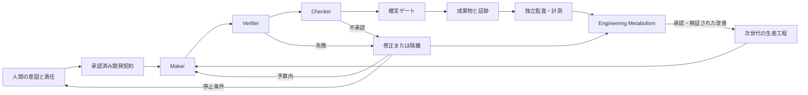

| | 職人加速モデル | Software Factory |
|---|---|---|
| 改善対象 | 個人の作業 | 生産システム |
| 信頼の根拠 | 開発者の能力・確認 | 契約、検証、職務分掌、証跡 |
| 失敗 | 個別の修正 | 検出、隔離、復旧、学習 |
| モデル | 作業能力の主要因 | 交換可能な構成要素の一つ |
| 成功 | コードが書けた | 受入条件を満たす成果物が確定した |

### 2.1 職務分掌という設計原則

Makerが自分の成果物を作り、その合否を最終的に決め、確定まで行えるなら、役割の名前を増やしても職務分掌にはならない。金融取引で実行と承認を分けるのと同様に、Factoryでは作成、判定、確定の権限を区別する。

| 役割 | 責務 | 単独では許可しないこと |
|---|---|---|
| 人間・設計担当 | 目的、契約、許容リスクの承認 | 承認のないルール変更を正規の成果物と扱うこと |
| Maker | 承認された範囲の実装 | 自分の合否の最終決定、保護された契約の変更 |
| Verifier | 定義済みの検査の実行と記録 | 合格基準の独断での緩和 |
| Checker | 独立した仕様・差分査読 | 自ら変更した成果物の最終承認 |
| 確定ゲート | 必須証拠と対象の同一性の照合 | 必須条件を欠いた成果物の確定 |
| Auditor | 生産工程と成果物の独立した点検 | 指摘を根拠に無制限の修正を継続すること |

これは論理的な責務分離の設計例である。実効性は権限設定や実行環境に依存し、別々のLLMを起動するだけで成立するわけではない。

### 2.2 三つの品質を別々に測る

製品が正しく動くこと、エージェントがよい仕事をすること、そして生産工程が規律どおり動くことは、互いに関連するが別々の評価対象である。

| 評価対象 | 主張の例 | 検証の例 | それだけでは示せないこと |
|---|---|---|---|
| Product Quality | 認可されない操作が拒否される | 受入テスト・形式検証 | 未記述の要件の正しさ |
| Agent Quality | 依頼された欠陥を再現し修正できる | 独立した課題セット・ブラインドEval | 毎回正しく実行されること |
| Factory Quality | 不承認の変更を確定しない | 状態遷移・証跡照合・障害注入 | 受入基準そのものの十分性 |

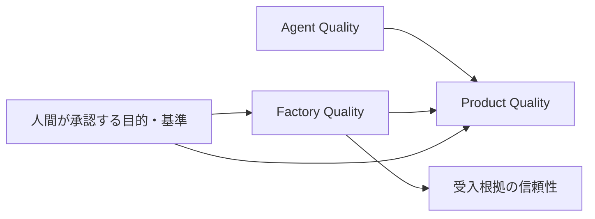

この分類は本稿の分析枠組みであり、既存の品質モデルを置き換える標準ではない。例えば、CheckerのEvalスコアが高くても不承認を確定ゲートが無視すればFactoryの欠陥である。逆に、工程が規定どおり動いても、物差しが不十分なら製品の欠陥は流出する。三者を混同しないことが、改善投資の判断を助ける。例えばAgent Qualityの改善で解決すべき問題に確定ゲートを追加しても、作業は遅くなるだけかもしれない。逆にFactory Qualityの欠陥は、モデルを更新しても残りうる。

### 2.3 七つの設計原則と実装の対応

本稿の設計原則と、リファレンス実装Auto Developer（参照スナップショット `72938c9`）における対応を以下に示す。本文中のv0.10.0はこの開発スナップショットに記された版名を指し、正式なGitタグやGitHub Releaseの公開を確認したことを意味しない。「状態」は本稿で確認した公開記録に基づく区分であり、各機能の網羅的な検証結果ではない。

| # | 設計原則 | 主な章 | Auto Developerでの対応 | 状態 | 根拠 |
|---|---|---|---|---|---|
| 1 | 正規経路の工学 | 3.3, 3.4 | 定型手順のスキル（`/nightly-run`、`/nightly-compile`）、CLIリファレンスの生成（DX-4）、文書中のコマンドの検査（DX-1、DX-14）、次の操作を案内するエラー出力（例：GATE-13、GATE-15） | 部分的（手順と案内の整備。コード構造としての正規経路の設計は対象外） | SPEC 4.10、4.2 |
| 2 | 意図から契約への変換 | 4 | Spec Compiler（`--outline` / `--check` / `--impact` / `--emit`）、承認済みIRの保護、DESIGN_DRIFT表示 | 実装済み（意味の完全性は保証しない） | v0.10.0リリースノート |
| 3 | 証拠と成果物の拘束 | 5.2, 5.3 | Tree SHA・SPECハッシュに拘束された一回限りのEvidence（INV-2）、異系統の査読の必須化（INV-6、GATE-4）、査読の入出力と確定対象の照合（INV-10、GATE-5〜7、BDL-4）、同一Evidenceへの二重判定の拒否（GATE-12/13）、低レベル経路でのFail-Fast（GATE-15） | 一部実装（1回の不承認の後、コードを変えずに再検証・再査読する経路は残る） | SPEC 3・4.2、Phase 70契約書、GATE-13テスト |
| 4 | 検証機構自体の検証 | 5.4 | CI実行環境の是正（Phase 71）、一時インデックスによる副作用の除去（GATE-9）、サンドボックスの実条件での修正（SBX-7/8）、監査指摘のRed/Green証明（AUDIT-5） | 一部実装（全変更のRed-First強制、CheckerのブラインドEvalはv0.11草案） | Phase 71契約書、SPEC 4.6・4.7、v0.11草案 |
| 5 | 回復可能な自律性 | 6.1 | 隔離と保全（RCV-1、RCV-6、RCV-7、INV-3）、ジョブ状態の原子的な永続化（RCV-2）、再開（RCV-3）、冪等なクラッシュ復旧 `recover inspect / plan / apply`（RCV-4）、統合ジョブの復旧（TEAM-6）、Pilot 04の障害注入E2E | 実装済み（Pilot 04の障害データでの再実行は本稿では未実施） | SPEC 4.3、Pilot 04 E2Eテスト |
| 6 | 合成可能な自律性 | 6.2 | worktreeの分離、担当範囲の検査（INV-9、TEAM-3）、Bundleの保全と統合ゲート、RCタグの生成（TEAM-5、TEAM-6）、本線への取込みは人間が行う | 実験的（独立したチームのみ対応。`depends_on` と職能別の専門化は未対応） | SPEC 4.8・6、v0.11草案 |
| 7 | 有限の自己改善 | 7.3〜7.5 | 異系統Auditorによる監査（AUDIT-1）、重要度による振り分け（AUDIT-2/3）、修正予算（AUDIT-4、既定5サイクル、INV-7）、Red/Greenによる解決の証明と教訓の記録（AUDIT-5） | 一部実装（教訓の自動集計・ガード候補の提案はv0.11草案、剪定の自動化は今後の課題） | SPEC 4.6、v0.11草案 |

原則1について実装が備えているのは、利用者とAgentが辿る手順・案内の整備にとどまる。3.3で述べた、コード構造そのものを正しく作りやすくする設計と、正規経路の発見しやすさを測る指標は今後の課題とする。

## 第3章：正しく作りやすく、間違って確定しにくい環境

規約を何度も読み聞かせるより、正しい道を選ぶ方が簡単なコードベースを作る。エージェントにとっても人間にとっても、これは自由を奪うための設計ではない。余計な探索と手戻りを減らし、本来の問題に集中するための設計である。

### 3.1 Harness・Loop・Graph

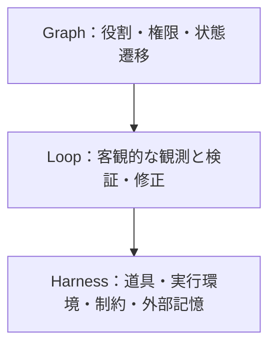

Harnessは何ができるか、Loopは何を合格とするか、Graphは誰が何を行い次にどの状態へ進めるかを定める。三層は独立した製品である必要はなく、責務を区別するための概念である。名称と基本的な層の整理は先行版が参照したm4lka氏の議論に由来する [R13]。これらがある時点の生産工程を規定するのに対し、Engineering Metabolismは経験を通じて三層を更新する横断機構である（第7章）。

### 3.2 WishからWallへ

自然言語の指示、対話式の確認、実行時の遮断、確定時の拒否は強制力が異なる。機密を作業環境に置かないこと、OS権限でアクセスを拒むこと、保護されたブランチへのマージ条件を外部から強制することは、プロンプトだけによる禁止より強い。

Git worktreeは作業状態の分離手段であり、OSレベルのセキュリティ境界ではない。ローカルフックや保護ファイル検査も、変更の確定を拒む仕組みと、アクセスそのものを禁止する仕組みを区別して扱う。エージェントが自ら変更できる設定は、単独では強制境界にならない。

### 3.3 正規経路の工学（Canonical Path Engineering）

壁を増やすだけではFactoryは成熟しない。正規の実装方法を最も発見しやすく、実行しやすくする必要がある。明快なモジュール境界、参照実装、型、適切な抽象化、少数の道具、機能マップ、具体的なエラーメッセージはそのための資産となる。

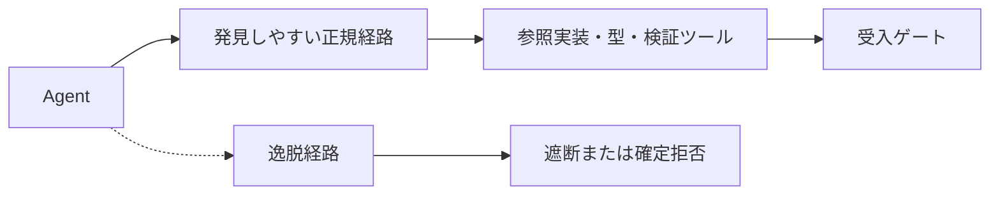

Lauren Tan氏の公開スキルpstackと講演の二次記録 [R5, R6] は、実際のアプリケーションをAgent自身が操作・観測できる環境と、成功しやすいコード構造の重要性を示唆する。個々の禁止ルールは文脈に依存するため、例えば特定のReact APIやコメントの禁止を一般原則として輸入する必要はない。重要なのは、正規経路の設計と、規範の機械化である。

### 3.4 スクリーンショットを渡す仕事から、Agent自身が測る仕事へ

画面、実行トレース、プロファイル、ログ、テスト結果をAgentが取得できれば、人間が観測を中継する必要は減る。観測能力と合否判定能力は別物である。スクリーンショットは有力な診断材料だが、位置や寸法の不変条件を数値で判定できるなら、その条件をテストとして実装する。

## 第4章：発散と収束を接続するSpec Compiler

設計の議論では、昨日の仮説を今日ひっくり返してもよい。だが、実装中に認可条件や金額の計算規則を勝手に変えられては困る。創造的な探索と規律ある実行は、同じ知性を用いるとしても、異なる工程として扱う価値がある。

Googleの公開リポジトリで説明されるEGM（Elephant-Goldfish Model）[R4] は、設計者と設計文書の査読者の文脈を分離する。本稿ではこれを実装と差分査読に拡張し、人間と長い文脈を共有して設計を行うElephantと、限定されたタスクを実行するMaker、実装時の会話を引き継がないCheckerを分離する。独立性は入力の分離、権限の分離、必要に応じた異系統モデルの採用によって高める（Auto Developerでは、MakerとChecker・Auditorが同一系統または系統不明の場合は承認として扱わない。INV-6）。ただし、コンテキストやモデルの分離だけで誤りの独立性が数学的に保証されるわけではない。

設計段階では曖昧さを許容し、代案を探索する。実行段階では、その曖昧さを勝手な実装判断に持ち込まない。この二つを接続する変換層をSpec Compilerと呼ぶ。

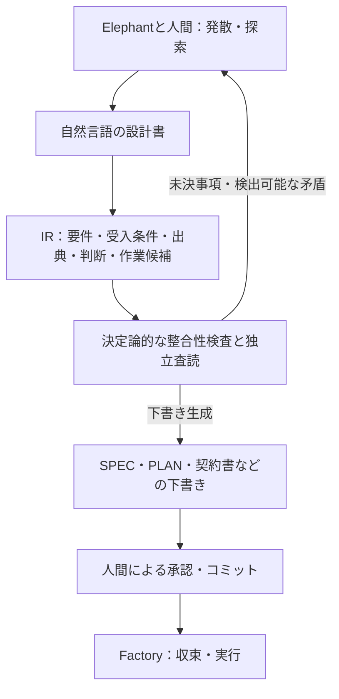

中間表現は設計書の出典を参照可能にする。実装ではJSON IRと出典範囲のハッシュ、要件IDと受入条件の参照、担当範囲、未決事項などを検査する。SPECやPLANはIRそのものではなく、IRから生成する契約文書の下書きである。

v0.10.0のSpec Compilerは `--outline`、`--check`、`--impact`、`--emit` を提供する。影響分析は候補の列挙であり、既存テストを変更すべきかの判断ではない。承認されたIRは保護対象になり、状態表示は設計変更（DESIGN_DRIFT）を示す。[リリースノート](https://github.com/hamatz/auto_developer/blob/72938c923efb4d4b141fffaa4aff6fc863186bfc/docs/releases/v0.10.0.md) を参照。

この変換は、自然言語の意味の完全性やすべての矛盾の検出を保証するコンパイラではない。機械が判定できる整合性を検査し、判定できない意味上の判断を人間と独立査読へ戻す。コンパイラ自身には正式な契約の変更権限を与えない。

## 第5章：証拠による実行統治 —— 検証したという事実を検証する

### 5.1 証拠の種類と限界

| 種類 | 支える判断 | 限界 |
|---|---|---|
| 形式検証 | 形式化された仕様に対する性質の証明 | 仕様やモデル化の妥当性は別途必要 |
| 決定論的検査 | 指定した条件でのテスト・型・ビルドの合否 | 未検査の性質を保証しない |
| 独立査読 | 仕様との差異、設計上の問題、テストの穴 | 確率的判断であり誤判定しうる |
| 観測アーティファクト | 現象の再現・診断・追加判断 | それだけでは受入条件の充足を示さない場合がある |
| 自己申告 | 状況の説明 | 単独では確定の根拠にしない |

決定論的検査と独立査読は代替関係ではない。本稿の提案する確定プロトコルでは、必要な両方の条件を満たさなければならない。

### 5.2 テストに合格したのは、本当にそのコードなのか —— Evidence-Bound Execution

検証の成功後に差分を変えること、別の成果物に対する承認を流用すること、同じ候補に対して都合のよい査読結果が出るまで再試行することは、独立した検証を導入した後にも生じうる問題である。

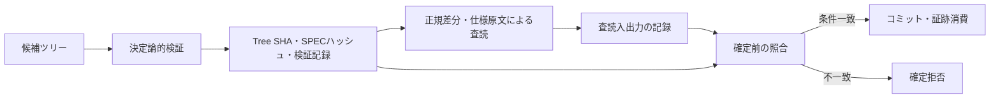

設計原則として、一つの検証証跡に対する最終査読判定を一意に扱い、不承認を隠して受入判定を選び直すことを許さない。失敗した査読の記録を保存し、必要な修正と再検証を経る。意図的に独立した再評価を行う場合は、その条件を別の承認済みポリシーに定める。

Auto Developerのv0.9.0では、検証されたツリーとSPEC、正規差分、査読に用いた仕様原文、Checker出力の照合を確定ゲートに組み込んだ。v0.10.0では、GATE-12/13により、低レベルの `record-review` 経路で同一Evidenceに対する確定済み判定の二重記録を拒否し、判定不能な出力も履歴に残す。新しいEvidenceを発行する再検証後は再査読できる。これは同一Evidence上の査読ガチャを抑止するが、コードを変更せず再検証することまで一律に禁止するものではない。実際、[対応テスト](https://github.com/hamatz/auto_developer/blob/72938c923efb4d4b141fffaa4aff6fc863186bfc/tests/test_gate13_single_review_per_verify.py) は同じコードで再検証した後の査読を許容する。一方、v0.10.0のGATE-15は、低レベル経路でも同一タスクの検証失敗と不承認を合わせて数え、2回に達した時点で検証と確定を拒否する（INV-4。`run` 経路はCORE-4の再試行上限）。したがって、通常の記録が利用できる一つの試行区間でも、1回の不承認の後、コードを変えずに再検証して新しいEvidenceを得て再査読する経路は残る。無関係な変更を加えて別のツリーにする場合も含め、過去の不承認を解消せずに確定する経路を制御するため、5.3の `NoUnresolvedReject` を提案するが、未実装である。

ハッシュは同一性と整合性の検査に有効だが、記録主体が正当であることや記録の完全な改ざん不能性まで保証するものではない。必要な脅威モデルに応じ、署名、外部の追記型記録、保護されたCIなどによる信頼基点を用意する。

### 5.3 確定の条件を明示する —— 受入プロトコルの不変条件

次の記号を用いる。以下は本稿が提案する論理的な受入条件の例であり、全実装経路に対する形式証明ではない。

| 記号 | 意味 |
|---|---|
| T | 正規化された候補ツリー |
| S | 承認済み契約（SPEC・受入条件など） |
| B | 差分の基点コミット |
| E | 検証環境と検査設定の記述（実行環境、検査対象、依存関係） |
| V, R | 検証記録、査読記録。それぞれ識別子 `id` を持つ |
| C | 確定対象 |
| P | 適用されるポリシー（権限、独立性、予算、再評価の条件） |
| task | 当該タスクの識別子 |
| H | 当該タスクの検証・査読・裁定の履歴 |
| digest(x) | 正規化したxのダイジェスト。記録の識別子とは区別する |

```text
GateEligible(C) :=
  -- 契約と権限
  ValidContract(S, P) AND Authorized(C, P)
  -- 記録の信頼性
  AND TrustedRecords(V, R, P)
  -- 決定論的検証：何を・何に対して・どの条件で検証したか
  AND Pass(V)
  AND V.subject  == digest(T)
  AND V.contract == digest(S)
  AND V.base     == B
  AND V.env      == digest(E) AND AcceptableEnv(E, P)
  -- 独立査読：検証記録を参照し、同じ入力を見たか
  AND Approve(R)
  AND R.evidence_id == V.id
  AND R.inputs == (digest(T), digest(S), B)
  AND IndependentReviewer(R, P)
  -- 反復の制御
  AND NoUnresolvedReject(task, T, H, P)
  AND WithinBudget(H, P)
  -- 確定対象の同一性と一回性
  AND digest(C.tree) == digest(T)
  AND FreshAndUnconsumed(V)

Commit(C) :=
  atomically { require GateEligible(C); write(C); consume(V); append(H) }
```

`NoUnresolvedReject(task, T, H, P)` は、当該タスクの履歴 H にある不承認または判定不能の査読結果について、候補ツリー T に対しポリシー P が要求する解消または裁定が行われていることを表す。ツリーのダイジェストが変化したという事実だけでは、過去の指摘が解消されたとはみなさない。解消の例は、指摘に対応した修正と再検証・独立査読、承認済みの独立再評価ポリシーに基づく再査読、または人間による裁定である。判定不能の出力は不承認とは区別し、P が定める再実行・裁定によって解消できる。この条件により、同じツリーの再検証や無関係な変更による受入判定の選び直しも制御の対象になる。v0.10.0のGATE-12/13が拒否するのは同一Evidence上の二重判定であり、GATE-15が制限するのはタスク単位の失敗回数である。`NoUnresolvedReject` に相当する指摘の解消をタスク履歴に拘束する制御は実装していない（5.2）。

`GateEligible` は本稿が提案する確定ゲートの判定条件である。この条件が示すのは「当該ポリシーの下で受入条件を満たした」という主張であり、「欠陥が存在しない」という主張ではない。ダイジェストの対象は正規化された成果物で、差分の基点、検証環境・検査設定の同一性、必要な依存関係も適用範囲に応じて記録する必要がある。照合と確定の間の競合も防がなければならない。上式の `Commit(C)` は、受入の確認・確定・証跡の消費・履歴の追記を一つの不可分な遷移として扱うことを示す。不可分性を実現できない場合は、障害時に同じ結果へ回復できるようにする（6.1の `Recovering`）。この判定条件の充足は、製品の完全な正しさや本番リリースの許可を意味しない。

信頼境界を明示する。Makerが検証器、証跡ストア、確定ゲート、署名鍵を同じ権限で改変できる環境では、ローカルの照合だけでは悪意ある主体に対する保証にならない。分離された実行権限、保護されたCI、外部の信頼基点は追加設計となる。SLSAおよびin-toto [R7, R8] の来歴・工程整合性の考え方と接続しうるが、Auto Developerがそれらの適合認証を取得したとは主張しない。

### 5.4 CIのGreenが保証していなかったこと —— Verification of Verification

Auto Developerの開発記録には、CIのPythonバージョン行列が意図した実行ファイルを使用していなかった事例がある。実行環境を是正したところ、macOSで多数の失敗が表面化した（第8章）。これは検査結果を信頼する以前に、何をどの条件で検査したのかを確かめる必要があることを示す具体例である。

CIがGreenでも、意図した環境やテストが実際に使われたとは限らない。検査の実行件数、実行環境、対象コミット、失敗時の分類、成果物との同一性を確認する。テストを意図的に失敗させる検証、ミューテーションテスト、プロパティベーステストも物差しの妥当性を高める手段となる。

新規の回帰テストについては、修正前に対象の欠陥によってRedとなり、修正後に同じテストでGreenとなることを確認する。既存の正常系・回帰テストが修正前からGreenであることは、当然ながら無意味ではない。両者を区別する。

候補テスト自体も信頼できないコードである。制限時間だけを設けても隔離にはならない。信頼できないテストを適切なOS境界内で実行し、サンドボックスを実際の条件で起動できない場合は停止する。AgentのSkillについても、独立したEval、必要に応じたブラインド評価や未使用の評価セットを使い、評価への過適合を監視する。Auto Developerでは監査候補テストのRed/Green検証は仕様化済みだが、通常タスクで追加したテストすべてのRed-Firstを機械で確認することやChecker自体のブラインドEvalはv0.11草案の検討事項である。

## 第6章：回復可能で合成可能な自律性

### 6.1 工場が真夜中に止まったら —— Recoverable Autonomy

無人稼働の成熟度は、成功経路だけでは測れない。クラッシュ、タイムアウト、連続不承認、破壊的操作の途中失敗を想定し、どの状態から再開できるかを設計する。

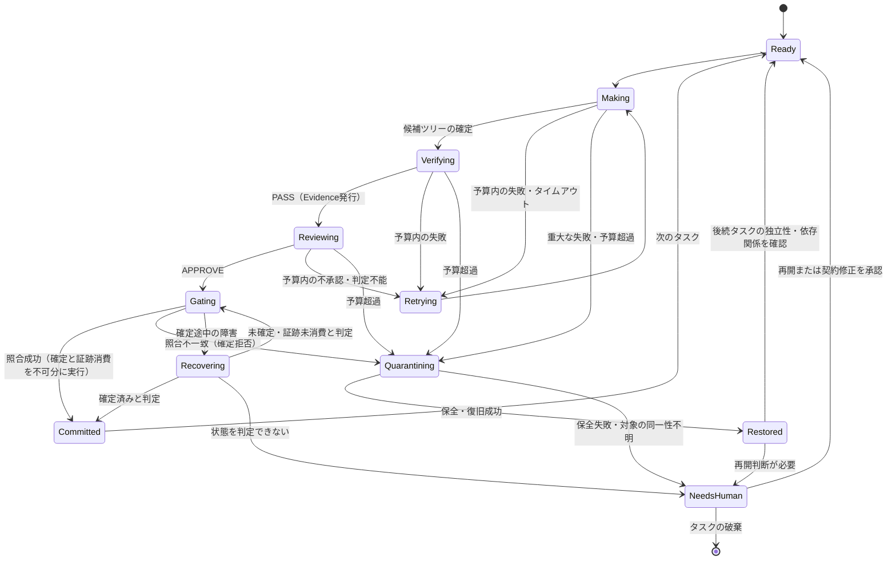

`Gating` は5.2・5.3の確定前の照合、`Recovering` は確定と証跡消費の途中で生じた障害からの回復を表す。Auto Developerでは、後者はジョブ状態の永続化と冪等な復旧コマンド `recover inspect / plan / apply`（RCV-2〜4）に対応し、Pilot 04の「コミット直後」の障害注入（8.2）が対象とする状態でもある。図中の「予算」は一般化した設計上の制約であり、実装主体の失敗、判定不能、時間や費用などを含みうる。Auto DeveloperのINV-4（`run` 経路はCORE-4、低レベル経路はGATE-15）は、同一タスクの検証失敗と不承認が合わせて2回に達したら停止する規則である。低レベル経路では判定不能な査読はこの計数に含めず、隔離後の再開などで計数がリセットされる。照合不一致は実装主体の失敗ではなく工程の異常を示しうるため、再試行には戻さず隔離する。`NeedsHuman` は終端ではなく、人間の裁定によって再開、契約の修正、破棄のいずれかへ進む。

失敗した変更を隔離し、機密の除外と保全の成功を確認してから作業状態を復元する。復旧の実行主体や対象の同一性が不明な場合には、安全側で停止する。後続作業の継続は独立性と依存関係が確認された場合に限る。隔離できたことは、次のタスクへ無条件に進んでよいことを意味しない。

### 6.2 一つの工場から複数の生産ラインへ —— 境界とスキルの直交

並列化とは、単にAgentの数を増やすことではない。担当領域（Ownership）とその領域固有の道具・技能・検証条件を分離して設計する。

| レーン | Ownershipの例 | 検証の例 |
|---|---|---|
| UI | UIコンポーネント | レイアウト・操作・アクセシビリティ |
| API | ドメインロジック・API | 型、境界値、冪等性 |
| Infra | IaC・環境設定 | 静的検査、権限、構成の妥当性 |

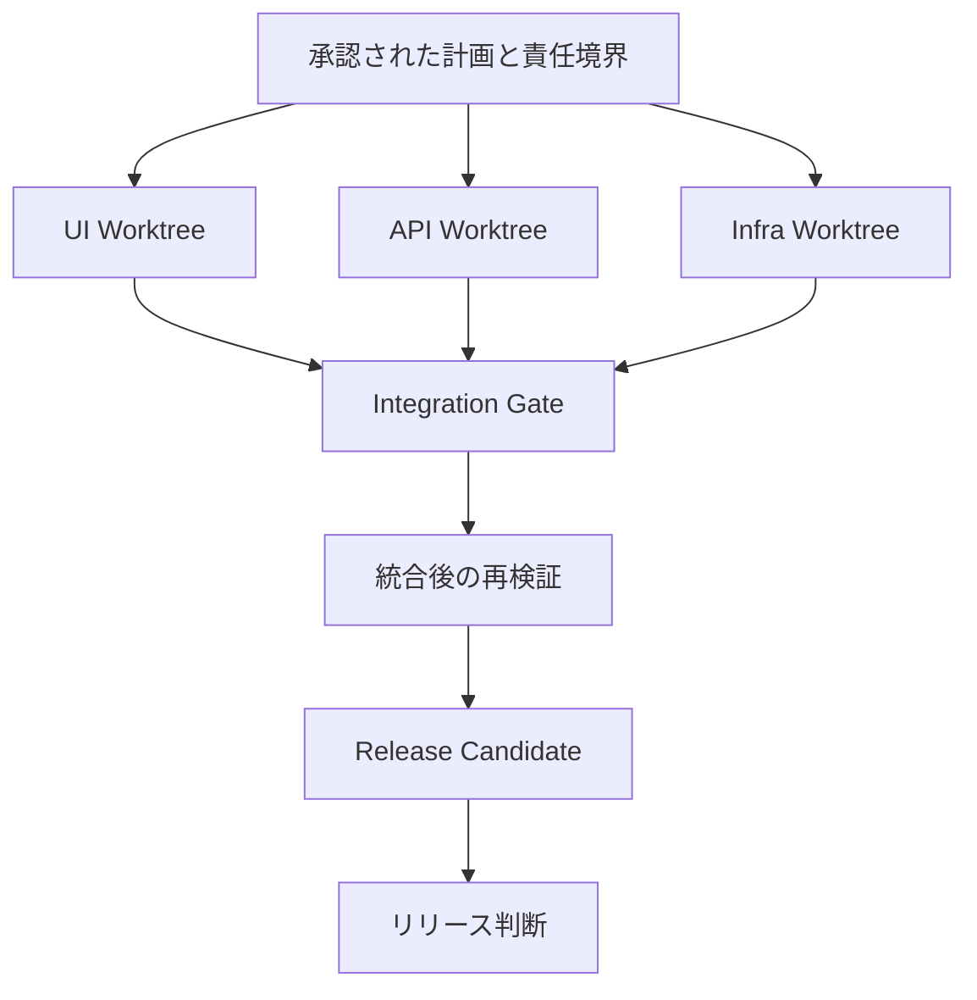

各チームの成果が正しくても、結合後の正しさは導かれない。統合ゲートは各チームの証跡を照合し、統合後の状態を再検証する。Auto Developerのマルチチーム経路は専用の統合ブランチとRCタグを生成し、本線への取り込みを人間に委ねる。v0.10.0のマルチチームは実験的で、全チームが同じMaker・Checker・検証を使用する。上表の職能別スキル・モデル・検証の割当は設計提案であり、実装済み機能ではない。[v0.11設計草案](https://github.com/hamatz/auto_developer/blob/72938c923efb4d4b141fffaa4aff6fc863186bfc/docs/contracts/v0.11-draft.md) は専門化を今後の課題としている。

## 第7章：Engineering Metabolism —— 開発するほど、開発能力そのものが育つ仕組み

> ソフトウェアを作るたびに、ソフトウェアを作る能力そのものを育てよ。

### 7.1 経験を能力に変える —— 工学的代謝の定義

本稿では、ソフトウェア生産の過程で得られた経験を、検証可能かつ持続的な生産能力へ変換する機構を **Engineering Metabolism（工学的代謝）** と定義する。先行版が参照したm4lka氏の成熟度モデルにおけるLevel 7 [R13] を出発点とするが、本稿では教訓の蓄積に加え、強制機構への昇格、改善の検証、剪定、予算と停止条件までを一つの機構として扱う。標準化された成熟度認証でも、名称の先取性を主張するものでもない。

その目的はエージェントにより多くの知識を与えることではない。過去の経験を、将来のエージェントがその経験を記憶していなくても機能する仕組みへ変換することである。Harness・Loop・Graphが生産工程の構造を規定するのに対し、Engineering Metabolismは、その構造を時間とともにどう更新するかを規定する。第四の積層ではなく、三層に作用する横断的な改善機構である。

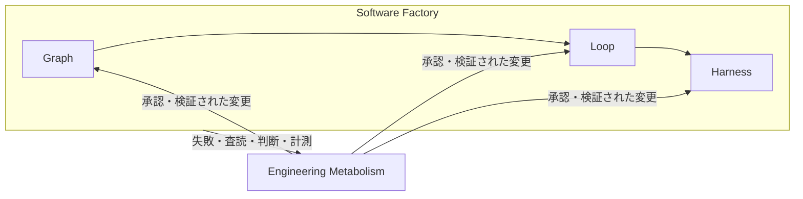

| 用語 | 本稿での位置づけ |
|---|---|
| Engineering Metabolism | 経験を生産能力へ変換する機構 |
| Engineering Immunity | 特定の欠陥や逸脱の再発を検出・遮断する能力 |
| Engineering Compounding | 有効な改善の蓄積から期待される長期的な効果。単調な向上や複利成長を保証しない |

代謝の一周期は、Capture（観測と記録）、Distill（教訓の抽出）、Promote（道具・型・テスト・関門への昇格）、Validate（有効性と副作用の検証）、Prune（不要な規約や検査の剪定）からなる。すべての経験を強制機構にする必要はない。機械化できない判断は文書として残し、費用対効果が見合わない候補は保留する。

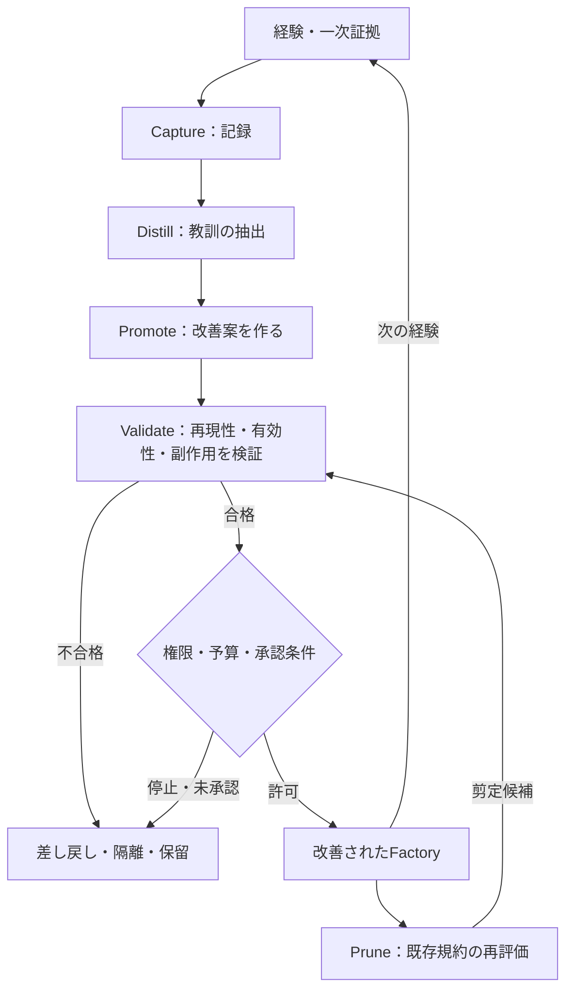

この図は概念上の全工程を示し、完全自動化された現行実装の状態を示すものではない。改善の確定には対象に応じた独立検証と承認を要求し、保護された検証条件や権限境界を改善主体が自ら緩和できないようにする。

### 7.2 同じ注意を繰り返さないために —— 教訓の昇格

使い捨てセッションは過去のバイアスを持ち込みにくい一方で、経験も揮発させる。経験を外部記憶として蓄積し、必要な時だけ参照し、可能な限り強制力のある仕組みへ移す。教訓の記録にはContext、Trap、Rule、Rung、Immunity Test、Proofを持たせる。

| 置き場所 | 性質 |
|---|---|
| 会話・プロンプト | 一時的な注意喚起 |
| AGENTS.md・LESSONS.md | 再利用可能だが遵守は必ずしも強制されない |
| 道具・参照実装 | 正しい経路を使いやすくする |
| テスト・リンター | 検出可能な逸脱を機械判定する |
| 確定ゲート・権限 | 不許可の確定やアクセスを遮断する |
| 構造そのもの | 失敗を起こしにくい設計に変える |

先行版でArcos氏に帰属させた修正の半減期 [R14] は概念的な比喩であり、具体的な時間を実測なしに一般化しない。重要なのは教訓を注意力への依存から、持続的な仕組みへ移すことである。

### 7.3 独立監査と免疫

タスク単位のCheckerと、広いスコープを対象とするAuditorを区別する。監査指摘を重大度と再現可能性で評価し、候補テストを隔離実行する。対象コミットに対するRed/Greenを確認した指摘を教訓として記録する。

候補テストが通ったというだけで、正式な受入テストや保護された免疫テストに無条件で昇格させない。物差しを変更することは生産ルールの変更であり、その承認権限を実装者から分離する。

### 7.4 優秀すぎる監査役が開発を止める —— 有限の自己改善

独立監査は、探索範囲や終了条件が曖昧であれば追加の指摘を見つけ続ける可能性がある。指摘の多さは監査の優秀さを直接示すものではない。欠陥ゼロを終了条件とすれば、有限の予算で運用することが難しくなる。

Auto Developerでは、重大なP0/P1指摘の修正経路とP2/INFOのバックログを分け、同一モジュールに対する修正サイクルに上限を設ける。上限到達は合格ではなく、人間の判断待ちである。既定の修正予算は同一モジュールへのP0/P1自動登録5サイクルである（AUDIT-4）。一般化したFactoryでは、回数に加えて時間、トークン、計算費用、リスクに応じた改善予算を設計する。

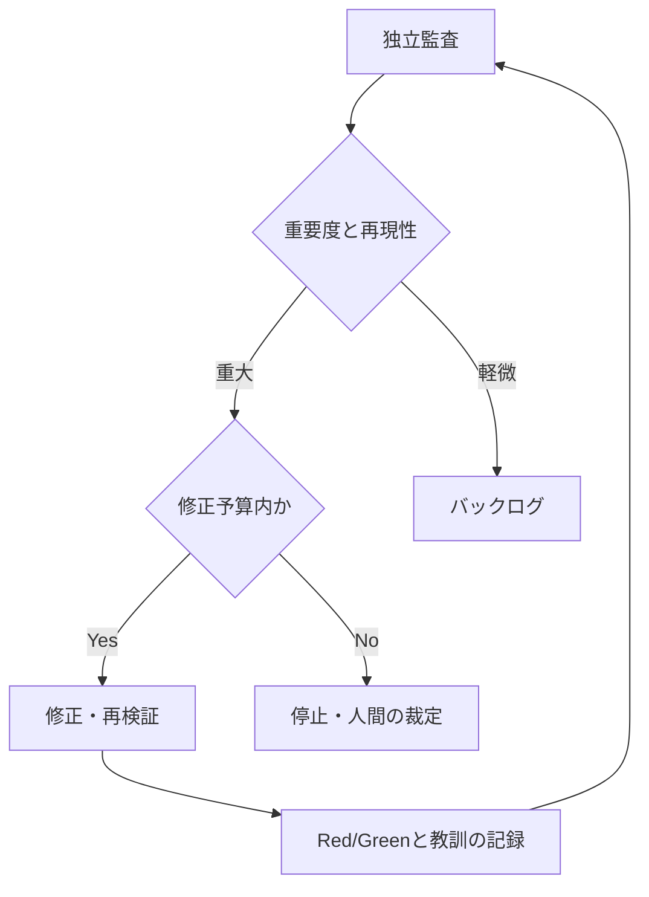

### 7.5 剪定と費用対効果

すべての過去の失敗を永久にルール化することが最適とは限らない。ガードには待ち時間、計算費用、保守費用、誤検出などのコストがある。低リスクな制約は、モデル変更後の複数回の評価や回帰テストで有効性を再評価し、根拠と承認を伴って剪定する。権限・機密・本番接続・証跡の必須条件は、自動で解除しない。

v0.10.0では監査指摘の再現テスト、修正前後のRed/Green、教訓の記録、改善予算が実装されている一方、通常のMakerによる全変更に対するRed-Firstの機械的強制、反復する教訓の自動集計とガード候補の提案、Checkerのブラインド評価は[v0.11草案](https://github.com/hamatz/auto_developer/blob/72938c923efb4d4b141fffaa4aff6fc863186bfc/docs/contracts/v0.11-draft.md)に記された今後の課題である。したがって、Engineering Metabolism全体の自動化や効果は未実証である。

### 7.6 最初の一本の生産ラインを作る

Factoryは最初から完成形である必要はない。まず、人間が毎回確認している一つの性質をテストにする。次に、そのテストを実装者が無断で弱められない確定条件にする。そこから、失敗のフィードバック、独立査読、証跡の拘束、隔離と復旧を順に組み込む。無人運転や並列実行は、それぞれの境界と停止条件を確認した後の拡張である。

例えば「認可されないAPI呼出しを拒否する」という一つの性質から始められる。独立した受入テストを用意し、実装者が変更できないCIで検査する。失敗した際は入力・観測値・期待値を記録し、修正と再検証を要求する。ここまででもFactoryの最小単位となる。

この導入順序は実装のための提案であり、成熟度を測る実証済みの尺度ではない。既存のCIやテストが十分に成熟したチームなら、途中から始めることもできる。小さく始めて、実際の失敗から必要な制約を増やすことが、Factoryそのものの過剰設計を避ける一つの方法となる。

## 第8章：Factoryを作るFactory —— 実践による理論の更新と評価

Auto Developerは、本稿の先行版を誰でも実践できるようにする目的で開発されたリファレンス実装である。自身の開発にも利用することで、Factoryの生産物だけでなくFactory自身の欠陥が観測された。

### 8.1 一晩の実行の記録 —— Phase 74

Phase 74（v0.10.0の手直し、8タスク）の実行を、三種類の記録を相互照合することで分析した事例を示す。照合に用いたのは、Auto Developerのイベント記録（`events.jsonl` のPhase 74の62件）、Gitのコミット履歴、隔離ブランチである。三者の件数・順序・時刻は一致した。実行は2026年11月25日 00:25（JST）に始まり、11:07（JST）に最後のタスクが確定した。以下の時刻もJSTで示す。

| 観測項目 | 値 |
|---|---|
| モデル | Maker：gemini-4-hydrogen-medium、Checker：claude-sonnet-5-5（異系統。INV-6） |
| 確定したタスク | 8 / 8 |
| 検証 | 17回（合格15、不合格2） |
| 査読 | 15回（APPROVE 8、REJECT 7）。1回目の査読でAPPROVEとなったタスクは4 / 8 |
| 隔離 | 3回（タスク5・7・8。いずれも2回連続の不承認の後） |
| 人間の介入 | 4回（保護された免疫テストの修正1回、隔離後の再開3回。後述） |
| 差分 | 25ファイル、+3,543 / −108行（`9eb4589..228ea07`） |
| 経過時間 | 約10.7時間（人間の対応を待った約3時間24分を含む） |

**人間の介入。** 介入は2種類、計4回あった。第一に、タスク4では、保護された免疫テストが、このタスクで塞ぐ「不承認の後に同じ検証へ承認を記録し直す」動作を前提にしていた。そのため03:17の検証で失敗して停止した。免疫テストは人間だけが変更できる。就寝していた筆者が06:28にテストを修正し（`8a99ca2`。範囲内で唯一の、パイプライン外のコミット）、新しいHEADを基点に検証からやり直して06:41に合格した。これは保護された物差しを実装者が変えられないという設計（3.2、7.3）が意図どおり働いた例である。同時に、新しい仕様と既存の免疫テストの矛盾を実装前に検出できなかった例でもある（8.2の「設計判断と受入条件の矛盾」）。第二に、3回の隔離はいずれも、同一タスクで失敗が2回続いたら停止するという規則（INV-4）に従ったものである。オーケストレーター（Antigravity）が停止して相談文を残した。筆者がClaude Code上でその内容を確認し、必要な修正を加えた上で、Antigravityに再開を指示した。したがってタスク4・5・7・8の確定には人間の判断と修正が含まれ、この実行は無人で完結したものではない。隔離後の再開の判断と修正の内容はイベント記録に残っておらず、筆者の記述に基づく。この経過は、6.1の状態遷移における `Quarantining → Restored → NeedsHuman → Ready` に相当する。停止条件が働き、判断が人間に渡ったことの実例でもある。

経過時間とは別に、人間の対応を待った時間と、実行ホストの稼働状態を含めた実作業時間を分けて記録することは、8.3の計測の課題である。

**査読が止めたもの。** REJECTの理由には具体的な欠陥が含まれる。例えば、`lstrip('./')` によりドットで始まるパスが壊れる不具合、統合時の検証スクリプトの設定が参照されない不具合、Evidenceのトークンをイベント記録に平文で書く変更がある。これらは独立査読が受入前に具体的な欠陥を指摘した記録である。一方で、人間のレビューなら見逃していたことや、従来手法より品質が高かったことは、対照実験なしに結論づけられない。行数は成果の規模を示す補助情報に留める。

この実行は、検証と査読の照合（GATE-5〜7、Phase 70）を備えた状態で行われた。同時に、査読の厳格化（GATE-13）そのものを実装している。低レベル経路でのFail-Fast（GATE-15）はまだ存在せず、停止の判断はオーケストレーターの手順に依存していた。

照合に用いたイベント記録と隔離ブランチは、公開リポジトリには含まれない。本稿の付録データとして、Phase 74のイベント記録、査読の全履歴（15件）、Evidence、隔離ブランチ、ダッシュボードの再生用スナップショットをまとめたアーカイブ [`phase74-evidence.tar.gz`](phase74-evidence.tar.gz)（SHA-256: `680b38d71acd727ca624d72d5003dcd0f97831018252c17230b736d1475f5124`）を本稿の付録として添付する。絶対パスと消費済みのEvidenceトークンは置換しているが、査読の入出力は無加工である。同梱の `verify.py` で、記録どうしの整合性とリポジトリとの一致を確かめられる。ダッシュボード上部の注意表示は、実行時ではなく生成時の状態を表す。

### 8.2 失敗が理論を変えた事例

**CheckerはREJECTと言った。それでもコードはコミットされた。**

`LESSONS.md` は、Phase 67〜69の四つのコミットについて、保存されたCheckerの出力と承認記録の不一致を報告している。開発記録によれば、バックグラウンドのCheckerから届いた完了通知の扱いが原因だった。この事例の教訓は、別モデルを用意したという事実と、そのモデルによる査読が正しく確定工程へ反映されたという事実は異なる、ということである。以後、査読の入力と出力を保存し、確定直前に照合する設計が導入された。

[Phase 70契約書](https://github.com/hamatz/auto_developer/blob/72938c923efb4d4b141fffaa4aff6fc863186bfc/docs/contracts/phase70.md) は、2026年11月22日の照合で発見した4件（`b7af7f2`、`86eeea9`、`e5fa287`、`84a0043`）に加え、Checker出力より先にコミットされた2件も記録している。後者の最終判定はAPPROVEだったが、順序の保証がなかった点は同じである。原因分析ではバックグラウンドの完了通知が二度届き、最初の通知で確定したこと、判定を文字列の自己申告として受け取るAPIだったことが挙げられている。対策はINV-10、GATE-5〜7、BDL-4として定義された。原出力ファイルを本稿のために再照合したわけではない。

**CIのGreenが保証していなかったこと。**

CIのバージョン行列が意図したPythonではなく別の実行ファイルを選んでいた問題は、検証スクリプトの環境選択を是正したときに顕在化した。記録上の失敗件数は、検証の網羅性や製品品質の一般的な尺度ではないが、検証環境の同一性を確かめる必要性を具体的に示している。

[Phase 71契約書](https://github.com/hamatz/auto_developer/blob/72938c923efb4d4b141fffaa4aff6fc863186bfc/docs/contracts/phase71.md) によると、macOS / Ubuntu × Python 3.10 / 3.12 のCI行列に対し、実際にはmacOSでPython 3.9、Ubuntuで3.12が使われていた。選択方法を修正するとmacOSで72件の失敗と9件のエラー、Ubuntuで1件の失敗が報告された。前者は主にサンドボックスでPythonのシンボリックリンク経路が読めない問題、後者は製品の不具合ではなくテストの誤った前提だった（SBX-7/8）。失敗の数をそのまま製品の欠陥数とみなしてはいけない。

**検証そのものが作業状態を変えた。** 同契約書は、Tree SHAを計算する検証処理が実際のGitインデックスにファイルをステージし、機密ファイルの誤コミットにつながりうることも報告した。GATE-9では一時インデックスを用いる設計に改めた。検証の副作用も検証対象である。

これらはリポジトリに記録された事後分析であり、本稿のために独立して再現した実験ではない。以下に、他の観測事例と設計への反映をまとめる。

| 観測された事象（リポジトリの記録による） | 導かれた設計原則 |
|---|---|
| REJECT出力とAPPROVE記録が食い違ったコミット4件 | 査読入力・出力と確定対象を拘束する |
| CIが意図したPythonで実行されておらず、是正後にmacOSで72失敗・9エラー | 検証環境と検証対象を確認する |
| サンドボックスの起動確認と実際の実行条件の差 | 本番相当の条件で前提を検証する |
| 監査指摘の反復による開発の長期化 | 重要度・修正予算・終了条件を設計する |
| 実装済みの機能に利用者の経路から到達できない | 公開手順・配布物を使ったE2Eを検証する |
| 設計判断と受入条件の矛盾 | 実装前に検出可能な仕様の整合性を検査する |

資料：[LESSONS.md](https://github.com/hamatz/auto_developer/blob/72938c923efb4d4b141fffaa4aff6fc863186bfc/LESSONS.md)、[SPEC.md](https://github.com/hamatz/auto_developer/blob/72938c923efb4d4b141fffaa4aff6fc863186bfc/SPEC.md)、[CHANGELOG.md](https://github.com/hamatz/auto_developer/blob/72938c923efb4d4b141fffaa4aff6fc863186bfc/CHANGELOG.md)。参照スナップショットは2026年11月27日の `72938c923efb4d4b141fffaa4aff6fc863186bfc`。以下の追加事例も同じスナップショットに基づく。

**工場の停止を試験する。** [Pilot 04のE2Eテスト](https://github.com/hamatz/auto_developer/blob/72938c923efb4d4b141fffaa4aff6fc863186bfc/tests/test_pilot04_recovery_e2e.py) はMaker実行中、検証直後、コミット直後、隔離途中の4つの障害注入データを対象に、復旧と再適用時の冪等性を確かめる設計である。ただし外部ZIPが利用できないとスキップされるため、テストコードの存在だけで4件の成功を主張しない。本稿では障害データを再実行していない。

**指摘ゼロは欠陥ゼロではない。** v0.10.0のリリースノートは独立監査の指摘0件を報告する一方、約60万トークンの差分入力に対し推論が短かったため弱い保証として扱うよう明記している。これは監査自身の評価が必要であることを示す事例である。

### 8.3 何をもって工場が賢くなったと判断するのか

Factoryの成果はPR数や生成行数だけでは測れない。受入済みタスク数、人間の介入時間、初回検証通過率、手戻り率、流出欠陥、再発率、安全な停止率、復旧成功率、受入済みタスク当たりの費用などを組み合わせる。特に、過去に検出した失敗を将来の検査へ変換する費用と、その後に削減された手戻りを評価する必要がある。

これらの指標をすべて計測済みと主張するものではない。現時点ではリファレンス実装の計測基盤と開発履歴を用いた評価設計の提案である。モデルのみを変更した場合、Factoryを改善した場合、それらを組み合わせた場合を、同等のタスクとリスク条件で比較することを今後の検証課題とする。

[METRICS.md](https://github.com/hamatz/auto_developer/blob/72938c923efb4d4b141fffaa4aff6fc863186bfc/METRICS.md) はイベント由来の指標とGit履歴由来の指標を区別している。例えばPhase 50〜53ではpipeline_commitsが各4件と記録されているが、イベント由来の初回通過率等は欠測である。正規経路外コミットには自動監査や外部コミットも含まれるので、人間介入回数と同一視しない。成功タスクだけを分母にする初回通過率には生存者バイアスがあり、全着手タスクの結果を併記することが望ましい。

Engineering Metabolismについては、さらに以下の指標を提案する。いずれも新規の評価設計であり、現行METRICS.mdで計測済みであることを意味しない。

| 指標 | 操作的定義案 |
|---|---|
| Lesson-to-Guard Latency | 昇格済み教訓について、初回の観測から承認済みガードの導入までの経過時間。未昇格件数も併記する |
| Guard Promotion Rate | 評価期間内に機械化可能と判定された教訓のうち、有効なガードとして確定した割合。判定基準と対象集合を固定する |
| Defect Recurrence Rate | 既知の欠陥類型に対する再発件数を、対応する再発機会数で除した値。機会の定義と観測期間を明記する |
| Guard Effectiveness | 独立に用意した対象欠陥入りケースのうち、ガードが検出・遮断した割合。正常ケースの誤拒否率も測定する |
| Guard Maintenance Cost | 観測期間中の検査実行、保守、誤拒否対応の人間時間と計算費用 |
| Improvement Yield | 比較可能な条件で観測された手戻り・流出欠陥・費用の変化を、改善投資と併記する。異なる単位を無根拠に合算しない |

代謝の活発さと健全さは異なる。規約の増加、テストの増加、監査回数だけでは改善を判定できない。改善後も再発しなかったという観察は、再発機会がなければガードの有効性を示さない。

### 8.4 次の実験：モデルの進歩とFactoryの進歩を分けて測る

中心仮説は、モデルを固定してFactoryを改善しても、安全に受け入れられる成果の量またはその費用対効果を改善できる、というものである。対照比較では次の2×2条件を設定する。

| | 基準の開発工程 | 強化したFactory |
|---|---|---|
| 基準モデル | A | B |
| 新しいモデル | C | D |

同じ初期コミット、等価なタスク、受入基準、計算資源・時間の上限を用い、タスク難易度で層別し、試行順序をランダム化する。各条件は隔離された作業環境で複数回実施し、隠した受入テストと独立した評価者で評価する。モデルの版、ツール、実行環境、プロンプト、Factory設定を固定または記録する。学習済みの教訓が対照条件に混入しないよう、試行間の状態を管理する。

主要評価項目は、全着手タスクに対する独立受入率と、重大な未検出欠陥の発生率である。副次評価項目は受入1件当たりの人間作業時間・計算費用・経過時間、安全な停止率、復旧成功率とする。失敗・タイムアウト・未完了を除外せず、全試行の費用を集計して受入件数で除す。受入件数がゼロなら単位費用は未定義として総費用と失敗件数を報告する。安全性の改善と生産性の改善が両立するかは結果に委ねる。観測数と不確実性を報告し、優越性を予断しない。モデルとFactoryの交互作用も評価し、比較対象の工程に既存のCIや人間レビューを残すことで、意図的に弱い対照群を作らない。

さらにFactoryそのものの評価には、意図的な不承認、証跡不一致、検証後改変、障害注入などの負例を使い、拒否すべきケースを拒否できた割合と、正常なケースの誤拒否率を測る。これらは実験計画であり、本稿では未実施である。

### 8.5 関連実践との比較

既存研究・実践との関係を、技術の名称ではなく解決対象で整理する。以下は公開資料に示された重点の比較であり、各システムの機能を網羅した比較試験ではない。

| 系譜 | 本稿との接続 |
|---|---|
| OpenAI Harness Engineering [R3] | エージェント向けの観測可能性、構造制約、開発環境の設計 |
| EGM [R4] | 設計文脈と独立した文書査読の分離。実装・差分査読への拡張は本稿の設計 |
| pstack [R5, R6] | エージェントの働き方と観測・評価。特に公開Eval手順は評価を明示する語を候補に見せない工夫を含む |
| Warp Factory Engineering [R9, R10] | 生産基盤の計測・改善・構成管理。Factoryの自己改善は本稿だけの発想ではない |
| SLSA・in-toto [R7, R8] | 成果物と工程の来歴、信頼基点に対する検証。受入証跡設計の先行技術 |
| SSDF・Assurance Case [R11, R12] | 安全なSDLCへの実践の組込み、主張・論拠・証拠の構造化 |

本稿の重点は、これらの知見を自律開発の受入プロトコル、失敗時の復旧、有限の改善へ結びつけ、実装の失敗記録を用いてその必要性を説明することである。例えばAssurance Caseの観点ではEvidence Bundleは主張を支える資料の一部であり、それ自体が安全性の論証を完結させるものではない。

Lauren Tan氏の講演については二次記録 [R6] を参照し、技術的な論点のうちブラインドEvalを公開プレイブック [R5] で確認した。講演の原映像を直接精査していないため、PR件数、Duneの個別制約、企業全体の効果を独立実証された結果として扱わない。

### 8.6 適用限界と妥当性への脅威

テストと査読の通過は、仕様の正しさや欠陥の不在を証明しない。異系統モデルにも共通の盲点があり、ハッシュ照合にも信頼基点が必要である。ソフトウェアの安全性には本番運用、依存関係、供給網、データ、法令や組織の承認規程なども関わる。Factoryはそれらを代替するものではない。

本稿の事例は主として単一のPython製OSSツールの自己開発に由来する。著者自身による事後分析であり、事例選択や観察者の偏り、モデルと仕様と工程の同時変更による交絡、原ログの欠測がある。異なる言語、企業規模、高リスク業務での外的妥当性は未検証である。

また、小規模な変更や試作に大規模なFactoryを導入することが常に経済的とは限らない。委譲するリスクと実行規模に応じて必要な制約と検証を設計すべきである。

## 第9章：結論 —— 明日、何を作れるか

AI開発に慎重な組織を説得するために、最新モデルがいかに賢いかを示すだけでは不十分である。問うべきなのは、誤った成果物がどのように検出され、どのような条件で確定され、失敗した場合に何が保存され、次の失敗をどう防ぐかである。

人間の仕事は、実装の逐次監視に限定されない。正しく作りやすい経路を設計し、検証可能な契約を定め、証拠を成果物に拘束し、失敗に備え、自己改善を持続可能な範囲に制御することも、ソフトウェア開発者の重要な仕事となる。

優れたガードレールは創造性を否定するためのものではない。組織が安心して委譲できる範囲を拡張するためのものである。

AIの能力は今後も変わる。今日のFactoryの実装方式は将来置き換えられるかもしれない。しかし、目的と受入条件を定め、権限を分離し、証拠を確認し、失敗から回復し、経験を次の生産能力へ還元するという課題は、モデルの世代を超えて重要である。

AIを無条件に信頼する必要のない仕組みを作る。さらに、その仕組み自体も検証可能にし、開発で得た経験によって生産能力を育てる。これが本稿の提案するSoftware Factory Engineeringであり、Engineering Metabolismはその持続的な進化を担う。

その価値は、今日の仕事を速く終わらせることだけではない。少人数では維持できなかった複雑なシステム、専門家の不足で諦めていたプロダクト、厳しい品質条件ゆえに着手できなかった開発に挑戦する余地を広げることにある。例えば、金融システムのような高信頼性領域でどこまで安全に委譲できるかは、今後検証すべき重要な研究課題である。

AI時代のソフトウェア工学は、コードを書くという営みの終焉ではない。工学の対象が、個々のソフトウェアから、その生産能力そのものへと拡張される、新たな時代の始まりである。

優れたソフトウェアを作ることは、これからも価値のある仕事であり続ける。しかし、優れたソフトウェアを生み出し続ける仕組みを作ることには、それとは異なる、持続的な価値がある。

私たちが設計するのは、今日の成果物だけではない。明日、何を作れるかという可能性そのものである。

**Build the Factory, Not Just the Software.**

**ソフトウェアを作るだけでなく、ソフトウェアを生み出す仕組みを作れ。**

## 参考文献・公開実践資料

参照基準日：2026年11月27日。論文、標準、公開実践記事、二次資料を区別する。R13・R14は先行稿の帰属を引き継いだもので、今回原文を再取得できていない。

- [R1] Joel Becker, Nate Rush, Elizabeth Barnes, David Rein, *Measuring the Impact of Early-2025 AI on Experienced Open-Source Developer Productivity*, 2025, [arXiv:2507.09089](https://arxiv.org/abs/2507.09089)（比較研究・プレプリント）。
- [R2] METR, *We are Changing our Developer Productivity Experiment Design*, 2026-02-24, [研究報告](https://metr.org/blog/2026-02-24-uplift-update/)（追跡報告）。
- [R3] OpenAI, *Harness engineering: leveraging Codex in an agent-first world*, 2026, [公開記事](https://openai.com/index/harness-engineering/)（実践報告）。
- [R4] Google, *Elephant-Goldfish Model*, [公開リポジトリ](https://github.com/google/elephant-goldfish-model)（OSS・公式サポート製品ではない）。[公式紹介記事](https://opensource.googleblog.com/2026/10/introducing-elephant-goldfish-model-plugin.html)。
- [R5] Cursor, pstack, [Eval playbook](https://github.com/cursor/plugins/blob/2f87c854fe3e2fcda44ca86b46ede35aad3c46b7/pstack/skills/poteto-mode/playbooks/eval.md)（公開スキル）。
- [R6] Tenten Skills Atlas, [Lauren Tan's multi-agent trust engineering](https://tenten-skills-knowledge-base.vercel.app/en/docs/skills-atlas-lauren-tan-agent-trust)（講演の二次記録、原映像未精査）。
- [R7] SLSA, [Verifying artifacts](https://github.com/slsa-framework/slsa/blob/ba7d291a1521a8f3fc68db80990f2ba1562ccb12/spec/verifying-artifacts.md)（仕様資料）。
- [R8] Santiago Torres-Arias et al., *in-toto: Providing farm-to-table guarantees for bits and bytes*, USENIX Security 2019, [論文・発表ページ](https://www.usenix.org/conference/usenixsecurity19/presentation/torres-arias)（査読付き研究）。
- [R9] Warp, *Becoming a factory engineer*, 2026, [公開記事](https://www.warp.dev/blog/factory-engineering-software-factories)（実践・概念整理）。
- [R10] Warp, *Closing the loop with self-improving cloud software factories*, 2026, [公開記事](https://www.warp.dev/blog/agent-self-improving-software-factories)（実践報告）。
- [R11] NIST, *Secure Software Development Framework (SSDF) Version 1.1*, SP 800-218, 2022, [標準的実践の勧告](https://csrc.nist.gov/pubs/sp/800/218/final)。
- [R12] Carnegie Mellon Software Engineering Institute, [Assurance Cases Overview](https://www.sei.cmu.edu/library/assurance-cases-overview/)（概説）。

- [R13] m4lka (@m4lkxx), *Harness, Loops, Graphs: What Each Layer Fixes and What It Breaks*, [X投稿](https://x.com/m4lkxx/status/2114338456750997922)（先行稿に基づく帰属）。
- [R14] Arcos (@0xarcos), *Harness Engineering: How to Build AI Agents That Never Make the Same Mistake Twice*, [X投稿](https://x.com/0xarcos/status/2115810770747339140)（先行稿に基づく帰属）。

## リファレンス実装・再現性に関する注記

- [先行版 paper.md](https://github.com/hamatz/agent-harness-kit/blob/f335368d285e83f41bf1bb1738724b2e34827008/docs/paper.md)
- [Auto Developer](https://github.com/hamatz/auto_developer)
- [Auto Developer SPEC](https://github.com/hamatz/auto_developer/blob/72938c923efb4d4b141fffaa4aff6fc863186bfc/SPEC.md)
- [Auto Developer LESSONS](https://github.com/hamatz/auto_developer/blob/72938c923efb4d4b141fffaa4aff6fc863186bfc/LESSONS.md)
- [Auto Developer CHANGELOG](https://github.com/hamatz/auto_developer/blob/72938c923efb4d4b141fffaa4aff6fc863186bfc/CHANGELOG.md)

本稿の事例は上記固定コミットに含まれる公開記録を根拠とする。8.1のPhase 74の記録は、筆者の手元のイベント記録・Git履歴・隔離ブランチで照合したが、第三者は付録データを用いて記録の整合性を再照合できる。付録の内部整合性は同梱スクリプトで確認したが、外部の独立した再分析やGit bundleの全オブジェクトの完全復元を伴う検証は本稿では実施していない。Pilot 04の外部障害データ、講演原映像は本改訂では再検証していない。実装テストの独立再実行、外部査読、比較実験も未実施である。Engineering Metabolismは本稿で用いる操作的な定義であり、名称の先取性は主張しない。
