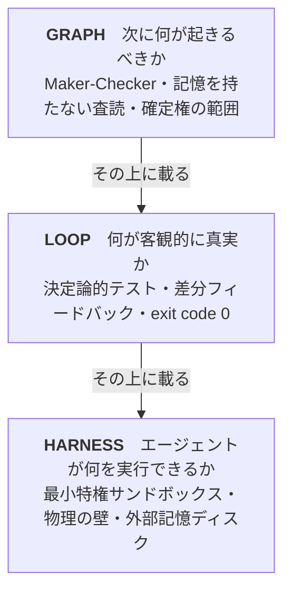
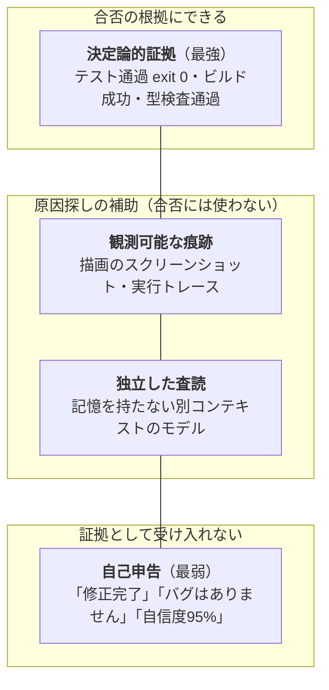
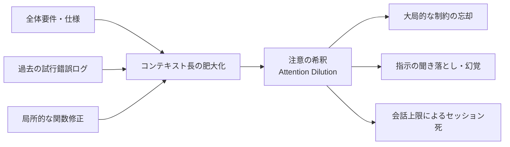
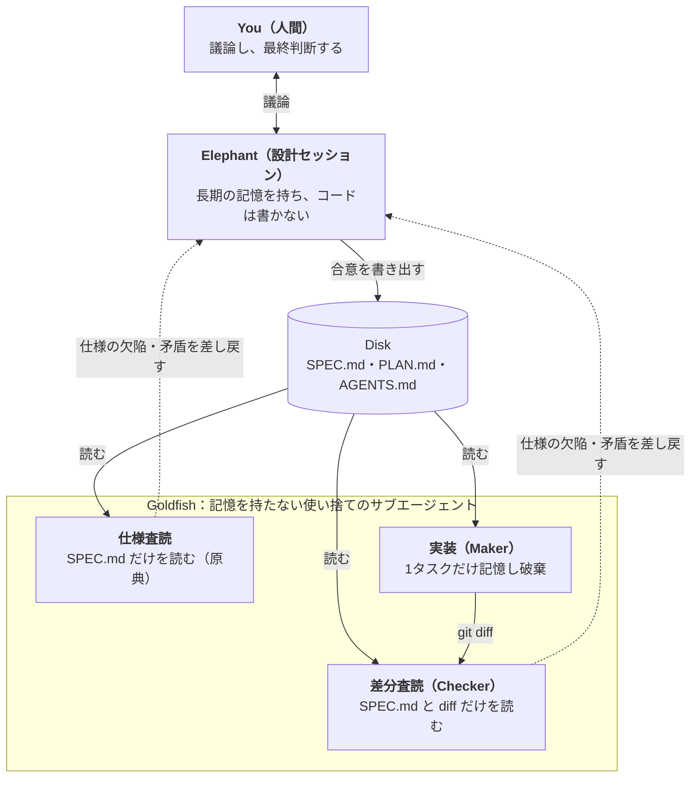
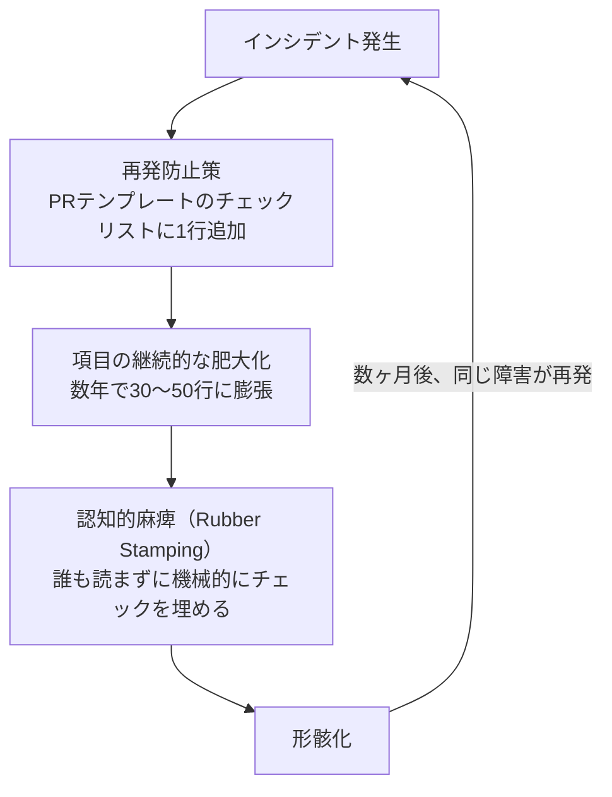
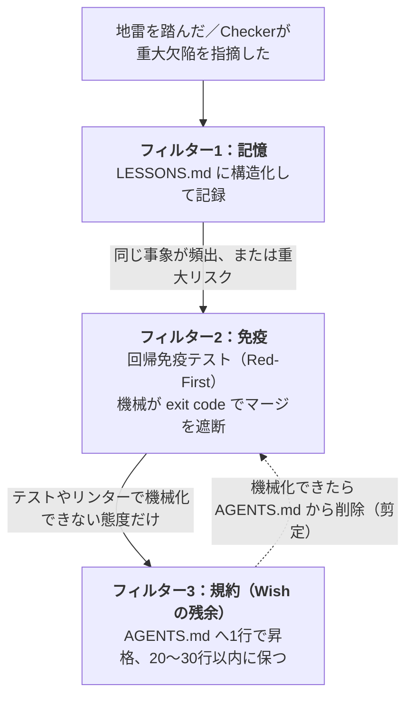
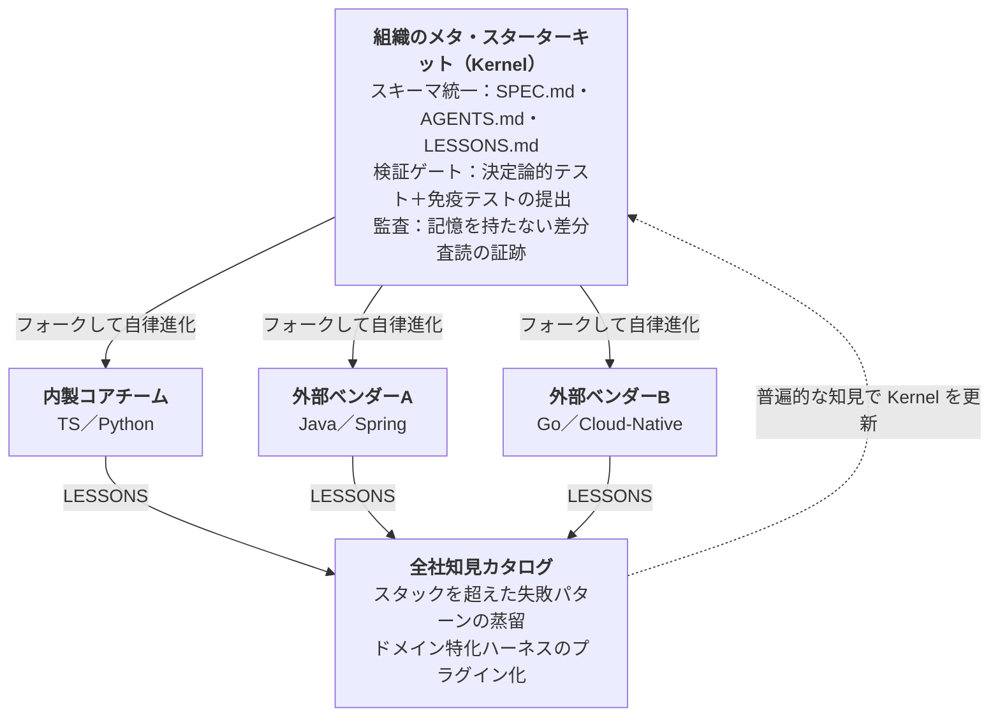

# 自律型AIエージェント時代におけるソフトウェア工学の再定義

2026年11月 · @hamatz

> English translation: [`paper.en.md`](paper.en.md)（正本はこの日本語版）
>
> この論文で述べるスターターキットは [`kit/`](../kit/)、事例に登場する組版ツールとその検査は [`examples/compositor/`](../examples/compositor/) に収録している。

## 論文要旨 / Executive Abstract

**「コードの筆記者」から「ハーネス設計者」への転換と、自己進化型組織のアーキテクチャ**

大規模言語モデル（LLM）とエージェント技術の台頭により、ソフトウェア開発のボトルネックは「コード生成速度」から「人間による確認・接着作業の認知的限界」へと移行した。従来のHuman-in-the-Loop（チャット型UI）や「開発者がコードを1行1行すべて把握すべし」という規範は、ソフトウェアの天文学的な複雑化とサイバー脅威の自動化を前に、安全性の保証ではなく生産性と防御速度を破壊する構造的障壁へと変質している。

本稿では、この精神論的な安全神話を排し、機械が判定できる客観的証拠（決定論的な検証）を核とした「Harness・Loop・Graph」の3層アーキテクチャを提示する。さらに、Googleが公開した「Elephant-Goldfish Model（EGM）」——長期の文脈を保持してコードを書かない設計セッション（Elephant）と、記憶を持たず独立に検査するサブエージェント（Goldfish）の分業——に着想を得て、Goldfishの役割を仕様査読から実装と差分査読へ拡張する認知的分業を理論づける。そのうえで、過去の障害事例を自然言語のチェックリストではなく「再現テスト（Immunity Tests）」へと自己昇格させるLevel 7（自己学習ループ）の設計論を確立する。

最後に、内製チームと外部ベンダーが混在するエンタープライズ環境において、技術スタックの統一を強制することなく「検証プロトコル」のみを共通化して知見を交配・進化させる「連邦型（Federated）スターターキット組織論」を提唱し、次世代エンジニアリング組織における競争優位の源泉を再定義する。

## 第1章：自律型エージェント開発の現状と「人間のボトルネック化」

### 1.1 Human-in-the-Loop の不都合な真実と人間ルーター問題

大規模言語モデル（LLM）の急速な発展に伴い、ソフトウェア開発の現場では「AIにコードを書かせる」こと自体は日常的な風景となった。しかし、現在広く普及しているいわゆる「Human-in-the-Loop（人間参加型）」の開発スタイルは、重大な構造的欺瞞を内包している。

人間がAIの手綱を握り、主導権を持ってタスクを推進しているように見えて、実態は「人間が開発ツール群とAIモデルの隙間を埋める、最も低速で高価な接着剤（Glue）」に成り下がっている。典型的なチャット型UI（単一セッション）による開発ループには、工学的に見て極めて非効率な「4大病理」が蔓延している。

1. **差分不可視による認知過負荷（Diff Blindness）**：リポジトリ全体や数千行のコードブロックをチャットに投入し、修正案として再び巨大なコードブロックを受け取る運用では、変更の境界線が完全に消失する。人間は「何がどう変わったのか」を自らの眼球でスキャンして突合せざるを得ない。AIが数秒で生成したコードの代償として、人間が数十分の差分確認コストを支払うという本末転倒が生じている。
2. **粗大コンテキストによる知能劣化（Context Bloat）**：関連性の薄いファイル群や長大なエラーログを会話履歴へ流し込むことで、モデルの有限なコンテキストは瞬く間に飽和する。注意機構が希釈され、初期に合意した設計原則の忘却、指示の聞き落とし、ハルシネーションの多発という「知能の劣化」が構造的に起きる。
3. **検証のブラックボックス化（False Confidence）**：モデルはしばしば「修正しました。これで正常に動作するはずです」と自己申告する。しかし、その背後でどのようなテストが実行されたのか、客観的証拠は一切提示されない。自己申告を信じた人間が手元でビルドし、初歩的なランタイムエラーで手戻りするサイクルが繰り返される。
4. **生身のプロセス間通信（Human as an IPC Cable）**：「エラーログをコピーし、チャットにペーストし、AIの提案をエディタに貼り付け、再びテストを実行する」反復において、人間の高度な知性は一切使われていない。人間は単なる「クリップボード兼プロセス間通信の電線」として認知的リソースをすり減らしている。

人間をループの中心に置く設計は、安全を担保しているのではなく、システム全体の開発スループットを人間の生身の処理速度に縛り付ける「最大のボトルネック」となっている。

### 1.2 「全行把握＝説明責任」から「根拠を示せること＝説明責任」へ

この「人間ボトルネック」を温存させ、自律化への移行を阻んでいる規範が、「**開発者はすべてのコード行を把握していなければならない**」という考え方である。

金融機関、基幹インフラ、官公庁といったミッションクリティカルな領域では、「中身を理解していないコードを本番に出すのは、監査や規制当局に対する説明責任の放棄だ」という反論が根強い。この反論は、説明責任を真剣に扱っている点で正しい。本稿が問うのは説明責任の要否ではなく、その中身である。全行を人間が読むことは、説明責任を果たす唯一の方法でも、最も確かな方法でもない。

第一に、**「人間がコードを1行1行把握している」という前提は、現代のソフトウェアスタックでは既に成り立っていない**。堅牢な金融システムも、Linuxカーネル、PostgreSQL、暗号化ライブラリ、数千の依存パッケージの上に構築されている。もちろん、これらは盲目的に信頼されているわけではない。採用実績、選定基準、脆弱性情報の監視、SBOM（ソフトウェア部品表）、ライセンス確認という、全行の読解とは別の信頼の仕組みがある。つまり説明責任は、これまでも「全行を読んだ」ことではなく、「なぜ信頼してよいかの根拠を示せる」ことで果たされてきた。

生成されたコードは、依存ライブラリと違って採用実績を持たない。だからこそ、根拠はもっと直接的な形で用意しなければならない。仕様に対する決定論的テスト、回帰免疫テスト、記憶を持たない査読、そしてそれらの監査証跡である。

第二に、防御の速度がある。公開された修正差分から脆弱性の所在を読み取り、攻撃コードを作る作業は以前から知られており、AIエージェントによって自動化が進みうる領域である。防御側が修正パッチの1行1行を数週間の会議体で読み合わせる速度に固執すれば、その間、既知の脆弱性を抱えたまま稼働を続けることになる。目視の手続きが厚いほど安全になるとは限らない。

したがって、必要なのは目視をやめることではなく、**人間が読む対象を移すこと**である。人間の注意は有限なので、機械が判定できないもの、誤ったときの損害が大きいものに集中させる。

| 対象 | 誰がどう確かめるか |
| --- | --- |
| `SPEC.md`（不変条件・スコープ） | 人間が読み、承認する。ここが誤っていれば、以降のすべての検証が誤った物差しになる |
| 受入テスト・免疫テストの差分 | 人間が読む。テストが仕様を正しく写しているかは、機械がまだ判定できない（第2.2節の4） |
| 高リスク領域の実装差分（認証・認可、決済・勘定、暗号、データの削除やマイグレーション、外部公開API） | 決定論的ゲートを通したうえで、人間が全行を読む |
| それ以外の実装差分 | 決定論的ゲートと記憶を持たない査読に委ね、人間はサンプリングで傾向を見る |

この配分なら、監査や規制当局に対して「仕様と物差しと高リスク箇所は人間が確かめ、それ以外は機械的な検証の証跡で示す」と説明できる。全行を読んだという主張より、検証可能な根拠を伴う分、説明責任としてはむしろ強い。

### 1.3 気合と根性から「客観的な物差し」へのパラダイムシフト

ソフトウェア工学が目指すべき地平は、「人間が気合と根性ですべてのコード行を読み、バグがないと信じ込む」という主観的信仰の維持ではない。正しさの根拠を、人間の読解力という不確実な認知から、機械が判定できる客観的な物差しへ移すことである。

ただし、物差しにも強さの違いがある。定理証明支援系言語（Lean 4など）による形式検証は、仕様を満たすことを**証明**する。一方、テストの通過は、指定したケースで壊れていないことの**証拠**にすぎず、テストが書かれていない欠陥の不在までは示さない。本稿が主に依拠するのは後者である。形式検証は対象を選べば最も強い物差しだが、現場のコードの大半にはテストという物差しを当てることになる。だからこそ、その物差し自体の弱さを担保する仕組みが要る（第2.2節の4）。

- **旧パラダイム（精神論的統制）：**「AIの出力は信用できない。したがって人間がすべてを目視確認し、手作業で修正しなければならない」→ 人間が疲弊し、見落としが発生し、スケールしない。
- **新パラダイム（工学的ハーネス統制）：**「AIは確率的推論を行うため、当然ミスやハルシネーションを起こす。したがって、**AIが不変条件や仕様から逸脱した瞬間に物理的にコミットをブロックし、自己修正へ追い込む『検証レール（Harness & Loop）』を人間が設計する**」→ 信頼の対象を「モデルの賢さ」から「検証パイプラインの厳格さ」へと置換する。

エンジニアの役割は、「コードの筆記者（Writer）」から、仕様と制約を客観的に定義し、エージェントが自律走行するための環境を調律する「ハーネス設計者（Harness Architect）」へと脱皮しなければならない。

### 1.4 実践からの観測

本節には、筆者自身のプロジェクトで観測した事例を記す。対象のツールは、このリポジトリの [`examples/compositor/`](../examples/compositor/) に収録している。

#### 事例：縦組み組版ツールのレイアウト崩れ修正

縦組みと紙面モード（ページ送り）に対応した長編執筆ツールを、チャット型UIでエージェントと開発した。図版がページの境目をまたいで切れる、章がページの頭から始まらない、特定の節だけ数pxずれる——こうした崩れの修正に、**スクリーンショットを毎回添えて共有しながら、20回以上のやり取り**を要した。

エージェントに「目」がなかったわけではない。描画結果のスクリーンショットという観測可能な痕跡は、毎回渡していた。それでも収束しなかった理由は3つある。

1. **撮って渡すのが人間だった** —— 1往復ごとに、人間がビルドし、画面を撮り、チャットに貼った。第1.1節の病理4「生身のプロセス間通信」そのものである。
2. **スクリーンショットは「崩れている」ことは示すが、「どこが何pxずれているか」は示さない** —— 証拠のヒエラルキーでは決定論的証拠より下の段にあたる。合否の物差しが人間の目なので、直ったかどうかの判定も毎回人間が下した。
3. **直した崩れを守るテストがなかった** —— ある修正が、以前直した別の崩れを再発させる。その結果、コードには対症療法が積み重なった。図版を運ぶ、合わなければ詰め物に切り替える、最後にもう一度検査して押し出す、という三段構えと、配置処理を4回交互に繰り返して収束させる処理が、その痕跡として残っている。

**5分の確認で済んでいたことが、むしろ問題だった** —— 1往復あたりの人間の確認は、簡単な回帰確認を含めて5分以内だった。それでも、20回以上のやり取りのうち16回は、直ったはずのものが直っていなかったためのやり直しだった。同じ不具合の再発ではなく、「直ったようで別の箇所が崩れた」「一部の用紙サイズでだけ直っていた」という形の手戻りである。このツールは判型4種×組方向2種の8通りで組版が変わる。5分の目視でその全部を見ることはできず、見た1〜2通りが正しければ「直った」と判断していた。

**どの層で防げたか** —— 崩れの大半は Loop の層で防げた。「どの図版もページの境目をまたがない」「章はページの頭から始まる」は位置を計算すれば Exit Code で判定でき、8通りすべてに掛けても人間の手間は増えない。最初の崩れを直した時点でこの検査を回帰免疫テストとして置いていれば、「他が崩れた」も「一部の判型だけ直った」もその場で検出され、エージェントが自分で測って直すループになっていた。

**機械化できなかった部分** —— 一方で、「説明文のすぐ下から本文が始まると窮屈」「回り込みの左右の空きが詰まって見える」といった判断はテストにできず、最後まで人間の目が必要だった。ここは第4.3節でいう Evaluator としての人間が残る領域である。

#### 観測値の記録

| 観測項目 | 実測（位置検査テストの導入前） | 備考 |
| --- | --- | --- |
| レイアウト崩れ修正の往復回数 | 20回以上 | スクリーンショットを毎回共有 |
| 1往復あたりの人間の確認時間 | 5分以内 | 簡単な回帰確認を含む |
| 手戻り（直したはずが直っていなかった）の回数 | 16回 | 「直ったようで別の箇所が崩れた」「一部の用紙サイズでだけ直っていた」を含む |
| 同一不具合の再発 | 0件 | 手戻りはすべて別箇所・別判型での崩れ |
| Checker（査読）の差し戻し件数 | 未計測 | 当時は Checker を置いていなかった |

テスト導入後の比較値は取っていない。本稿の主張は、上の導入前の観測と、付録5・6で示した「ツールの出力は通り、壊した版は落ちる」という確認に拠っている。導入後の往復回数が実際にどれだけ減るかは、本稿の検証の範囲外である。

**今後計測するなら** —— 自己学習ループが働いているかを測る指標として、Arcos 氏は「再発率」を挙げている。その週に起きた失敗のうち、すでに `LESSONS.md` に記録されている失敗が占める割合で、ゼロに近づいていれば学習が回っている。ただし、本節の事例はこの指標だけでは捉えきれない。同一不具合の再発は0件で、16回の手戻りはすべて「別の箇所」「別の判型」で起きたからである。直した崩れを守るだけでなく、まだ見ていない組み合わせを機械に見させる（付録6）ことが要る。再発率とあわせて「人間の目視でしか見つからなかった不具合の件数」を記録しておくと、検査の網の粗さが見える。

次章では、この思想を実環境において具現化するための実行基盤構造——Harness（環境と壁）、Loop（客観的証拠）、Graph（権限分離）の3層アーキテクチャ——について詳述する。

## 第2章：エージェント実行基盤の3層アーキテクチャ

自律型エージェントの運用において信頼の拠って立つべき場所は、モデル自身の確率的出力（自己申告）ではなく、モデルを取り囲む外部構造にある。この外部構造は、明確な責任境界を持つ「Harness（環境と壁）」「Loop（客観的証拠）」「Graph（権限分離）」の3層として定義されなければならない。



### 2.1 Harness（環境と壁）：Wish（お祈り）から Wall（物理遮断）へ

アーキテクチャ図からAIモデルそのものを消去したとき、残るすべての実行基盤——ファイルシステム、CLI、サンドボックス、プロセス権限——の総体が「Harness」である。成熟したハーネスの原則は、エージェントに必要最小限の力だけを与え、逸脱を物理的に不可能な状態に置くことにある。

#### 1. 道具の最小化原則（Least-Tool Principle）

エージェントに「便利なツール」を無制限に追加することは、知能の向上ではなく判断の迷走を招く。ツールが多すぎる環境では、エージェントは「どのツールを使うべきか」というメタ推論に計算資源を奪われ、誤選択や競合を起こす。優れたハーネスは、入出力が厳格に規定された少数のプリミティブな道具（ファイル読み書き、最小限のシェル実行、テストランナー）に絞り込まれている（具体的な上限数は筆者の経験則であり、モデルとタスクにより異なる）。

#### 2. 「お祈り（Wish）」と「壁（Wall）」の決定的な断絶

- **お祈り（Wish）：**「`.env` や認証鍵は読み込まないでください」「勝手にマイグレーションを実行しないでください」とプロンプトやルールファイルに書く。
- **対話式確認（Interactive Prompt）：**「`.env` を開いてよろしいですか？ \[Y/n\]」と人間に都度確認する。
- **物理の壁（Wall）**：エージェントのプロセスから、対象がそもそも存在しない、または権限上アクセスできない状態にする。

プロンプトでの禁止は、モデルが長大な推論の果てにそれを破るリスクを原理的に排除できない。確認ダイアログは承認疲れを誘発し、「とりあえずY」という形骸化を招く。

ここで注意すべきは、**よく「壁」と誤解される設定の多くが、実は壁ではない**ことである。たとえば `.gitignore` は「コミット対象から外す」だけであり、作業領域にあるファイルをエージェントが読むことは防げない。本稿でいう壁は、次のいずれかを満たすものに限る。

| 壁の種類 | 具体例 | 防げること | 防げないこと |
| --- | --- | --- | --- |
| 存在させない | 本物の機密はシークレットストアとCI/本番環境にのみ置き、エージェントの作業領域には `.env.example`（ダミー値）しか存在させない。コンテナに機密ディレクトリをマウントしない | 読み取り・ログ展開・漏洩のすべて | なし（存在しないものは読めない） |
| 権限で遮断する | OSパーミッション、サンドボックスのファイルシステム制限、エージェントツール側の読み取り拒否設定 | 意図しない読み取り | ツール側の拒否設定のみの場合、シェル経由の迂回（サンドボックス併用が前提） |
| 合流点で遮断する | ブランチ保護で「CIの必須チェック通過」をマージ条件にする。CIでテスト・型検査・シークレットスキャンを実行 | 検証未通過のコードの本番系への合流 | 作業領域内での一時的な逸脱（ここは Loop が担う） |

ローカルのpre-commitフックも有用だが、`--no-verify` で迂回できるため、それ単体は壁ではなく「早期警告」と位置づける。最終的な壁は、エージェントが設定を変更できないサーバ側（ルールセットやブランチ保護とCI）に置く。ただし、これが壁として働くのは、バイパスを誰にも許さず（管理者も含む）、エージェントの資格情報にリポジトリ設定・ルールセット・ワークフローを変更できる権限を与えていない場合に限る。設定を変えられる者にとって、設定は壁ではない。

#### 3. RAM（コンテキスト）と Disk（ファイルシステム）の分離

LLMのコンテキストウィンドウは揮発性の「RAM」である。長時間の作業において、進捗や設計仕様をRAMに保持させようとすれば、コンテキスト圧縮やセッション切り替えに伴って確実に揮発する。ハーネスは、永続化すべき状態をすべて「Disk」へ逃がす機構を備えていなければならない。

- `SPEC.md`：変わらない設計と不変条件のアンカー
- `PLAN.md`：現在のタスク進捗と次の一手
- `git commit`：ロールバック可能な状態のチェックポイント

エージェントがクラッシュしても、Disk上のファイルとGit履歴さえ読み直せば即座に作業を再開できる構造を作ること。これがハーネスの中核機能である。

### 2.2 Loop（客観的証拠に基づく収束）：証拠のヒエラルキー

エージェントが「修正しました。これで問題なく動きます」と出力したとき、それを鵜呑みにしてコミットを許可するシステムは、自動化の体を成していない。ループの強度は、そのシステムが完了の証拠として受け入れる最も脆弱なものの強度と一致するからである。

#### 1. 証拠のヒエラルキー（Hierarchy of Evidence）



エージェントの自己申告は最弱のノイズであり、ループを閉じる証拠として受け入れてはならない。コードの採択基準は、テストランナーが `exit 0` を返したか否かという決定論的事実に委ねられる。独立した査読は重要だが、決定論的証拠の代わりにはならず、それを補う位置にある。

#### 2. Red-First（失敗しうることの事前確認）原則

修正前からすでにGreenだったテストを通過証拠として受け入れるのは無意味である。それはテストが何も検査していない証拠に過ぎない。バグ修正や機能追加のループは、「変更前のコードで確実にRed（Exit 1）となるテストをまず作成し、その失敗を確認した後に、コード修正によってGreen（Exit 0）へ遷移させる」という遷移の観測を義務付けなければならない。

#### 3. 自然言語ではなく「一次証拠（Artifacts）」によるフィードバック

単に「テストが落ちました」と伝えるループは収束しない。収束をもたらすフィードバックとは、次のような客観的アーティファクトの提示である。

- **EXPECTED（期待値）** と **SAW（観測値）** の具体的差分
- 失敗したスタックトレースの該当行
- 探索範囲を限定するフェンス（「修正は `src/auth/` 配下に限定せよ」）

同一のSAWを伴う失敗が2回連続した場合は、ループを即座に中断（Escalate）する。同じ失敗の反復は、努力の不足ではなく、モデルが観測できていない領域があるか、問題設定そのものが破綻している証拠だからである。

#### 4. 物差しそのものの弱さを担保する

エージェントが実装とテストの両方を書くとき、テストは実装に合わせて弱くなりやすい。実装をなぞっただけのテスト、何も確かめない浅いアサーション、落ちたテストの期待値の書き換え——どれも Exit 0 を返す。Red-First は「このテストが何かを検査している」ことは示すが、「必要なことを十分に検査している」ことまでは示さない。そこで、物差しの側にも次の4つの仕組みを掛ける。

1. **受入テストは Maker に書かせない** —— `SPEC.md` から導く受入テストは、Elephant（と人間）の側で書く。Maker のコンテキストからは読めても書けないようにし、既存テストと免疫テストの変更・削除はコードオーナー（人間）の承認を必須にする。テストを書き換えて通す道を、お祈りではなく壁で塞ぐ。
2. **ミューテーションテストで検査の穴を測る** —— 実装をわざと少しずつ壊し（条件の反転、境界値のずらしなど）、テストが落ちるかを数える。壊しても通ってしまう変異は、テストが見ていない箇所である。Stryker（JS/TS）、PIT（Java）、mutmut（Python）などの道具がある。
3. **例ではなく性質を書く** —— プロパティベーステストは、「任意の入力に対して、この性質が成り立つ」と書き、道具が反例を探す（fast-check、Hypothesis など）。エージェントが思いつく例の範囲に検査が縛られにくい。
4. **人間が読むのはコードではなく、物差し** —— 人間のレビューの重心を、実装の差分から `SPEC.md` とテストの差分へ移す。テストが仕様を正しく写しているかは、機械がまだ判定できない領域であり、第4.3節の Evaluator としての人間の仕事である。

付録の `tests/verify_layout.mjs` の確認は、2のごく小さな手作業版にあたる。わざと壊した版を判型と組方向の組み合わせごとに作って掛けたところ、最初の版は横組みの崩れを一切検出できていないことが分かった。検査を直し、すべての組み合わせで壊した版が落ちることを確かめてから採用した（付録5）。

### 2.3 Graph（Maker-Checkerと権限分離）：記憶を持たない査読

決定論的テストが通っても、「コードがスパゲッティ化している」「不要な外部ライブラリが安易に追加された」「YAGNIに反する過剰な抽象化が施された」といった構造的腐敗（Architectural Decay）は防ぎ切れない。これを防ぐのが第3の層「Graph」であり、その中核が「Maker-Checker（作成と査読の分離）」である。

#### 1. 単一エージェントの自己盲目性（The Self-Blindness Problem）

実装を担当したエージェント自身に「このコードに問題はないか？」とレビューさせても、自身の盲点を高い確度でスルーする。自らが生成した文脈（バイアス）に囚われているためである。同じ会話履歴を共有したまま別のモデルに査読させても、この盲点は引き継がれる。

#### 2. Checker は「記憶を持たない査読者」でなければならない

Checkerの価値は、モデルの格の高さよりも、**Makerの試行錯誤を一切見ていないこと**にある。第3章で述べるEGMの用語でいえば、CheckerはGoldfish（記憶を持たないサブエージェント）として起動される。役割分担の例は次の通りである。

- **Maker（実装担当）**：スコープを極小化し、与えられたタスク仕様に対してコードを書き、テストを Green に導く。高速性・局所集中・ツール実行能力が求められる（例：Gemini系のモデル）。
- **Checker（査読担当）：**`SPEC.md` との照合、過剰設計の削ぎ落とし、潜在的エッジケースの指摘。抽象思考力と全体整合性の判断が求められる（例：Claude Opus）。

モデル名は2026年時点の一例であり、役割の定義はモデルに依存しない。異なる系統のモデルを組み合わせると盲点の重なりが減る効果も期待できるが、より本質的なのはコンテキストの分離である。

#### 3. 差分（Diff）という唯一の境界インターフェース

MakerからCheckerへのハンドオフで、Makerの作業ログ（自然言語の言い訳）を渡してはならない。Checkerがバイアスを受け、査読精度が低下するためである。引き渡すアーティファクトは、**`SPEC.md`（仕様基準）と `git diff`（変更の事実）の2点のみ**に限定する。

#### 4. Checker の確定権とその限界

Checkerには、単なるコメント係ではなく、**不要なコードを削除し、命名をリファクタリングする権限**（Pruner）を与える。ただし、Checkerが手を入れた瞬間、Checkerはその変更のMakerになる。そこで次の2つの規則を課す。

1. **再検証の義務**：Checkerの修正後も、第2.2節の検証ゲートを再実行し、Exit 0 を確認してから確定する。
2. **権限の範囲**：Checkerが直接行えるのは「削除」と「挙動を変えない改名・整理」に限る。ロジックの追加や挙動の変更が必要と判断した場合は、指摘としてMakerに差し戻す。

これにより「査読者の変更を誰も査読していない」という抜け穴を塞ぐ。

以上の3層構造が確立されて初めて、エージェントは「人間がお守りしなければ暴走するチャットツール」から、「仕様とテストのレールの上を自律走行する生産サブシステム」へと昇格する。次章では、この構造を、Googleが公開した「Elephant-Goldfish Model」の観点から理論的に解剖する。

## 第3章：認知モデルによる理論的裏付け —— Elephant-Goldfish Model の拡張

第2章の3層構造の根底には、LLMの認知的制約を克服するための計算資源配分の戦略がある。本章では、Googleが2026年10月にオープンソースとして公開した「Elephant-Goldfish Model（EGM）」を出発点とし、その分業を実装と差分査読へ拡張する。なぜ単一セッションに全体像と局所実装の両方を背負わせると破綻するのか、どこに認知的な責任境界を引くべきかを論じる。

### 3.1 単一コンテキスト依存の限界と認知の破綻

最も直感的でありながら最も壊滅的な失敗を招くのが、「1つのチャットセッションの中に、要件定義から設計、詳細実装、テスト実行ログまでのすべてを蓄積していく」**モノリシック・コンテキスト運用**である。



#### 1. 注意機構の希釈（Attention Dilution）と知能の劣化

コンテキストウィンドウは人間の作業記憶に相当する。**「入力可能であること」と「そのすべてに等しく鋭敏な注意を配分できること」は同義ではない**。冗長な試行錯誤、大量のスタックトレース、無関係なモジュールがコンテキストに充満すると注意は希釈され、初期に定義した「認証ロジックの不変条件」や「命名規約」といった最重要の制約が背景ノイズに埋没する。

#### 2. 目はあっても物差しがない「盲目の反復ループ」

電子書籍の組版や複雑なHTML/CSSレイアウトのように、描画結果の確認が欠かせないタスクでは、反復ループが特に起きやすい。エージェントが自ら生成したテキスト表現しか見られない場合、「実際にどう描画されたか（SAW）」を観測できず、パディングやマージンの数値を当てずっぽうに変え続ける。

しかし、スクリーンショットを渡せば解決するわけではない。画像は「崩れている」ことは示せても、「どこが何pxずれているか」「何をもって直ったとするか」は示さない。合否の物差しが人間の目に残る限り、人間が撮影し、貼り付け、判定する往復は終わらない。第1.4節の事例では、スクリーンショットを毎回添えても20回以上のやり取りを要した。

ループを閉じるには、観測する目に加えて、測る物差しが要る。「どの図版もページの境目をまたがない」のように崩れを位置の条件として書き下し、エージェント自身が実行して Exit Code で判定できる形にすること。目（観測可能な痕跡）は原因を探すために使い、合否は物差し（決定論的証拠）で決める。

### 3.2 原典のEGM：象は設計し、金魚は検査する

EGMは、AI開発における役割を「Elephant」「Goldfish」「You（人間）」の3者に分ける枠組みである。

- **Elephant（象）**：長い会話履歴と文脈を保持する長期セッション。アーキテクチャの全体像とプロジェクトの記憶を持ち、**コードは一切書かない**。人間と議論しながら設計意図と細かな判断を記録し、設計書を起草することに専念する。
- **Goldfish（金魚）**：過去の会話履歴を一切持たない、ゼロコンテキストのサブエージェント。Elephantが起草した仕様書を、作成過程のバイアスを受けずに客観的に検査し、欠陥を指摘する。
- **You（人間）**：Elephantの問いに答え、設計上の選択を議論し、最終判断を下す。

この分業の核心は「記憶の非対称性」にある。設計には長い文脈が必要だが、検査には文脈がない方がよい。作成者の文脈を共有した検査者は、作成者の盲点も共有してしまうからである。

### 3.3 本稿の拡張：金魚を実装と差分査読にも使う

本稿は、EGMの「記憶の非対称性」という原理を、設計フェーズの外へ拡張する。原典のGoldfishは仕様の検査を担うが、本稿ではGoldfishを3つの用途で起動する。この拡張は本稿独自の提案であり、原典の主張ではない。

| 役割 | 記憶 | 受け取る入力 | 出力 | 原典との関係 |
| --- | --- | --- | --- | --- |
| Elephant（設計セッション） | 長期。会話履歴＋外部Disk | 人間との議論、査読結果 | `SPEC.md`、`PLAN.md`、`AGENTS.md` | 原典どおり。決定事項をDiskへ書き出す点を追加 |
| 仕様査読 Goldfish | なし | `SPEC.md` のみ | 仕様の欠陥・矛盾の指摘 | 原典どおり |
| 実装 Goldfish（Maker） | 1タスクの間だけ | `PLAN.md` の1ステップ、関連する仕様の抜粋、失敗するテスト | コード差分とテスト通過の証跡 | 本稿の拡張 |
| 差分査読 Goldfish（Checker） | なし | `SPEC.md` と `git diff` のみ | 剪定・改名のコミット、または差し戻し | 本稿の拡張 |



GoldfishはElephantの会話を読まず、Diskだけを読む。仕様の問題は、どのGoldfishが見つけてもElephantへ戻る。

#### 1. 象の責務：判断をRAMからDiskへ書き出すアンカー

Elephantはコードを書かず、システムが向かうべき北極星（Goal）と破ってはならない境界線（Invariants）を人間と合意する。原典のElephantは長い会話履歴そのものを記憶として使うが、本稿ではさらに、**合意した判断を必ず `SPEC.md` や `AGENTS.md` という外部Diskに書き出す**ことを求める。Elephantのセッションが途切れても、Disk上の不変条件は揺らがない。下流のすべてのGoldfishは、Elephantの会話ではなく、このDiskだけを読む。

#### 2. 実装金魚の責務：不要な文脈を意図的に持たない超集中実行

実装Goldfishは、システム全体のアーキテクチャや過去の失敗履歴といった雑音から切り離され、**「`PLAN.md` のステップ3にある、この1つのテストをパスさせること」だけに注意を集中する**。「将来の拡張性」や「別モジュールとの整合性」への配慮は、局所的な実装フェーズでは過剰設計を誘発する原因となる。実装Goldfishには「狭いスコープ、明確な入出力仕様、失敗するテスト」だけを与える。

#### 3. 査読金魚の責務：何も知らないからこそ見える

差分査読Goldfish（第2章のChecker）は、Makerの試行錯誤を一切見ていない。`SPEC.md` と `git diff` だけを入力とするため、「なぜこう書いたか」という言い訳に引きずられず、仕様との乖離と不要な複雑さだけを見る。これは原典が仕様に対して行っている検査を、コード差分に対して行うものである。

### 3.4 コンテキストのライフサイクル管理：強制ガベージコレクション

分業を成立させる最後の鍵は、Goldfishのコンテキストを使い捨てにすることである。

#### 1. 実装金魚の短命化（Ephemeral Subagents）

実装Goldfishは、1つのタスクを達成した瞬間に、そのコンテキストごと破棄される。作業の連続性は会話ログではなく、次の3つの確定アーティファクトで担保される。

1. **`git commit`**：確定したコード差分とメッセージ
2. **`PLAN.md`**：完了ステータスへ更新されたチェックボックス
3. **客観テストの実行ログ**：全件通過（Exit Code 0）の痕跡

#### 2. チェックポイントでの査読と、象への還流

実装Goldfishが終了した節目で、新しい査読Goldfishが起動され、`SPEC.md` と `git diff` だけを読んで査読する。査読Goldfishが「仕様そのものが曖昧・矛盾している」と判断した場合、それはコードの問題ではなく設計の問題である。その指摘はElephant（と人間）へ戻され、`SPEC.md` の改訂として決着する。

### 3.5 EGM との関係：設計は EGM に、実装と検証は本稿のハーネスに

原典の EGM は Google がプラグインとして公開しており、Antigravity、Claude Code、Codex などに導入できる。では、それを入れれば本稿の仕組みは要らないのか。答えは否である。両者は受け持つ段階が違い、補い合う関係にある。

EGM は「実装に入る前に設計を固める」ための道具である。構想の壁打ち、設計書の起草、新しいコンテキストの査読者による段階的なレビュー、指摘の解消、設計書とコードのずれの報告までを備え、承認された設計書は `docs/designs/` に置かれる。一方で、Goldfish が査読するのは設計書と、そこから参照されるソースコードであり、コードの差分ではない。CI・フック・権限による強制も持たず、EGM 自身、レビューはテストや人間の判断の代わりにはならないとしている。

| 段階 | 受け持つもの | 中身 |
| --- | --- | --- |
| 構想・設計 | EGM | 壁打ち、設計書の起草、記憶を持たない段階的なレビュー、人間の承認、設計書とコードのずれの報告 |
| 設計から仕様へ | 両者の接点 | 承認された設計書から `SPEC.md`（不変条件・受入テスト・完了定義）を起こす |
| 実装 | 本稿（Harness・Graph） | 機密を置かない作業領域、1タスクで破棄する実装 Goldfish、`PLAN.md` |
| 検証 | 本稿（Loop・Graph） | Exit Code による判定、Red-First、記憶を持たない差分査読と権限の制限、CODEOWNERS とブランチ保護 |
| 学習・組織 | 本稿（第4章・第5章） | 回帰免疫テストへの昇格、`AGENTS.md` の剪定、連邦型の展開 |

第1.4節の事例が、この境界をよく示している。20回以上の往復は設計の誤りではなく、直ったかどうかを測る物差しがないことから生じた。設計をどれだけ磨いても、このループは止まらない。止めるのは第2.2節の Loop と、付録5・6の検査である。

実践としては、設計の段階は EGM に任せ、承認された設計書を `SPEC.md` の起点にするのがよい。`SPEC.md` には、設計書のうち受入テストに落とせる不変条件と完了定義を抜き出して書く。第3.3節の表の「仕様査読 Goldfish」は、EGM を使わない場合の最小限の代替と位置づける。また、EGM の「設計書とコードのずれの報告」は、第4章の剪定と同じく、書かれたものと実態のずれを定期的に見つける仕組みとして併用できる。

以上により、「エージェントが長時間の作業で徐々に錯乱していく」現象は、記憶を持つべき役割と持つべきでない役割の混同であったことが明らかとなる。しかし、Goldfishを使い捨てにすることは、そのセッションで得られた試行錯誤や地雷回避のノウハウも消滅させる。次章では、この忘却の代償を克服する自己学習ループを論じる。

## 第4章：Level 7への到達：記憶の揮発を防ぐ自己学習ループ

**PRチェックリスト形骸化の罠を越える自律代謝システム**

Goldfishを使い捨てる運用は、作業過程で得られた試行錯誤、ライブラリの非公開の挙動、二度と踏んではならない地雷の教訓を揮発させる。セッションを跨ぐたびにエージェントが同一の過ちを繰り返し、人間が同じ注意をプロンプトで喚起し続ける状態は、まだ自律運用の手前にある。

本章でいう「Level」は、m4lka（@m4lkxx）氏の記事「Harness, Loops, Graphs: What Each Layer Fixes and What It Breaks」が示した成熟度の段階に拠る。同記事は、エージェントの子守りから複数エージェントの運用までを、次の8段階に整理している（表の訳と要約は本稿による）。

| Level | 層 | 名前 | できるようになること |
| --- | --- | --- | --- |
| 0 | — | チャット | 人間がすべてを担う |
| 1 | Harness | 手 | エージェントが自分で実行できる |
| 2 | Harness | 記憶 | 作業を途中から続けられる |
| 3 | Loop | 検査 | 間違いが表に出る |
| 4 | Loop | フィードバック | 間違いから自力で戻れる |
| 5 | Graph | 形 | 仕事が正しい形に分かれる |
| 6 | Graph | 関門 | 間違いが小さいうちに止まる |
| 7 | 学習 | — | 同じ間違いが二度と起きない |

本章が目指すのは、このうち Level 7——タスクの実行と失敗の経験がディスク上に蒸留され、次のエージェントの行動規範へと自動還元される状態——である。同記事は Level 7 を、学習がすべての層で起きる段階として描いている。本稿はこれを、教訓を「回帰免疫テスト」という実行可能な形へ昇格させる仕組みとして具体化する。

### 4.1 人間組織における「PR規約肥大化の悲劇」という病理

自己学習ループの設計で最も警戒すべきは、**人間の開発組織が繰り返してきた「チェックリストによる品質管理の失敗」をエージェントにそのまま適用すること**である。



この失敗の本質は、過去の教訓を「人間の注意力」に依存する自然言語の箇条書きとして放置したことにある。エージェント運用でも、過去の失敗をルールファイルやプロンプトに継ぎ足していけば、注意の希釈が再来し、エージェントは指示の海で溺れる。Level 7の自己学習とは、チェックリストを増やすことではない。**教訓を「注意力を要求するテキスト」から「機械が物理的に弾く実行可能コード」へ昇華させる代謝プロセス**である。

### 4.2 3つの自己昇格（Promotion）メカニズム



#### 1. フィルター1：事後学習メモリ（`LESSONS.md`）への構造化記録

予期せぬエラーの解消に複数回のリトライを要した場合、あるいは差分査読Goldfish（Checker）から設計の欠陥を指摘された場合、エージェントはタスク完了時に `LESSONS.md` へ教訓を記録する。曖昧な感想文を排除するため、次のスキーマを強制する。

- **Context**：発生箇所のファイル、利用技術、具体的な状況
- **Trap（やらかし）**：何を誤認し、どのような不具合を引き起こしたか
- **Rule（教訓）**：推奨される、または厳禁される実装パターン
- **Rung（置き場所）**：修正を本節の4の表のどの段に置いたか。直感より一段下を目指す
- **Immunity Test**：再発を機械的に検証するテストコードへの相対パス
- **Proof（作動の確認）**：元の失敗を再現し、ガードが実際に作動したことを確かめた記録

`LESSONS.md` はプロンプトに常時全行展開するのではなく、タスク開始時に関連する領域だけを検索して参照する「外部辞書」として機能する。

#### 2. フィルター2：回帰免疫テスト（Immunity Tests）の義務化

これが人間のPRチェックリスト病と決別する最大の分水嶺である。バグ修正において、エージェントは修正コードを書く前に、**現状のコードで確実に失敗（Exit 1）する再現テスト**を先行配置する（Red-First）。修正後にそのテストがパスすることを確認したうえで、再現テストは一時的なスクラップではなく**回帰免疫テストとしてリポジトリに永続配置**される。

自然言語で「〇〇の例外処理を忘れないこと」と100回唱えさせるよりも、CIでその例外を突くテストを1本走らせる方が、はるかに確実に再発を防ぐ。エージェントが過去の規約を意識していようがいまいが、CIの必須チェックがマージを遮断する「自動免疫」が成立する。

#### 3. フィルター3：ルールファイル（`AGENTS.md`）への昇格と定期的「剪定（Pruning）」

同一カテゴリの地雷が `LESSONS.md` に繰り返し登場し、かつテストやリンターでは機械化できない場合に限り、その教訓は `AGENTS.md` へ1行の規範として昇格する。つまり `AGENTS.md` は「機械化できなかった Wish の残余」を置く場所であり、そのこと自体を自覚的に扱う。

- **テスト・リンター代替の原則** —— 型定義、リンターのカスタムルール、単体テストで機械的にブロックできるようになった規範は、`AGENTS.md` から即座に削除する。
- **残余を小さく保つ** —— 自然言語の規範は常に「機械化できない、高次の設計思想・態度」に限定し、20〜30行以内（筆者の経験則）に保つ。

#### 4. 修正の置き場所と「半減期」

Arcos 氏は、同じ失敗を防ぐための修正が、置く場所によって「同じ失敗が戻ってくるまでの期間」が大きく違うことを、修正の半減期と呼んで段に整理している。次の表は、その整理を本稿の用語に対応づけたものである。

| 修正の置き場所 | 効き目が続く期間（目安） | 本稿での位置づけ |
| --- | --- | --- |
| 会話で注意する | そのセッションだけ | Wish |
| プロンプトに書く | 数日 | Wish |
| `AGENTS.md` に書く | 数週間 | Wish の残余（本節の3） |
| 道具（スクリプト）にする | 数か月 | Harness |
| 検査（テスト・リンター・CI）にする | 消すまで | Loop（回帰免疫テスト） |
| 関門（フック・権限・ブランチ保護）にする | 消すまで | Wall |
| 作りそのものを変える | ずっと | Wall（対象を存在させない） |

本節の3つのフィルター（記憶・免疫・規約）は、この段を大きく3つにまとめたものにあたる。原則は、修正を保てる限り下の段へ押し込むことである。表の上の3段はどれも人間やモデルの注意に頼っており、文脈が長くなったりモデルが替わったりすると埋もれる。下の段に行くほど、注意に頼らずに効く。

#### 5. 剪定は、根拠に基づいて行う

本節の3の剪定は「機械化できたら自然言語の規範を消す」というものだった。もう一つ、ガードそのものを消す剪定がある。ガードはトークン、待ち時間、エージェントの注意を消費し、より賢いモデルなら自力で見つける別の解き方を妨げることもある。Vercel は、社内のデータ分析エージェントの専用ツールを17個から2個に減らし、代表的な5件の問い合わせで成功率・速度・トークン量のすべてが改善したと報告している。標本は小さいが、ガードや道具を足し続けることが常に正しいわけではないことを示している。

ただし、消す判断も根拠に基づかなければならない。モデルを更新するたびに、次の手順で確かめる。

1. 危険度の低いガードを一つ外す
2. そのガードが生まれた元の失敗を再現する（`LESSONS.md` の Immunity Test を流す）
3. まだ失敗するならガードを戻す。失敗しなくなったら削除し、理由を `LESSONS.md` に残す

権限、機密、本番環境への接続にかかわるガードは、この手順でも自動では外さない。ガードを締めることはエージェントにも許すが、緩めることができるのは人間だけ、という第2.2節の4の原則と同じである。

### 4.3 人間の役割の転換：Evaluator と Rule Pruner へ

Level 7の自己学習ループが稼働し始めると、人間はエラーメッセージを右から左へコピペする「接着剤」でも、Diffを1行ずつ読む「人力リンター」でもなくなる。人間の責務は次の2つのメタ領域へ移る。

1. **評価関数の設計者（Evaluator）**：何をもって「成功」とするかを `SPEC.md` に条件として定義し、Elephantとの議論を通じて磨くこと。エージェントがテストを欺瞞する抜け道（Specification Gaming）を通っていないかを監視すること。
2. **ルールの調律者（Rule Pruner）：**`LESSONS.md` の蓄積を定期的に俯瞰し、不要になった自然言語規範を切り捨て、本質的な知見だけをハーネスへと蒸留すること。

コードの生成と修正をエージェント自身の客観的ループに委ねることで、人間は「システムの自己進化メカニズムそのものを設計する側」へと移る。次章では、この自己学習ループを企業・組織全体のスケールへと拡大する。

## 第5章：組織論への展開：スターターキットの分散進化と知見の交配

**内製・外注が混在するエンタープライズにおける連邦型エコシステム**

第4章までの仕組みは、単一のリポジトリや小規模チームで劇的な生産性と安全性を発揮する。しかし企業全体へ展開しようとすると、「組織構造の壁」に突き当たる。基幹系・フロントエンド・データ基盤・モバイルで異なる技術スタックが存在し、複数の外部SIerやベンダーが参画する「内製と外注のハイブリッド構造」が常態だからである。

### 5.1 技術スタック完全統一の幻想と、中央集権統制の破綻

全社展開で最初に陥りがちなのが、「全社標準の単一ツールチェーン・単一言語スタックの強制」である。この中央集権統制は、次の現実を前に瓦解する。

1. **ドメイン最適化とベンダー強みの毀損**：低レイテンシ処理や勘定系にGoやJava、WebフロントエンドにNext.js、データパイプラインにPythonが選ばれるのには明確な理由がある。外部パートナーも得意なスタックでこそ高い生産性を発揮する。単一スタックを押し付ければ、現場の生産性は根底から破壊される。
2. **ルールの形骸化と中央のボトルネック化**：技術スタックが異なればコードの生成特性も依存ライブラリの癖も異なる。現場にフィットしない抽象的なルールは即座に形骸化し、例外申請を中央が捌ききれずに推進組織そのものがボトルネックと化す。
3. **「勝者総取り」モデルの脆弱性**：最も成果を出した単一チームのスターターキットを全社標準とする淘汰モデルは、局所最適の罠に落ちる。Web開発で最適化されたキットは、基幹系バッチやセキュリティクリティカルな現場では致命的な不適合を起こす。

目指すべきは、現場の自律性と技術の多様性を担保しながら、組織全体の免疫力だけを統合的に高める「連邦型（Federated）モデル」である。

### 5.2 「スタック」ではなく「検証プロトコル」を共通化する

組織横断で統一すべき唯一の領域は、「エージェントを走らせ、検証し、知見を吸い上げるためのメタ・コンテナ＝検証プロトコル（Verification Protocol）」である。



中央（Platform Engineering組織やCoE）が配布する「メタ・スターターキット（Kernel）」は、特定のコードテンプレートではなく、次の3つのインターフェース規約のみを定義する。

#### 1. 入出力アーティファクトのスキーマ統一

- システムの不変条件を定義する `SPEC.md`
- 機械化できない規範の残余を置く `AGENTS.md`
- 失敗の構造を辞書化する `LESSONS.md`

この3ファイルの配置場所とスキーマを全社で固定する。内部の言語がJavaであろうとRustであろうと、エージェントが仕様を読み、規範に従い、失敗を記録する「手続きの型」を共通化する。

#### 2. 受入基準（Definition of Acceptance）の機械的プロトコル化

「納品されたソースコードを人間が全行レビューして検収印を押す」商習慣を見直し、客観的アーティファクトの提出を検収条件とする。ただし、第2.2節の証拠のヒエラルキーに従い、**決定論的証拠と補助証拠を区別する**。

| 区分 | 提出物 | 検収での扱い |
| --- | --- | --- |
| 必須（決定論的証拠） | `SPEC.md` の全仕様に対する決定論的テストの完全通過（Exit Code 0）。発注側が管理するCI上での実行ログ | 1つでも欠ければ不合格 |
| 必須（決定論的証拠） | 開発中の不具合に対する回帰免疫テストのコミット履歴（修正前にRedだったことの記録を含む） | 1つでも欠ければ不合格 |
| 補助証拠 | 記憶を持たない差分査読（Checker）のログと、指摘への対応記録 | 合否の根拠にはしない。指摘の傾向を人間がサンプリングして確認する |

テストの実行は、ベンダーの手元ではなく**発注側が管理するCI**で行う。提出されたログを信じるのではなく、発注側の環境で再現できることを検収条件とすることで、ログそのものが自己申告になることを防ぐ。発注側は、異種言語のコードを1行ずつ読む重労働から解放され、「ハーネスが健全に機能し、決定論的証拠が揃っているか」の監査に集中できる。

#### 3. 失敗の構造化データ（メタ知識）の共通フォーマット

各チームが遭遇した地雷（Trap）と教訓（Rule）を、全社レジストリへ同期可能な構造化データとして記述させる。

### 5.3 連邦型（Federated）進化：分散探索と知見の交配

#### 1. 各現場における「分散探索（Fork & Local Adaptation）」

各現場は中央のKernelをフォークしてプロジェクトを開始し、技術スタックや事業特性に応じた独自の進化を遂げさせる。フロントエンドチームはヘッドレスブラウザを用いたレイアウト崩れの検証ハーネスを磨き、基幹系チームはDBコネクションプールの枯渇やデッドロックを検知するストレステストハーネスを進化させる。多様な現場で同時にエージェントを走らせることで、組織全体として無数の環境における失敗と成功のパターンを並行して掘り進めることができる。

#### 2. 普遍的知見の「コアKernelへの昇格（Distillation）」

各プロジェクトの `LESSONS.md` のうち、技術スタックを超えて適用できる知見は、中央のKernelへ還元され全社標準となる。スタックが異なっても、重大な地雷の本質は共通している。

- 外部API通信における指数バックオフ付きリトライとタイムアウト遮断の欠落
- 分散環境における冪等性（Idempotency）保証の漏れ
- 機密情報のメモリ展開およびログ出力リスク

Javaを採用するベンダーAのエージェントが踏んだ地雷は抽象化され、Pythonを採用する内製チームのエージェント環境へも翌日には反映される。

#### 3. ドメイン特化ハーネスの「カタログ化とプラグイン共有」

言語依存の深い知見や特定の検証スクリプト（例：付録の `tests/verify_layout.mjs`）は、全社コアに無理やりマージせず、「検証プラグイン・カタログ」として社内レジストリに登録する。類似のスタックで立ち上げるチームは、カタログから実績あるハーネスをインポートして即座に高い防御力を得られる。

### 5.4 組織知の複利化（The Compounding Organization）

プロジェクトの終了とともに散逸していた現場のノウハウは、本モデルによって初めて**機械可読な組織資産**として蓄積される。外部ベンダーが書いたコードそのものはプロジェクト固有であっても、`LESSONS.md`、回帰免疫テスト、検証ハーネスは発注元の中央レジストリに永続資産として残る（その帰属と、ベンダー間での共有範囲は契約で事前に定めておく必要がある）。

プロジェクトを立ち上げるたび、外部パートナーと協業するたびに、社内のスターターキット群は賢く強靭になっていく。組織の失敗経験が、人の入れ替わりによって忘却されない「生きたコードとルール」へ変換され続けること。これこそが、単にAIツールを導入しただけの競合が追いつけない、**自己進化型エンジニアリング組織の競争優位**である。

## 第6章：結論 —— ソフトウェア工学の再定義と新たな競争優位

コードの自動生成が実用域に達した今、我々が直面しているのは「ソフトウェアの品質・安全性・生産性を保証する工学的メカニズムそのものの再設計」である。

### 6.1 「コードの筆記」から「メタシステムの調律」へ

かつてのソフトウェアエンジニアリングは、職人が手作業でレンガを一段ずつ積み上げる行為に似ていた。組織のガバナンスとは、人間がそのレンガの並びを目視で検分し、判を押す作業（全行目視レビュー）であった。しかし、ソフトウェアの複雑化とサイバー脅威の自律化は、この手作業の前提を崩した。

- **旧来のソフトウェア工学**：要件から直接コードを導出し、人間がその正しさを主観的に信認する工学。
- **次世代のソフトウェア工学：**満たすべき不変条件（SPEC）と物理的制約（Harness）を定義し、エージェントが自律的にコードを収束させる客観的検証ループ（Loop & Graph）を構築・調律する**メタ工学（Meta-Engineering）**。

エンジニアの主戦場は、「コードを書くこと」から「AIが仕様から逸脱できないレールを敷くこと」へと移行した。信頼の源泉は、モデルの気まぐれな知能ではなく、モデルを取り囲む**決定論的な検証ゲートの厳格さ**と、**記憶を持つ役割と持たない役割の正しい分離**に宿る。

### 6.2 組織競争力の再定義：モデルの優劣から「ループの代謝速度」へ

最先端の基盤モデルは、API経由で誰もが利用できるコモディティである。最新モデルを契約しただけで得られる優位性は、数ヶ月で消失する。真の格差を生むのは、自社の設計思想、セキュリティ規約、過去の失敗の教訓を、エージェントが迷わず走れる「実行可能なプロトコル」へ落とし込めているかという組織知の成熟度である。

これは推測ではない。LangChain は、モデル（gpt-5.2-codex）を変えずにハーネスだけを改善し、Terminal Bench 2.0 の成績を 52.8% から 66.5% に上げ、順位を上位30位の圏外から上位5位まで押し上げた（2026年2月の発表時点）。改善の中心は、終了の直前に仕様と照らして検証させる仕組みと、同じファイルの編集を繰り返すループの検出だった。2024年の SWE-agent の研究でも、同じ GPT-4 Turbo を使い、エージェント向けに設計したインターフェースが、素のシェルより相対で64%多くの課題を解いている。OpenAI のあるチームは、人間が直接コードを書かずに、約5か月で100万行規模のリポジトリと約1,500件のプルリクエストを Codex に作らせたと報告している。そこで重視されたのも、100行程度の短い `AGENTS.md` や、直し方をエラーメッセージに含めた独自のリンターといった、ハーネスの側の工夫だった。

1. **初期値の差**：プロジェクト初日から、蓄積された地雷回避策と自動検証ハーネスを組み込んでエージェントを走らせる組織と、毎回ゼロからチャットに指示を打ち込む組織。
2. **代謝速度の差**：あるチームの不具合が即座に回帰免疫テストへ変換され、翌日には全社・全ベンダーのエージェントに共有される組織と、同じ障害を各所で何度も再発させる組織。

真の資産とは、失敗から学び、エージェント群の行動規範へ還元できるループの回転速度（Compounding Feedback Loop）そのものである。

### 6.3 結言

「AIが人間の仕事を奪うか」という議論は、工学的にはすでにピントを外している。問われるべきは、人間が「コードの筆記」という作業を脱ぎ捨て、「制約・検証・進化システムの設計」へと自らの知性を跳躍させられるか否かである。

気合と根性による全行の目視をやめ、人間が読む対象を仕様と物差しと高リスク箇所へ移し、それ以外は客観的証拠に基づく機械的検証のレールに委ねること。設計の記憶は象に、実装と査読は記憶を持たない金魚に委ねること。そして、個々の現場の失敗を全社の免疫力へと昇華させる連邦型スターターキットを育てること。この規律を受け入れた開発組織こそが、次世代のデジタル社会における創造性を牽引していく。

## 付録：スターターキットサンプル

リポジトリ立ち上げ時にそのまま配置して運用を始められるテンプレート一式である。このリポジトリの [`kit/`](../kit/) に同じものを収録している（付録6の組版専用の検査は [`examples/compositor/`](../examples/compositor/)）。**守らせる仕組みを機械（Wall）に置き、ルールファイルには機械化できない残余だけを書く**構成にしている。

### ディレクトリ配置

```text
.
├── AGENTS.md             # エージェントへの指示（業界共通の置き場所）。機械化できない規範の残余と、機械側の強制箇所の索引
├── SPEC.md               # 仕様・不変条件・スコープ定義書（Elephantが起草）
├── PLAN.md               # 現在のタスク進捗と次の一手
├── LESSONS.md            # 自己治癒メモリ（やらかし・教訓・置き場所・免疫テスト・作動確認）
├── tests/
│   ├── verify_ui.mjs     # UI の汎用検証：ブラウザのエラーを Exit Code で判定
│   ├── verify_layout.mjs # 組版を扱う場合：紙面の不変条件（図版のページまたぎ・章の改ページ）を判定
│   └── verify_matrix.mjs # 組版を扱う場合：判型×組方向の全組み合わせを書き出して verify_layout に掛ける
├── .github/
│   ├── CODEOWNERS        # 壁：テスト・ゲートの変更に人間の承認を求める（ルールセットで必須化して初めて効く）
│   └── workflows/
│       └── verify.yml    # 壁：マージ条件となる必須チェック
├── .env.example          # ダミー値のみ。本物の .env は作業領域に存在させない
└── .gitignore            # 誤コミット防止（壁ではない）
```

### 壁はどこにあるか

| 守りたいこと | 壁（機械による強制） | 補助（壁ではない） |
| --- | --- | --- |
| 機密をエージェントに見せない | 本物の機密は作業領域・コンテナに存在させない。開発は `.env.example` のダミー値で行い、本物はCI/本番のシークレットストアにのみ置く | エージェントツール側の読み取り拒否設定、`.gitignore` |
| 機密をコミットさせない | CIのシークレットスキャンを必須チェックにする | ローカルのpre-commitフック |
| 検証未通過のコードを合流させない | ブランチ保護で `verify` ワークフローの通過をマージ条件にし、管理者も例外にしない | AGENTS.md の説明 |
| エージェントにゲートやテストを書き換えさせない | `.github/`、受入テスト・免疫テスト、保護設定の変更に、コードオーナー（人間）の承認を必須にする。バイパスは誰にも許さず、エージェントの資格情報には設定やルールセットを変更できる権限を与えない | なし |

### 1. `SPEC.md`（仕様・不変条件契約書）

Elephant セッションが人間と議論して起草し、仕様査読 Goldfish の検査を経て確定する。設計の段階に EGM を使う場合は、承認された設計書（`docs/designs/`）から、受入テストに落とせる不変条件と完了定義を抜き出して書く（第3.5節）。

```markdown
# Product Specification & Invariant Contracts (SPEC.md)

## 1. 概要 (Overview)
- プロジェクト名称: [プロジェクト名]
- 目的 / 解決する課題: [1-2文で簡潔に記載]
- 想定ユーザー & 利用形態: [ローカル完結CLI / シングルページWeb / マイクロサービス等]

## 2. コア要件 (MVP Scope)
- [ ] 機能A: [入力条件] に対して [期待される出力・状態変化] を返す
- [ ] 機能B: 外部DB/認証サーバーに依存せず、ローカルで永続化する
- [ ] 機能C: [キーボード操作 / APIエンドポイント] のサポート

## 3. 非機能要件・絶対制約 (Constraints & Out of Scope)
- スコープ外: クラウド認証の独自実装 / 重厚なUIライブラリの無断導入 / 過剰な分散アーキテクチャ
- 技術スタック制約: [例: TypeScript (Node.js v20+ / ESM)]
- 依存ライブラリ方針: 新規パッケージ追加時は理由を PLAN.md に記録すること

## 4. 厳格な不変条件 (System Invariants)
1. データ整合性: オフラインでも読み書きが完結し、クラッシュ時にデータが破損しないこと
2. 境界値防御: 不正な入力に対してクラッシュせず、適切なエラーを返すこと
3. 機密遮断: ログ、UI、テストに機密情報・APIキー・個人情報が出力されないこと

## 5. 完了定義 (Definition of Done)
- CIの verify ワークフローがすべて成功していること（ローカルでの成功は完了の証拠にならない）
```

### 2. `AGENTS.md`（規範の残余と強制箇所の索引）

エージェントへの指示は、リポジトリ直下の `AGENTS.md` に置く。`AGENTS.md` は、Linux Foundation 傘下の Agentic AI Foundation が管理する、エージェント向け指示ファイルの共通形式である。Codex、Cursor、Gemini CLI、GitHub Copilot、Jules などが読み、Antigravity も v1.20.3（2026年3月）から読む。`.antigravity/rules.md` のように特定ツールの置き場所に書くと、第5章の連邦型モデルで別のツールを使う現場に持ち込めない。独自のファイル名を読むツール（`GEMINI.md`、`CLAUDE.md` など）では、そのファイルから `AGENTS.md` を参照させ、中身を二重に持たない。

```markdown
# Agent Execution Rules

本ファイルは2部構成である。
第1部は「機械が強制していること」の索引であり、守らせる仕組みは本ファイルの外にある。
第2部は、機械化できていない規範の残余（Wish）である。
第2部の項目が機械化できた時点で、その項目は第1部へ移すか削除する。

---

## 第1部：機械で強制済み（参照のみ）
- 検証ゲート: .github/workflows/verify.yml（型検査・リンター・テスト・シークレットスキャン）。
  通過しないコードはブランチ保護によりマージできない。
- 機密: 本物の .env は作業領域に存在しない。.env.example のダミー値を使うこと。
- ゲートとテストの変更: .github/、受入テスト、免疫テストの変更・削除は人間のコードオーナー承認が必須。
  テストを書き換えて通すことはできない。

---

## 第2部：機械化できない規範（Wish の残余。20〜30行以内に保つ）

### 実装（Maker）
1. タスクの解決に必要最小限のコードのみを変更する。SPEC.md にない抽象化・機能追加をしない。
2. 既存のテスト、公開インターフェース、型定義を独断で変更しない。必要なら PLAN.md に理由を書いて止まる。
3. 作業は PLAN.md の1ステップごとに [実装 → 検証 → コミット] を完結させる。
4. バグ修正では、修正前に失敗する再現テストを書き、失敗を確認してから修正する（Red-First）。
5. 同一の失敗が2回続いたら、修正を止めて状況を PLAN.md に記録する。

### 査読（Checker）
6. 入力は SPEC.md と git diff のみ。実装時の会話ログは読まない。
7. 直接行ってよいのは、不要コードの削除と挙動を変えない改名・整理のみ。
   ロジックの追加・挙動の変更が必要なら、指摘として差し戻す。
8. 直接修正した場合は、検証ゲートを再実行して成功を確認してから確定する。
9. 仕様そのものの曖昧さ・矛盾を見つけたら、コードではなく SPEC.md の問題として報告する。

### 学習（Level 7）
10. 着手前に LESSONS.md を検索し、関連する Trap を確認する。
11. 2回以上手こずった問題、Checkerに重大な指摘を受けた問題は、完了時に LESSONS.md に記録する。
```

### 3. `LESSONS.md`（自己治癒メモリ）

2件目は、第1.4節の事例を記録の形で示したものである。

```markdown
# Repository Lessons Learned (AI Operational Memory)

## 記録フォーマット
### [YYYY-MM-DD] 事象の簡潔な要約
- Context: 対象ファイル、利用ライブラリ、作業内容
- Trap: 何を誤認し、どのような不具合を引き起こしたか
- Rule: 今後とるべき実装パターン（推奨/禁止）
- Rung: 修正の置き場所（会話 / プロンプト / AGENTS.md / 道具 / 検査 / 関門 / 作り）。直感より一段下を目指す
- Immunity Test: 再発を機械的に防止するテストのパス
- Proof: 元の失敗を再現し、ガードが作動したことを確かめた記録

## 恒久教訓インデックス

### [記入例] 非同期処理とトランザクションのスコープ
- Context: IndexedDB 操作全般
- Trap: transaction のスコープ内で外部の fetch を await したため、トランザクションが自動コミットされ例外が発生した
- Rule: トランザクション内に非同期I/Oを混在させない。必要なデータを取得し終えてから書き込む
- Rung: 検査
- Immunity Test: tests/storage_transaction.test.ts
- Proof: 修正前のコードでこのテストが失敗することを確認済み

### [記入例] 縦組み紙面で図版がページをまたぐ
- Context: 紙面モード（ページ送り）の組版。図版・コード図版を本文に回り込ませる処理
- Trap: 図版の前に余白を足して次のページへ押したところ、本文がその余白まで避け、別の図版が境目をまたいだ。
  スクリーンショットで確認しながら直したため、直した崩れが別の修正で崩れ、一部の判型でだけ直っていることもあり、20回以上往復した
- Rule: 図版は余白で押さず、本文中のページの切れ目まで運ぶ。運べないときだけ詰め物を挿む。
  合否は目視ではなく位置の検査で決め、全判型・全組方向（8通り）に掛ける
- Rung: 検査（CI の必須チェック）
- Immunity Test: tests/verify_layout.mjs、tests/verify_matrix.mjs
- Proof: 8通りすべてで、壊した版が Exit 1 になることを確認済み（付録5・6）
```

### 4. `.github/workflows/verify.yml`（壁：必須チェック）

このワークフローをルールセット（またはブランチ保護）の必須ステータスチェックに指定して初めて壁になる。ファイルを置くだけでは壁にならない。

```yaml
name: verify
on:
  pull_request:
  push:
    branches: [main]

jobs:
  verify:
    runs-on: ubuntu-latest
    steps:
      - uses: actions/checkout@v4
        with:
          fetch-depth: 0
      - uses: actions/setup-node@v4
        with:
          node-version: 20
      - run: npm ci
      # 以下3つはプロジェクトに合わせて置き換える（例は TypeScript）
      - run: npx tsc --noEmit
      - run: npm run lint
      - run: npm test
      - name: Secret scan
        uses: gitleaks/gitleaks-action@v2
        env:
          GITHUB_TOKEN: ${{ secrets.GITHUB_TOKEN }}
          # 組織アカウントのリポジトリでは無料のライセンスキーが必要（個人アカウントでは不要）
          # GITLEAKS_LICENSE: ${{ secrets.GITLEAKS_LICENSE }}

      # --- UI を持つリポジトリの場合 ---
      # - run: npx playwright install --with-deps chromium
      # - run: npm start &                                  # 検査対象を起動する
      # - run: node tests/verify_ui.mjs http://localhost:3000
      # 画面の正しさは、プロジェクトごとに測れる条件を足す。組版のように組み合わせで
      # 結果が変わるものは、全組み合わせを機械に掛ける（examples/compositor/tests/ を参照）
      # - if: failure()
      #   uses: actions/upload-artifact@v4
      #   with:
      #     name: test-results
      #     path: test-results/
```

### 5. `tests/verify_layout.mjs`（組版の検証スクリプト：見た目ではなく物差しで判定する）

スターターキットには、ブラウザのエラーだけを検査する汎用の `tests/verify_ui.mjs` を置く。画面の「正しさ」そのものは、プロジェクトごとに測れる条件を書き足す。ここではその例として、組版ツールの紙面の不変条件を検査するスクリプトを示す。

このスクリプトは、第3.1節の「目は原因探しに、合否は物差しで」に従い、組版の不変条件を位置の計算で検査して Exit Code で判定する。スクリーンショットは撮るが、合否には使わない。コンソールエラーしか見ない検査では、第1.4節の事例のようなレイアウト崩れは素通りする。

- **検査する条件** —— ブラウザのエラーが0件であること。紙面モードのときは、どの図版・コード図版もページの境目をまたがないこと、本編の章がページの頭から始まること。
- **失敗の出し方** —— 違反ごとに EXPECTED と SAW の対を出す（第2.2節の一次証拠）。エージェントはこの出力だけで、どの図版が何ページ目で何pxはみ出したかを知り、自分で直せる。
- **実装上の注意** —— 拡張子を `.mjs` にして ESM の指定を不要にしている。待機には非推奨の `networkidle` を使わず、フォントの読み込み完了を待つ（組版処理がフォント読み込み後にやり直されるため）。書き出した HTML のパスも直接渡せる。

**Red-First で確認済み（判型4種×組方向2種）** —— 筆者の組版ツールで検証用の本（3章・コード図版12個）を、A4・B5・A5・A6 × 縦組み・横組みの8通りで書き出した。それぞれに、わざと壊した版を用意して掛けた結果が次の表である。

| 掛けた版 | 縦組み（4判型） | 横組み（4判型） |
| --- | --- | --- |
| ツールの出力そのもの | すべて Exit 0 | すべて Exit 0 |
| ページ揃えと図版の運搬を止めた版 | すべて Exit 1（違反9〜11件） | 対象外（横組みでは使われない処理） |
| 章の改ページ指定を外した版 | — | すべて Exit 1（章2件） |
| コード図版をページより高くした版 | — | すべて Exit 1（図版12件） |

**物差しの穴は、物差しを壊して見つかった** —— 最初の版のスクリプトは、縦組みのA5だけで確かめていた。横組みに掛けると、章の改ページ指定を外した版でも Exit 0 を返した。横組みでは1ページが段組みの1段になり、どの要素も段の左端から始まるので、横方向の位置しか見ない検査では違いが出ないためである。横組みでは「段の上端からの距離」と「箱が複数の段に分かれていないか」で判定するよう直し、上の結果を得た。第2.2節の4でいう「物差しそのものの弱さ」が、このテスト自身で起きていた。壊した版で落ちることを確かめていなければ、横組みの崩れを一切検出しないテストが Exit 0 を返し続けていたことになる。

```javascript
/**
 * examples/compositor/tests/verify_layout.mjs
 * 組版（紙面モード）の検証ゲート。合否は「見た目」ではなく、測れる条件で決める。
 * 汎用のブラウザエラー検査（kit/tests/verify_ui.mjs）に、Compositor の紙面の不変条件を足したもの。
 *   1. ブラウザのエラーが 0 件（コンソール・未捕捉例外・読み込み失敗）
 *   2. 紙面モードのとき、組版の不変条件を満たす
 *      - どの図版・コード図版もページの境目をまたがない
 *      - 本編の章はページの頭から始まる
 * スクリーンショットは人間が原因を探すための補助で、合否には使わない。
 *
 * 準備: npm install -D playwright && npx playwright install chromium
 * 実行: node examples/compositor/tests/verify_layout.mjs <書き出したHTMLのパス>
 */
import { chromium } from 'playwright';
import fs from 'node:fs';
import path from 'node:path';
import { pathToFileURL } from 'node:url';

const arg = process.argv[2] || 'http://localhost:3000';
const target = /^https?:\/\//.test(arg) ? arg : pathToFileURL(path.resolve(arg)).href;
const OUT_DIR = path.resolve('test-results');
// スクリーンショットは入力ごとに別の名前で残す（8通りを続けて検査しても上書きしない）
const name = (/^https?:\/\//.test(arg) ? arg.replace(/^https?:\/\//, '') : path.basename(arg, path.extname(arg)))
  .replace(/[^A-Za-z0-9._-]+/g, '_').slice(0, 80) || 'page';
const SHOT = path.join(OUT_DIR, name + '.png');
const TOL = 1; // px。丸め誤差の許容幅
// CI でネットワークに出られない場合、Web フォントの取得失敗はエラーに数えない
const IGNORE = [/fonts\.(googleapis|gstatic)\.com/];
const ignored = (url) => IGNORE.some((re) => re.test(url));

fs.mkdirSync(OUT_DIR, { recursive: true });
const browser = await chromium.launch();
// 紙が縮小表示されない大きさにしておく
const page = await browser.newPage({ viewport: { width: 1600, height: 1400 } });

const errors = [];
page.on('console', (m) => {
  // 読み込み失敗はコンソールにも出るが、URL は location() にしか入っていない
  if (m.type() === 'error' && !ignored(m.location().url || '')) errors.push('console: ' + m.text());
});
page.on('pageerror', (e) => errors.push('uncaught: ' + e.message));
page.on('requestfailed', (r) => { if (!ignored(r.url())) errors.push('request failed: ' + r.url()); });
page.on('response', (r) => { if (r.status() >= 400 && !ignored(r.url())) errors.push('HTTP ' + r.status() + ': ' + r.url()); });

let failures = [];
try {
  const res = await page.goto(target, { waitUntil: 'load', timeout: 15000 });
  if (res && res.status() >= 400) throw new Error('HTTP ' + res.status());
  // ページ送りの組版処理はフォント読み込み後にやり直されるので、それを待つ
  await page.evaluate(() => document.fonts.ready);
  await page.evaluate(() => new Promise((r) => requestAnimationFrame(() => requestAnimationFrame(r))));
  await page.screenshot({ path: SHOT, fullPage: true });

  failures = await page.evaluate((TOL) => {
    const out = [];
    const stage = document.querySelector('.stage');
    const flow = document.querySelector('.flow');
    const reel = document.querySelector('.reel');
    // 紙面モードでなければ組版の検査はしない
    if (!stage || !flow || !reel || !reel.firstElementChild) return out;
    const vert = document.documentElement.classList.contains('vertical');
    const m = (stage.style.transform || '').match(/scale\(([\d.]+)\)/);
    const z = m ? parseFloat(m[1]) : 1;
    const w = flow.getBoundingClientRect().width / z; // 1ページの幅
    const ref = reel.firstElementChild.getBoundingClientRect();
    // 本文の先頭から見た位置。縦組みは右から左へ進む
    const startOf = (el) => {
      const b = el.getBoundingClientRect();
      return (vert ? ref.right - b.right : b.left - ref.left) / z;
    };
    const pageOf = (x) => Math.floor((x + TOL) / w) + 1;
    const inPage = (x) => ((x % w) + w) % w;
    const label = (el) => {
      const t = el.querySelector('figcaption, .bar');
      return ((t && t.textContent) || el.className || el.tagName).trim().slice(0, 40);
    };

    const figures = [...reel.querySelectorAll('figure, .code')].filter((el) =>
      !el.closest('.footnotes, .outline') &&
      !(el.parentElement && el.parentElement.closest('figure, .code'))); // 入れ子は外側だけ
    const chapters = reel.querySelectorAll('section.movement:not(.frontmatter)');
    const chapterName = (el) => { const h = el.querySelector('h2'); return (h && h.textContent) || el.id; };

    if (vert) {
      // 縦組み：ページは右から左へ並ぶ。位置は「本文の先頭からの横の距離」で測る
      for (const el of figures) {
        const s = startOf(el);
        const wid = el.getBoundingClientRect().width / z;
        const rem = inPage(s);
        if (rem + wid > w + TOL) {
          out.push({
            rule: '図版がページの境目をまたがない',
            what: label(el),
            expected: 'ページ内の位置 + 幅 <= ' + w.toFixed(0) + 'px',
            saw: rem.toFixed(1) + ' + ' + wid.toFixed(1) + ' = ' + (rem + wid).toFixed(1) +
                 'px（' + pageOf(s) + 'ページ目から' + pageOf(s + wid) + 'ページ目へ）',
          });
        }
      }
      for (const el of chapters) {
        const s = startOf(el);
        const rem = inPage(s);
        if (rem > TOL && rem < w - TOL) {
          out.push({
            rule: '章はページの頭から始まる',
            what: chapterName(el),
            expected: 'ページ内の開始位置 0px',
            saw: rem.toFixed(1) + 'px（' + pageOf(s) + 'ページ目の途中）',
          });
        }
      }
    } else {
      // 横組み：1ページ＝段組みの1段。どの要素も段の左端から始まるので、横の位置では判定できない。
      // 「ページの頭」は段の上端、「ページをまたぐ」は箱が複数の段に分かれていること
      const fr = flow.getBoundingClientRect();
      const pageNo = (r) => Math.floor(((r.left - ref.left) / z + TOL) / w) + 1;
      for (const el of figures) {
        const rects = [...el.getClientRects()].filter((r) => r.width && r.height);
        const r0 = rects[0];
        if (!r0) continue;
        const last = rects[rects.length - 1];
        const over = (last.bottom - fr.bottom) / z;
        if (rects.length > 1 || over > TOL) {
          out.push({
            rule: '図版がページの境目をまたがない',
            what: label(el),
            expected: '1つのページ（段）に収まる',
            saw: rects.length > 1
              ? rects.length + 'つの段に分割（' + pageNo(r0) + 'ページ目から' + pageNo(last) + 'ページ目へ）'
              : 'ページの下端を ' + over.toFixed(1) + 'px 超過（' + pageNo(r0) + 'ページ目）',
          });
        }
      }
      // 章見出しには自前の上余白があるので、上端ぴったりにはならない。
      // 「前の章の文字が1行でも入る隙間があるか」を、本文の行送りを物差しにして判定する
      const adv = parseFloat(getComputedStyle(document.documentElement).getPropertyValue('--line-adv')) || 20;
      for (const el of chapters) {
        const r0 = [...el.getClientRects()].find((r) => r.width && r.height);
        if (!r0) continue;
        const top = (r0.top - fr.top) / z;
        if (top >= adv - TOL) {
          out.push({
            rule: '章はページの頭から始まる',
            what: chapterName(el),
            expected: 'ページ上端からの位置 < 1行（' + adv + 'px）',
            saw: top.toFixed(1) + 'px（' + pageNo(r0) + 'ページ目の途中）',
          });
        }
      }
    }
    return out;
  }, TOL);
} catch (e) {
  console.error('[verify FATAL] ' + e.message);
  await browser.close();
  process.exit(1);
}
await browser.close();

// 失敗は EXPECTED と SAW の対で出す。エージェントがそのまま修正の手がかりにできるように
for (const e of errors) console.error('[browser] ' + e);
for (const f of failures) {
  console.error('[layout] ' + f.rule + ' — ' + f.what);
  console.error('  EXPECTED: ' + f.expected);
  console.error('  SAW:      ' + f.saw);
}
if (errors.length || failures.length) {
  console.error('[verify FAILED] browser errors: ' + errors.length + ', layout violations: ' + failures.length);
  process.exit(1);
}
console.log('[verify PASSED] 0 errors, 0 layout violations. 補助のスクリーンショット: ' + SHOT);
process.exit(0);
```

実際の失敗出力の例（ページ揃えを止めた版）：

```text
[layout] 図版がページの境目をまたがない — event · Example 3-1
  EXPECTED: ページ内の位置 + 幅 <= 425px
  SAW:      175.0 + 340.0 = 515.0px（19ページ目から20ページ目へ）
[layout] 章はページの頭から始まる — 第2章
  EXPECTED: ページ内の開始位置 0px
  SAW:      125.0px（9ページ目の途中）
[verify FAILED] browser errors: 0, layout violations: 10
```

### 6. `tests/verify_matrix.mjs`（組み合わせ全部を機械に見させる）

第1.4節の手戻りの多くは「一部の用紙サイズでだけ直っていた」ことだった。人間が5分の目視で見切れないなら、組み合わせは機械に全部見させる。このスクリプトは、ツールの「プロジェクト書き出し」で作ったフォルダ（`book.json`・`chapters/*.md`・`images/`）を読み、判型4種×組方向2種の8通りで本を書き出して、それぞれを `verify_layout.mjs` に掛ける。1通りでも落ちれば Exit 1 になる。スクリーンショットは組み合わせごとに別の名前で残るので、どの判型で崩れたかを後から見比べられる。

書き出しはツール自身の処理（`filesToBook` と `buildBookHtml`）にやらせ、テスト側で組版を再実装しない。再実装すると、テストとツールがずれて「テストは通るのに本は崩れる」になるためである。これは第5.3節でいう「ドメイン特化ハーネス」の一例で、組版を扱わないリポジトリには不要である。

**確認結果** —— 検証用の本のプロジェクトフォルダで、3つの版のツールに掛けた。

| 掛けたツール | 縦組み（4判型） | 横組み（4判型） | 終了コード |
| --- | --- | --- | --- |
| 組版ツールそのもの | 4/4 合格 | 4/4 合格 | Exit 0 |
| 縦組みのページ揃えを止めた版 | 0/4（すべて不合格） | 4/4 合格 | Exit 1 |
| 横組みの章の改ページを外した版 | 4/4 合格 | 0/4（すべて不合格） | Exit 1 |

壊した箇所に対応する組み合わせだけが落ち、それ以外は通る。検査が「何でも落とす」のでも「何も見ていない」のでもないことが、この形で確かめられる。

```javascript
/**
 * tests/verify_matrix.mjs
 * 本を判型4種 × 組方向2種の8通りで書き出し、それぞれを verify_layout.mjs に掛ける。
 * 1通りでも落ちれば Exit 1。人間が5分の目視で見切れない組み合わせを、機械に全部見させる。
 *
 * 書き出しはツールそのもの（Compositor の HTML）にやらせる。組版の処理を
 * テスト側で再実装すると、テストとツールがずれて「テストは通るのに本は崩れる」になるため。
 *
 * 準備: npm install -D playwright marked@18.0.7 && npx playwright install chromium
 * 実行: node tests/verify_matrix.mjs --app compositor.html --project book/ [--verify tests/verify_layout.mjs]
 *   --project は Compositor の「プロジェクト書き出し」で作ったフォルダ
 *   （book.json・chapters/*.md・images/）
 */
import { chromium } from 'playwright';
import { spawnSync } from 'node:child_process';
import fs from 'node:fs';
import path from 'node:path';
import { createRequire } from 'node:module';
import { fileURLToPath, pathToFileURL } from 'node:url';

const args = Object.fromEntries(
  process.argv.slice(2).reduce((a, v, i, all) => (v.startsWith('--') ? a.concat([[v.slice(2), all[i + 1]]]) : a), []));
if (!args.app || !args.project) {
  console.error('使い方: node tests/verify_matrix.mjs --app <compositor.html> --project <プロジェクトのフォルダ>');
  process.exit(2);
}
const SIZES = ['A4', 'B5', 'A5', 'A6'];
const DIRS = ['vertical', 'horizontal'];
const OUT = path.resolve('test-results', 'books');
// 検査本体。既定は同じフォルダの verify_layout.mjs（--verify で別の場所を指定できる）
const VERIFY = path.resolve(args.verify || path.join(path.dirname(fileURLToPath(import.meta.url)), 'verify_layout.mjs'));
// 外部CDNに頼らず、版を固定したローカルの marked を使う（CIで結果が揺れないように）
// （marked は lib/ 以下を exports で公開していないので、package.json の場所から辿る）
const MARKED = path.join(path.dirname(createRequire(import.meta.url).resolve('marked/package.json')), 'lib', 'marked.umd.js');

// プロジェクトのフォルダを { "相対パス": 中身 } に読み込む。画像はバイト列のまま渡す
function readProject(dir) {
  const files = {};
  const walk = (d) => {
    for (const e of fs.readdirSync(d, { withFileTypes: true })) {
      const p = path.join(d, e.name);
      if (e.isDirectory()) { if (e.name !== '.git') walk(p); continue; }
      const rel = path.relative(dir, p).split(path.sep).join('/');
      files[rel] = rel.startsWith('images/') ? [...fs.readFileSync(p)] : fs.readFileSync(p, 'utf8');
    }
  };
  walk(dir);
  return files;
}

fs.mkdirSync(OUT, { recursive: true });
const project = readProject(path.resolve(args.project));
const browser = await chromium.launch();
const page = await browser.newPage();
await page.route('**/*', (r) => {
  const u = r.request().url();
  if (u.startsWith('file:')) return r.continue();
  if (u.includes('/marked')) return r.fulfill({ path: MARKED, contentType: 'text/javascript' });
  if (u.includes('lucide')) return r.fulfill({ body: 'window.lucide={createIcons(){}}', contentType: 'text/javascript' });
  return r.fulfill({ body: '', contentType: 'text/javascript' }); // 編集画面の見た目用（Tailwind など）は書き出しに不要
});
await page.goto(pathToFileURL(path.resolve(args.app)).href, { waitUntil: 'load' });

const built = [];
for (const size of SIZES) {
  for (const dir of DIRS) {
    const html = await page.evaluate(({ project, size, dir }) => {
      const files = {};
      for (const k in project) files[k] = Array.isArray(project[k]) ? new Uint8Array(project[k]) : project[k];
      const book = filesToBook(files, 'book');
      book.paperSize = size; book.direction = dir; book.viewMode = 'paper';
      return buildBookHtml(book);
    }, { project, size, dir });
    const file = path.join(OUT, `${size}_${dir}.html`);
    fs.writeFileSync(file, html);
    built.push(file);
  }
}
await browser.close();

let failed = 0;
for (const file of built) {
  const r = spawnSync(process.execPath, [VERIFY, file], { encoding: 'utf8' });
  const name = path.basename(file, '.html');
  if (r.status === 0) { console.log('PASS ' + name); continue; }
  failed++;
  console.log('FAIL ' + name);
  // 違反の中身（EXPECTED / SAW）をそのまま流す。合否の表示は順番が崩れないよう、すべて標準出力に出す
  for (const line of (r.stdout + r.stderr).split('\n')) if (/^\[(layout|browser)\]|^  (EXPECTED|SAW)/.test(line)) console.log('  ' + line);
}
console.log(`[matrix] ${built.length - failed} / ${built.length} passed`);
process.exit(failed ? 1 : 0);
```

### 7. `.gitignore`（誤コミット防止。壁ではない）

`.gitignore` はコミット対象から外すだけで、エージェントが作業領域のファイルを読むことは防げない。本物の `.env` はそもそも作業領域に置かない運用が前提であり、以下はその運用が崩れたときの誤コミット防止の保険である。

```gitignore
# 誤コミット防止（読み取りは防げない）
.env
.env.*
!.env.example
*.pem
*.key
credentials.json

# 検証アーティファクト（Playwright の慣習に合わせる）
test-results/
```

## Sources

- [google/elephant-goldfish-model（Elephant-Goldfish Model の原典リポジトリ）](https://github.com/google/elephant-goldfish-model)
- [Google open sources its Elephant-Goldfish Model plugin for AI coding（BetaNews）](https://betanews.com/article/google-open-sources-its-elephant-goldfish-model-plugin-for-ai-coding/)
- [Elephant-Goldfish Model (EGM) Plugin: Installation, Workflow, and Use Cases（SmartScope）](https://smartscope.blog/en/blog/elephant-goldfish-model-egm-plugin-installation-claude-code-2026/)
- [m4lka（@m4lkxx）「Harness, Loops, Graphs: What Each Layer Fixes and What It Breaks」（X、2026年10月25日）](https://x.com/m4lkxx/status/2114338456750997922)
- [Arcos（@0xarcos）「Harness Engineering: How to Build AI Agents That Never Make the Same Mistake Twice」（X、2026年10月29日）](https://x.com/0xarcos/status/2115810770747339140)
- [LangChain「Improving Deep Agents with Harness Engineering」（2026年2月17日）](https://langchain.com/blog/improving-deep-agents-with-harness-engineering)
- [OpenAI「Harness engineering」（2026年2月11日）](https://openai.com/index/harness-engineering/)
- [Yang ほか「SWE-agent: Agent-Computer Interfaces Enable Automated Software Engineering」（2024年）](https://arxiv.org/abs/2405.15793)
- [Vercel「We removed 80% of our agent's tools」（2025年12月22日）](https://vercel.com/blog/we-removed-80-percent-of-our-agents-tools)
- [OpenAI「Agentic AI Foundation」（AGENTS.md の寄贈と採用状況）](https://openai.com/index/agentic-ai-foundation/)
- [Antigravity と AGENTS.md（agentpedia.codes）](https://agentpedia.codes/blog/antigravity-agents-md-guide)
